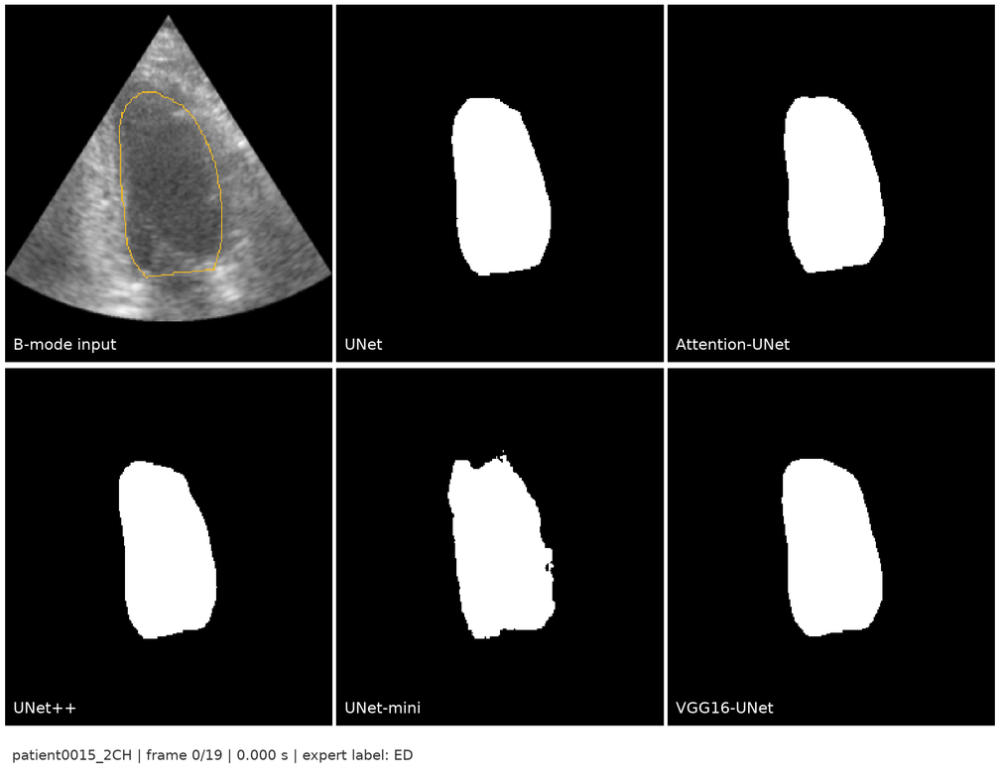

# CAMUS 左心室视频分割与逐帧容积基线

面向 CAMUS 多帧超声心动图的左心室分割基线。模型训练只读取人工标注的 ED/ES 帧；推理按时间顺序处理整段 cine，包括无标签帧。项目当前范围是数据准备、左室分割、逐帧容积和心动指标计算、结果可视化及评价，不包含贴片硬件或波束合成代码。

## 结果预览

### 最高 Dice 基线：U-Net

该测试患者视频由固定测试集的 2CH cine 逐帧推理生成；绿色为模型掩码，琥珀色轮廓仅在存在专家标注的帧显示。GIF 为便于阅读的慢速预览，MP4 保留源帧率。


[下载源帧率 MP4](reports/lvseg_baselines/assets/best_model_patient0015_2CH.mp4)

### 同一患者的五模型全视频外推对比

五个基线在同一 2CH 测试 cine 上逐帧推理。琥珀色轮廓表示该帧有专家标签；其余帧只显示模型预测，不补造标签。



[下载五模型对比 MP4](reports/lvseg_baselines/assets/five_model_patient0015_2CH.mp4)

### 分割结果对比

下表为固定患者级测试集上按患者先求均值、再跨患者汇总的结果。mIoU 是前景与背景 IoU 的均值。Dice、mIoU、Precision 和 Recall 越高越好；HD95 与 ASD 越低越好。HD95 是双向表面距离合并后的 95 百分位，ASD 是双向平均表面距离；距离以原始图像像素间距换算为 mm。每名患者的 ED/ES 标注帧用于分割评价，整段视频（包括无标签帧）都参与推理和容积曲线。

| 模型 | Dice | mIoU | Precision | Recall | HD95 (mm) | ASD (mm) |
|---|---:|---:|---:|---:|---:|---:|
<!-- SEGMENTATION_METRICS_TABLE_START -->
| UNet | 0.9387 ± 0.0291 | 0.9375 ± 0.0253 | 0.9392 ± 0.0475 | 0.9431 ± 0.0319 | 3.98 ± 2.12 | 1.40 ± 0.58 |
| Attention-UNet | 0.9339 ± 0.0254 | 0.9330 ± 0.0226 | 0.9586 ± 0.0335 | 0.9143 ± 0.0359 | 3.73 ± 1.18 | 1.46 ± 0.52 |
| UNet++ | 0.9317 ± 0.0271 | 0.9308 ± 0.0236 | 0.9505 ± 0.0442 | 0.9187 ± 0.0346 | 3.86 ± 1.32 | 1.53 ± 0.59 |
| UNet-mini | 0.9026 ± 0.0367 | 0.9035 ± 0.0308 | 0.9053 ± 0.0637 | 0.9087 ± 0.0467 | 9.89 ± 6.15 | 2.66 ± 0.90 |
| VGG16-UNet | 0.9332 ± 0.0282 | 0.9324 ± 0.0240 | 0.9355 ± 0.0463 | 0.9359 ± 0.0340 | 3.89 ± 1.18 | 1.47 ± 0.49 |
<!-- SEGMENTATION_METRICS_TABLE_END -->

完整数值见 [模型对比 CSV](reports/lvseg_baselines/model_comparison.csv) 和 [结果报告](reports/lvseg_baselines/RESULTS.md)。表中 `±` 表示患者级指标的样本标准差。

### 逐帧容积波形与时相

每帧分割掩码按原始图像间距计算 20 圆盘单平面 Simpson 容积，并沿真实时间顺序绘制。实心标记为预测容积曲线检测出的 EDV 峰与 ESV 谷；空心标记为数据提供的专家 ED/ES 参考帧，参考标签不参与预测峰谷选择。


CAMUS 提供半周期片段，没有相邻两个 EDV 峰，因此该数据的 HR 和 CO 保留为空。2CH 与 4CH 是不同步采集的序列，不合并计算双平面容积。

### 不同模型的容积估算误差

图中按视图比较每名测试患者有标注帧的平均绝对容积差。预测轮廓和专家掩码使用同一个单平面 Simpson 几何法；因此这是同几何方法的一致性对照，不是独立临床容积准确性验证。


## 数据和评价协议

- CAMUS 官方原始数据：500 名患者，3,500 个发布清单文件全部通过 SHA-256 校验；包含 2CH/4CH 多帧 cine、对应标签和时序/空间信息。原始数据遵循 CC BY-NC-SA 4.0，非商业研究使用，需按 [CAMUS 许可与引用说明](docs/data_sources/CAMUS_LICENSE_TERMS.md)署名。
- 处理后数据：1,000 段 cine、19,232 帧；2,000 帧有 ED/ES 专家掩码。固定患者划分为训练/验证/测试 400/50/50，防止同一患者跨集合。
- 对比模型：U-Net、Attention U-Net、U-Net++、U-Net-mini、VGG16-U-Net；模型选择只用验证集，测试集只用于最终评价。
- 测试集共 50 名患者、100 段 cine、1,961 帧。每个模型都推理全部帧，其中 200 帧有标签、1,761 帧无标签。IoU、Dice、Precision、Recall、HD95、ASD 只在有标签帧上计算。
- 容积波形覆盖推理视频的每一帧。容积 Bland–Altman 对照仅使用带专家掩码的测试帧；预测掩码和专家掩码使用相同 Simpson 几何法。
- 原始影像、处理后数组、模型权重及逐帧缓存不提交到 Git；README 展示所需的轻量图像、GIF 和 MP4 作为结果资产纳入仓库。

## 运行

在 Windows 项目根目录使用项目虚拟环境：

```powershell
.venv\Scripts\python.exe scripts\download_camus.py --workers 4
.venv\Scripts\python.exe scripts\prepare_camus.py
.venv\Scripts\python.exe scripts\run_baselines.py --stage all --device cuda
.venv\Scripts\python.exe scripts\export_readme_assets.py
.venv\Scripts\python.exe -m pytest -q
```

无 CUDA 时将 `--device cuda` 改为 `--device cpu`。EchoNet-Dynamic 仅支持在取得数据访问授权后准备；该数据没有空间标定，不用于报告 mL 容积或绝对 CO。

## 目录

```text
lvseg/                         左室数据、模型、评价、时相和容积
scripts/                       下载、预处理、训练/评价及 README 素材导出
configs/lvseg.yaml             基线模型、数据和评价设置
tests/                         左室分割与心功能指标检查
reports/lvseg_baselines/       结果报告、对比表和 README 展示素材
```

工程检查通过不等于贴片系统验证或临床有效性验证。当前 CAMUS 单平面几何结果不应解释为同步双平面或独立临床容积测量。
