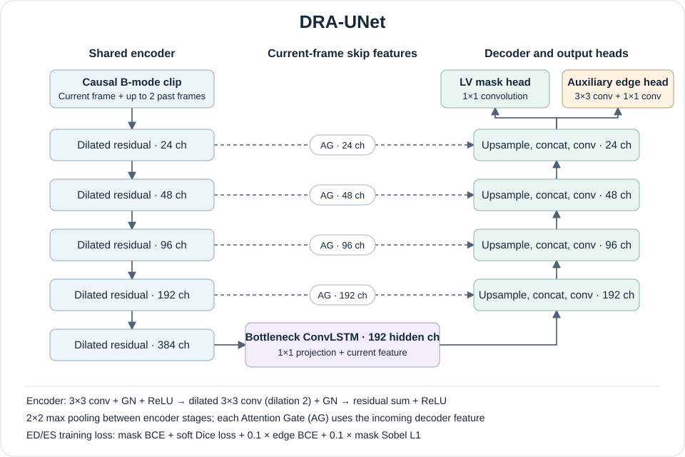
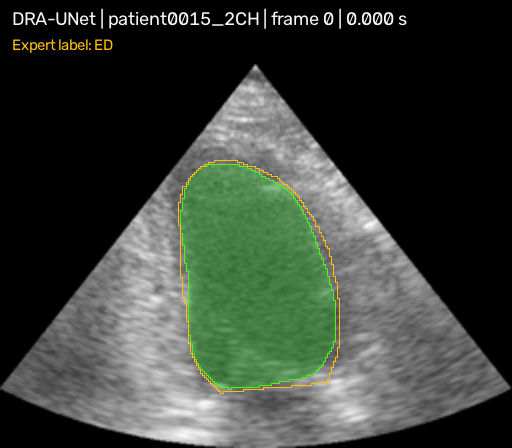
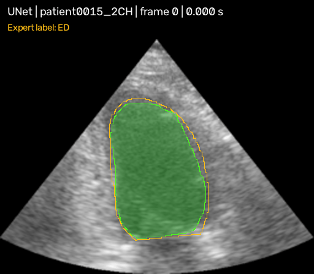
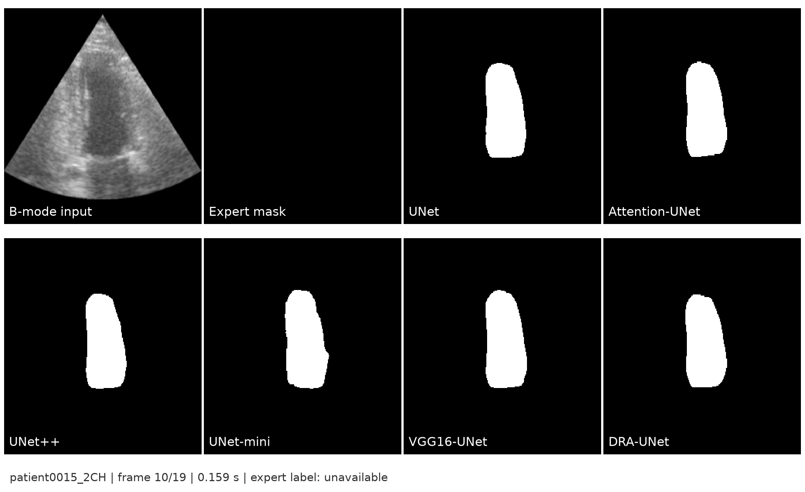
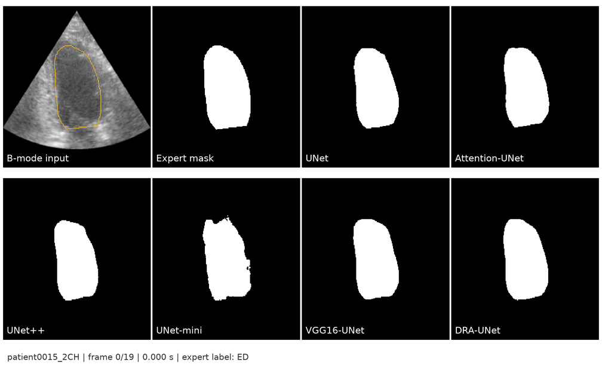
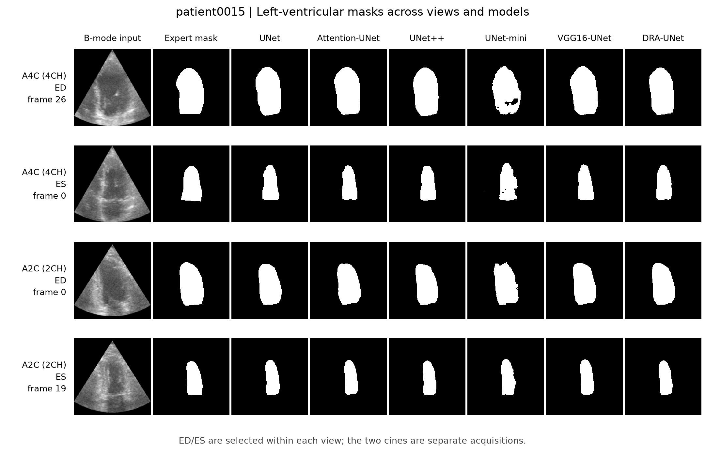
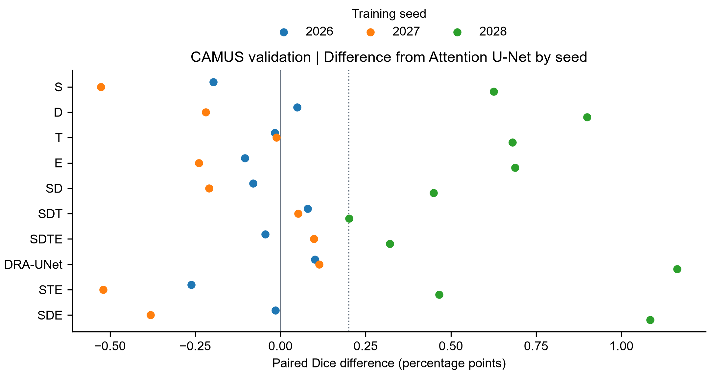
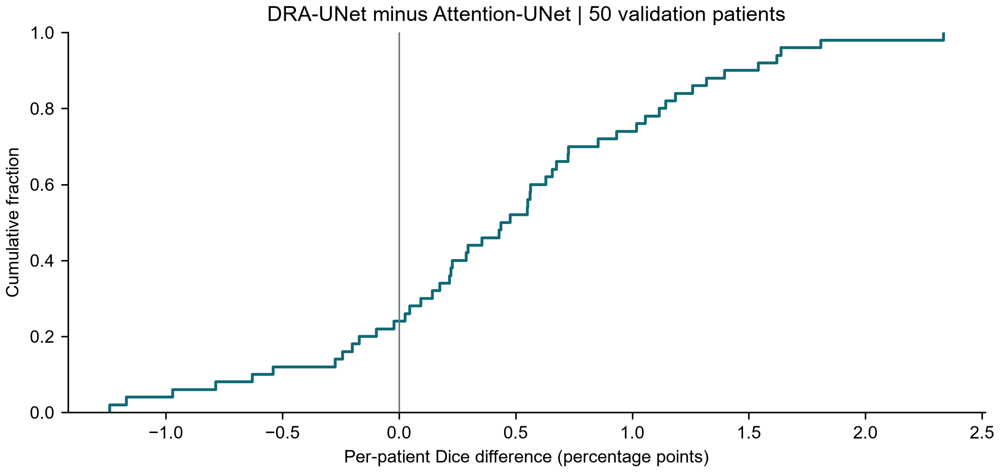
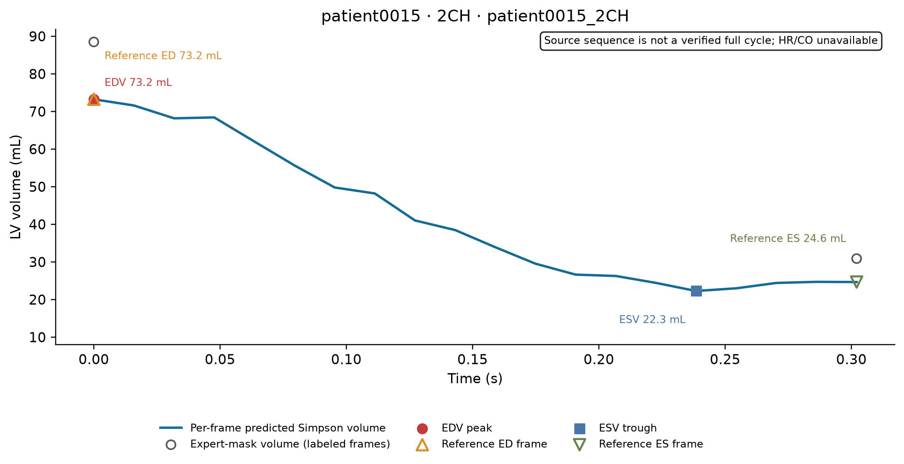

# CAMUS 左心室视频分割与逐帧容积估算

**DRA-UNet** 是本项目的最终左心室分割模型。模型沿用 Attention-UNet 的跳连门控，在编码器引入空洞残差块，在最深层融合时间上下文，并在解码末端加入边缘监督。训练只对专家标注的 ED/ES 帧计算分割与边缘损失。推理按时间顺序处理 CAMUS 超声 cine 的每一帧，预测掩膜用于后续容积和心功能指标计算。

## 文字流程图

```text
CAMUS 原始多帧超声视频：同一患者的 2CH / 4CH 独立 cine
附带原始像素间距、时间信息和专家 ED / ES 掩膜
    ↓
原始文件校验 → 预处理并保留原始标注、坐标变换和元数据
    ↓
固定患者级划分：训练 400 人 / 验证 50 人 / 测试 50 人
    │
    ├─ 模型训练与选择
    │   仅对训练 / 验证患者的 ED / ES 目标帧计算监督损失
    │       ↓
    │   UNet / Attention-UNet / UNet++ / UNet-mini / VGG16-UNet
    │   每个模型独立训练 5 次，归一化参数只由训练数据确定
    │       ↓
    │   每次训练保存验证损失最低的权重
    │   按这些权重的跨种子验证 Dice 均值选择基线
    │   以 Attention-UNet 为对照完成模块消融 → DRA-UNet
    │
    ├─ DRA-UNet 单病例预览：A2C 逐帧分割与 A2C / A4C 掩膜对比
    │
    └─ 五种基线定量评价：固定测试集
        每段视频按原始时间顺序逐帧分割，包括全部无标签帧
            ↓
        二值左室掩膜 → 还原原图尺寸 → 像素间距换算为 mm
            ↓
        PCA 估计长轴 → 沿长轴划分 20 层 → 单平面 Simpson 容积
        2CH 与 4CH 分别计算，不按帧号直接合并
            ↓
        所有帧的容积按真实时间排列，绘制 V(t) 曲线
            ├─ 预测曲线峰谷 → EDV / ESV → 有效配对时计算 SV / EF
            ├─ 完整周期 + 可靠时间 + 相邻 EDV 峰 → T / HR / CO
            │   条件不足时保留 null 和原因，不反射或拼接半周期
            └─ 有专家标签的帧 → 分割指标 + 同几何法容积一致性评价
                无标签帧不计算参考误差，但保留其分割结果与容积
```

模型、权重和阈值在测试前确定。二值化阈值为 0.5，逐帧预览使用各模型 2026 种子的权重。

## DRA-UNet 模型结构



共享编码器处理当前帧及最多两帧历史。最深层 ConvLSTM 跳过序列开头的补位帧，输出经投影后与当前帧瓶颈特征相加。四条跳连只传当前帧的特征，分别由对应解码特征门控。训练时使用专家掩膜计算分割 BCE、Soft Dice 损失、边缘 BCE 和预测掩膜的 Sobel 梯度损失。逐帧容积计算使用分割头生成的掩膜。[模型代码](lvseg/models/ablation.py) · [损失函数](lvseg/losses.py)

## 结果预览

### DRA-UNet 逐帧左心室分割

使用固定测试患者 `patient0015` 的 A2C cine。绿色为 DRA-UNet 预测掩膜，琥珀色轮廓仅在专家标注的 ED 和 ES 帧显示。GIF 为慢速预览，MP4 保留源帧率。[源帧率 MP4](reports/lvseg_ablation/assets/dra_patient0015_2CH.mp4) · [素材来源与权重校验](reports/lvseg_ablation/assets/provenance.json)



<details>
<summary>查看同病例的 Attention-UNet 基线视频</summary>



[源帧率 MP4](reports/lvseg_baselines/assets/best_model_patient0015_2CH.mp4)

</details>

### 同一患者的六模型掩膜网格对比

2×4 网格包含 B 超输入、专家掩膜、五个基线与 DRA-UNet。下图展示 A2C 中间帧（索引 10），该帧没有专家掩膜。所有面板按原始宽高比显示，模型掩膜直接使用二值预测。



<details>
<summary>展开同一布局的全视频逐帧对比</summary>



专家掩膜仅在 ED 和 ES 帧显示。[源帧率 MP4](reports/lvseg_ablation/assets/six_model_patient0015_2CH.mp4)

</details>

### 同一患者 A4C / A2C 双切面的模型掩膜对比

同一测试患者的 A4C（CAMUS 记为 4CH）与 A2C（2CH）分别展示专家标注的 ED 和 ES 帧。每行依次为 B 超输入、专家掩膜、五个基线与 DRA-UNet。两个切面独立采集，各自按原始相位标注取帧。[双切面 PDF](reports/lvseg_ablation/assets/multiview_masks_patient0015.pdf) · [六模型网格 PDF](reports/lvseg_ablation/assets/six_model_patient0015_2CH.pdf)



影像素材来自 CAMUS，采用 CC BY-NC-SA 4.0。[数据署名与许可](docs/data_sources/CAMUS_LICENSE_TERMS.md)

### 五种基线分割结果

五种基线在固定患者划分下各独立训练 5 次。按跨种子的验证集 Dice 均值选择基线；测试集不用于选模。表中验证 Dice 与测试指标均为跨种子均值；每次测试指标先在患者内平均，再汇总。mIoU 是前景与背景 IoU 的均值，HD95/ASD 使用原始像素间距换算为 mm。测试集 ED/ES 标注帧用于分割评价，整段视频（包括无标签帧）都参与推理和容积曲线。

<!-- SEGMENTATION_METRICS_TABLE_START -->

| 模型 | 验证集 Dice | 测试 Dice | 测试 mIoU | Precision | Recall | HD95 (mm) | ASD (mm) |
|---|---:|---:|---:|---:|---:|---:|---:|
| UNet | 0.9298 | 0.9355 | 0.9346 | 0.9444 | 0.9316 | 4.06 | 1.49 |
| **Attention-UNet** ✓ | 0.9300 | 0.9363 | 0.9353 | 0.9432 | 0.9340 | 3.74 | 1.43 |
| UNet++ | 0.9296 | 0.9349 | 0.9340 | 0.9373 | 0.9379 | 3.98 | 1.48 |
| UNet-mini | 0.8880 | 0.9025 | 0.9035 | 0.9026 | 0.9114 | 10.76 | 2.82 |
| VGG16-UNet | 0.9243 | 0.9321 | 0.9311 | 0.9351 | 0.9344 | 4.10 | 1.53 |

<!-- SEGMENTATION_METRICS_TABLE_END -->

完整均值见 [模型对比 CSV](reports/lvseg_baselines/model_comparison.csv)；逐次实验结果、验证集选择记录和离散程度见 [重复实验报告](reports/lvseg_baselines/repeated_runs.json) 与 [结果报告](reports/lvseg_baselines/RESULTS.md)。

### DRA-UNet 模块消融

表中为 CAMUS 验证集 50 名患者的三种子均值（2026、2027、2028）。B 为本轮同训练配置下重训的 Attention-UNet。S 表示用 SE 替换 Attention Gate，D 表示空洞残差编码器，T 表示瓶颈 ConvLSTM，E 表示边缘分支与 Sobel 损失。DRA-UNet 对应 DTE 配置，完整测试集指标尚未汇总。

<!-- DRA_ABLATION_TABLE_START -->

| 配置 | Dice | mIoU | Precision | Recall | HD95 (mm) | ASD (mm) | Simpson MAE (mL) | 配对 ΔDice |
|---|---:|---:|---:|---:|---:|---:|---:|---:|
| B | 0.9287 | 0.9280 | 0.9294 | 0.9328 | 4.28 | 1.57 | 7.96 | +0.0000 |
| S | 0.9284 | 0.9278 | 0.9396 | 0.9221 | 4.22 | 1.55 | 7.90 | -0.0003 |
| D | 0.9311 | 0.9301 | 0.9328 | 0.9336 | 4.11 | 1.50 | 7.97 | +0.0024 |
| T | 0.9309 | 0.9301 | 0.9287 | 0.9375 | 4.20 | 1.51 | 7.88 | +0.0022 |
| E | 0.9298 | 0.9292 | 0.9367 | 0.9273 | 4.15 | 1.52 | 7.98 | +0.0011 |
| SD | 0.9292 | 0.9284 | 0.9272 | 0.9364 | 4.09 | 1.53 | 8.50 | +0.0005 |
| SDT | 0.9298 | 0.9290 | 0.9288 | 0.9356 | 4.11 | 1.52 | 8.28 | +0.0011 |
| SDTE | 0.9299 | 0.9292 | 0.9258 | 0.9389 | 4.11 | 1.52 | 8.06 | +0.0013 |
| **DRA-UNet (DTE)** | 0.9333 | 0.9322 | 0.9396 | 0.9309 | 3.88 | 1.44 | 7.59 | +0.0046 |
| STE | 0.9276 | 0.9268 | 0.9325 | 0.9274 | 4.35 | 1.57 | 8.02 | -0.0011 |
| SDE | 0.9310 | 0.9301 | 0.9345 | 0.9323 | 3.99 | 1.48 | 8.10 | +0.0023 |

<!-- DRA_ABLATION_TABLE_END -->

DRA-UNet 相比 B 的验证 Dice 提高 0.0046，HD95 从 4.28 mm 降至 3.88 mm。配对图按相同种子比较两个配置，患者级图对每位患者的三次配对差值取均值。[完整消融结果](reports/lvseg_ablation/RESULTS.md) · [收敛曲线](reports/lvseg_ablation/evidence/DTE_vs_B/convergence.png) · [输入时间上下文对照](reports/lvseg_ablation/evidence/DTE_vs_B/context_dice.png)





### 逐帧容积波形与时相

图中使用 Attention-UNet 基线的逐帧分割掩膜，按原始图像间距计算 20 圆盘单平面 Simpson 容积并按时间绘制。实心标记为预测容积曲线检测出的 EDV 峰与 ESV 谷，空心标记为专家 ED/ES 参考帧。



CAMUS 提供半周期片段，没有相邻两个 EDV 峰，因此该数据的 HR 和 CO 保留为空。2CH 与 4CH 是不同步采集的序列，不合并计算双平面容积。

### 不同模型的容积估算误差

图中按视图比较五种基线在每名测试患者有标注帧上的平均绝对容积差。预测轮廓和专家掩码使用同一个单平面 Simpson 几何法。


## 容积计算方法

### 逐帧空间标定与 PCA 主轴估计

模型对每一帧输出左室概率图，以 0.5 为阈值得到二值掩膜，再用最近邻插值还原原始图像尺寸。设原图横向、纵向像素间距为 $`s_x`$、$`s_y`$（mm/pixel），前景像素 $`(x_j,y_j)`$ 对应的物理坐标为：

$$
\mathbf{p}_j=(x_js_x,\ y_js_y)^{\mathsf T}.
$$

对这些物理坐标中心化后进行 PCA，以最大特征值对应的特征向量作为长轴方向 $`\mathbf{u}`$，其垂直方向为短轴方向 $`\mathbf{v}`$。长轴投影的最大值与最小值之差为该帧长度 $`L_t`$。PCA 使用预测轮廓本身，不读取专家掩膜或人工心尖、瓣环关键点；它给出的是轮廓派生的主轴估计。

### 单平面 Simpson 圆盘求和

沿长轴将左室划分为 $`N=20`$ 个等厚圆盘，厚度为 $`\Delta L_t=L_t/N`$。第 $`i`$ 层的直径 $`D_{t,i}`$ 由该层掩膜沿短轴方向的投影跨度估计；当前实现额外加上 $`\min(s_x,s_y)`$ 的像素宽度修正，空层直径记为 0。

单切面无法直接测得另一方向的盘径，当前方法假设每层横截面为圆形，得到：

$$
V_t=\frac{1}{1000}\sum_{i=1}^{N}\frac{\pi}{4}D_{t,i}^{\,2}\Delta L_t
\qquad (\mathrm{mL}).
$$

其中直径和厚度均以 mm 计，除以 1000 将 mm³ 转换为 mL。这是 Simpson 圆盘求和几何估计；单平面圆形横截面假设会带来几何误差。

每帧都执行以上计算，再以原始时间戳组成 $`\{(t_k,V_k)\}`$。没有时间戳但有可靠帧率 $`f`$ 时使用 $`t_k=k/f`$。**无标签帧同样参与分割、容积计算与曲线绘制**；空掩膜或无效几何输出缺失值，不用 0 代替真实容积。若缺少空间标定，只保留明确标为 `pixel3_proxy` 的几何代理量，不报告 mL 绝对容积。

### 双切面与双平面方法的关系

当前 CAMUS 的 A4C（4CH）与 A2C（2CH）是独立采集序列，主评价流程分别计算单平面容积。双切面对比图中的 ED/ES 也按各自元数据选取，不表示两个视频逐帧同步。

代码预留了双平面 Simpson 接口，但尚未接入主评价流程。若后续完成两个切面的空间标定、同一时相配对以及心尖至基底方向和盘位对应，每层可按椭圆截面计算：

$$
V_t^{\mathrm{bi}}=\frac{1}{1000}\sum_{i=1}^{N}
\frac{\pi}{4}D_{t,i}^{\mathrm{A4C}}D_{t,i}^{\mathrm{A2C}}\Delta L_t.
$$

这里两个直径必须属于对应时相、对应盘位；当前预留接口以两切面长轴的较小值确定共同盘厚。连续双平面波形还需验证逐帧时间对应。PCA 只估计切面内主轴，不能完成视频同步或保证解剖盘位配准。

实现位置：[容积几何计算](lvseg/metrics/volume.py) · [逐帧推理与原图坐标还原](lvseg/evaluate.py)。

## 心功能指标计算方法

### 容积曲线的峰谷与时相

峰谷检测只读取预测容积和时间，不读取专家 ED/ES 标签。当前实现按连续有效片段检测峰谷，以该片段容积变化范围的 4% 设置显著性阈值；符合条件的片段端点也可作为候选峰谷。内部峰检测按默认最短周期 0.30 s 设置最小峰间距，端点候选另行判断。

对一个候选 EDV 峰，在它与下一候选峰之间选择最低的后续谷作为 ESV；如果没有下一峰，则只在已有片段的后续部分寻找谷。只有满足 $`0<\mathrm{ESV}<\mathrm{EDV}`$ 的时序配对才生成有效事件。

EDV 峰至后续 ESV 谷对应容积下降阶段；ESV 谷至下一 EDV 峰对应容积上升阶段。曲线显示预测 EDV/ESV 标记，并单独显示专家参考时相。这里依据容积识别时相，不据此推断缺少独立标注的瓣膜事件或等容分期。

### 指标公式与单位

设第 $`k`$ 个有效事件的峰、谷时刻分别为 $`t_{\mathrm{ED},k}`$、$`t_{\mathrm{ES},k}`$：

| 指标 | 计算方式 | 单位与条件 |
|---|---|---|
| EDV，舒张末期容积 | $`\mathrm{EDV}_k=V(t_{\mathrm{ED},k})`$ | 空间标定有效时为 mL |
| ESV，收缩末期容积 | $`\mathrm{ESV}_k=V(t_{\mathrm{ES},k})`$ | 同一有效事件中的后续谷，单位 mL |
| SV，每搏量 | $`\mathrm{SV}_k=\mathrm{EDV}_k-\mathrm{ESV}_k`$ | mL/beat；需要有效峰谷配对和空间标定 |
| EF，射血分数 | $`\mathrm{EF}_k=\mathrm{SV}_k/\mathrm{EDV}_k`$ | 无量纲；代码输出 `EF_percent`，即该比值乘 100% |
| T，心动周期 | $`T_k=t_{\mathrm{ED},k+1}-t_{\mathrm{ED},k}`$ | s；需要相邻两个 EDV 峰及已确认的完整周期 |
| HR，心率 | $`\mathrm{HR}_k=60/T_k`$ | bpm；需要可靠时间和有效完整周期 |
| CO，心输出量 | $`\mathrm{CO}_k=\mathrm{SV}_k\times\mathrm{HR}_k`$ | SV 以 mL 计时为 mL/min；再除以 1000 得 L/min |

当前完整周期的可接受范围默认为 0.30–2.50 s，可在评价配置中调整。即使检测到两个峰，来源序列也必须已确认包含完整周期，才计算 HR；绝对 CO 还必须具有空间标定。缺少空间标定时，SV 等几何派生量沿用代理单位，不解释为临床 mL 或绝对 CO。

CAMUS 半周期片段的 HR/CO 保留为空；仅当片段内存在有效 EDV→ESV 时序配对时报告相应 SV/EF。不能形成配对时相关结果同样保留为空，不倒序、反射或拼接视频制造周期。缺失原因随结果保存；无独立参考时不报告 HR/CO 的临床准确率。

实现位置：[峰谷检测与心功能指标](lvseg/metrics/cycles.py) · [容积曲线绘制](lvseg/visualization/volume_curve.py)。

## 分割与容积评价指标

### 分割重叠指标

仅在有专家标签的测试帧上，将预测左室掩膜 $`P`$ 与原始专家掩膜 $`G`$ 在相同原图坐标中比较。TP 为正确预测的左室像素，FP 为误判为左室的背景像素，FN 为漏检的左室像素，TN 为正确预测的背景像素。

| 指标 | 计算公式 | 解释 |
|---|---|---|
| Dice | $`2\mathrm{TP}/(2\mathrm{TP}+\mathrm{FP}+\mathrm{FN})`$ | 前景重叠程度，越高越好 |
| IoU | $`\mathrm{TP}/(\mathrm{TP}+\mathrm{FP}+\mathrm{FN})`$ | 左室前景交并比，越高越好 |
| mIoU | $`(\mathrm{IoU}_{\mathrm{LV}}+\mathrm{IoU}_{\mathrm{BG}})/2`$ | 左室与背景两类 IoU 的均值；背景 IoU 为 $`\mathrm{TN}/(\mathrm{TN}+\mathrm{FP}+\mathrm{FN})`$ |
| Precision | $`\mathrm{TP}/(\mathrm{TP}+\mathrm{FP})`$ | 预测左室中实际属于左室的比例，越高越好 |
| Recall | $`\mathrm{TP}/(\mathrm{TP}+\mathrm{FN})`$ | 实际左室中被检出的比例，越高越好 |

### 边界距离指标

设预测与专家轮廓分别为 $`A=\partial P`$、$`B=\partial G`$，$`d(a,B)`$ 表示轮廓点 $`a`$ 到 $`B`$ 中最近点的欧氏距离，使用原始像素间距换算为 mm。将两个方向的距离样本合并且不去重，记为 $`\mathcal{D}`$：

$$
\mathrm{HD95}=Q_{0.95}(\mathcal{D}),\qquad
\mathcal{D}=\{d(a,B):a\in A\}\mathbin{\uplus}\{d(b,A):b\in B\}.
$$

$$
\mathrm{ASD}=\frac{\sum_{a\in A}d(a,B)+\sum_{b\in B}d(b,A)}{|A|+|B|}.
$$

HD95 为合并双向距离的第 95 百分位，ASD 为按轮廓点数加权的双向平均距离，两者越低越好。任一掩膜为空时 HD95/ASD 为缺失值；无空间标定时只能以 pixel 报告。重叠指标按实现约定处理空掩膜：两者都为空时为 1，仅一者为空时前景 Dice/IoU、Precision/Recall 为 0；mIoU 仍按前景和背景分别计算。

每次实验先在患者内平均各有标签帧的指标，再在患者间平均，最后对 5 个独立种子的结果取均值。HD95/ASD 的缺失值不当作 0，按有效值汇总。README 对比表仅展示均值；基线选择使用验证集 Dice 的跨种子均值，测试集指标不参与选模。

### 容积误差与 Bland–Altman 一致性

对每个有标签帧，分别将预测掩膜和专家掩膜送入**同一个单平面 Simpson 方法**，得到 $`\hat V_j`$ 与 $`V_j^{\mathrm{mask}}`$。当前容积误差图按患者 $`p`$、切面 $`v`$ 汇总其有效标签帧的平均绝对差：

$$
\mathrm{MAE}_{p,v}=\frac{1}{K_{p,v}}\sum_{j=1}^{K_{p,v}}
\left|\hat V_{p,v,j}-V_{p,v,j}^{\mathrm{mask}}\right|.
$$

$`K_{p,v}`$ 为该患者、该切面中预测与专家掩膜容积均有效的标签帧数。空间标定有效时 MAE 以 mL 计，越低越好。图中每个点为一名患者，箱体表示中位数及四分位范围，红色菱形表示均值；该图使用各模型 2026 种子的代表性权重。

Bland–Altman 对每一对有效测量计算横坐标 $`m_j`$ 和差值 $`d_j`$，再计算平均偏差与 95% 一致性界限：

$$
m_j=\frac{\hat V_j+V_j^{\mathrm{mask}}}{2},\qquad
d_j=\hat V_j-V_j^{\mathrm{mask}},\qquad
\mathrm{Bias}=\bar d=\frac{1}{n}\sum_{j=1}^{n}d_j.
$$

$$
s_d=\sqrt{\frac{\sum_{j=1}^{n}(d_j-\bar d)^2}{n-1}},\qquad
\mathrm{LoA}_{\mathrm{lower}}=\bar d-1.96s_d,\qquad
\mathrm{LoA}_{\mathrm{upper}}=\bar d+1.96s_d.
$$

其中 $`n`$ 为有效测量对数，$`s_d`$ 为差值的样本标准差；不足两对时不计算一致性界限。上述 95% 解释以差值分布近似正态等假设为前提。这些界限描述测量差的一致性范围，不是均值的置信区间，也不是“准确率百分比”。

结果分别保留按切面的帧级分析，以及先在每名患者、每个切面内平均标签帧容积、再进行比较的患者级分析。帧级包含同一患者的重复测量，不能把这些帧当成相互独立的患者。当前对照参考是专家掩膜经相同几何法得到的容积，不等同于独立临床容积标签或数据集提供的 EF 标签。

**评价范围：**Dice/IoU 衡量有标签帧的分割质量，容积 MAE/Bland–Altman 衡量这些帧上的同几何法一致性。无标签帧保留在预测曲线中，但缺少逐帧容积参考，当前不能据此宣称整条容积曲线已经获得完整准确性验证。

实现位置：[分割指标](lvseg/metrics/segmentation.py) · [Bland–Altman 计算](lvseg/metrics/cycles.py) · [患者级汇总](lvseg/evaluate.py) · [模型容积误差图](lvseg/visualization/comparison.py)。

## 数据和评价协议

- CAMUS 官方原始数据：500 名患者，3,500 个发布清单文件全部通过 SHA-256 校验；包含 2CH/4CH 多帧 cine、对应标签和时序/空间信息。原始数据遵循 CC BY-NC-SA 4.0，非商业研究使用，需按 [CAMUS 许可与引用说明](docs/data_sources/CAMUS_LICENSE_TERMS.md)署名。
- 处理后数据：1,000 段 cine、19,232 帧；2,000 帧有 ED/ES 专家掩码。固定患者划分为训练/验证/测试 400/50/50，防止同一患者跨集合。
- 对比模型：U-Net、Attention U-Net、U-Net++、U-Net-mini、VGG16-U-Net；模型选择只用验证集，测试集只用于最终评价。
- 测试集共 50 名患者、100 段 cine、1,961 帧。每个模型都推理全部帧，其中 200 帧有标签、1,761 帧无标签。IoU、Dice、Precision、Recall、HD95、ASD 只在有标签帧上计算。
- 容积波形覆盖推理视频的每一帧。容积 Bland–Altman 对照仅使用带专家掩码的测试帧；预测掩码和专家掩码使用相同 Simpson 几何法。
- 原始影像、处理后数组、模型权重及逐帧缓存不提交到 Git；README 展示所需的轻量图像、GIF 和 MP4 作为结果资产纳入仓库。

## 运行

在 Windows 项目根目录使用项目虚拟环境：

```powershell
.venv\Scripts\python.exe scripts\download_camus.py --workers 4
.venv\Scripts\python.exe scripts\prepare_camus.py
.venv\Scripts\python.exe scripts\run_baselines.py --stage all --device cuda
.venv\Scripts\python.exe scripts\run_repeated_baselines.py --seeds 2026 2027 2028 2029 2030 --device cuda
.venv\Scripts\python.exe scripts\export_readme_assets.py
.venv\Scripts\python.exe -m pytest -q
```

无 CUDA 时将 `--device cuda` 改为 `--device cpu`。EchoNet-Dynamic 仅支持在取得数据访问授权后准备；该数据没有空间标定，不用于报告 mL 容积或绝对 CO。

DRA-UNet 使用 `build_model("DRA-UNet")` 构建。消融训练配置、锁定的代码版本和预览导出命令见 [DRA-UNet 复现步骤](docs/dra_unet_reproduction.md)。

## 目录

```text
lvseg/                         左室数据、模型、评价、时相和容积
scripts/                       下载、预处理、训练/评价及 README 素材导出
configs/lvseg.yaml             基线模型、数据和评价设置
tests/                         左室分割与心功能指标检查
reports/lvseg_baselines/       结果报告、对比表和 README 展示素材
reports/lvseg_ablation/        DRA-UNet 三种子消融、结构图和预览
```

工程检查通过不等于贴片系统验证或临床有效性验证。当前 CAMUS 单平面几何结果不应解释为同步双平面或独立临床容积测量。
