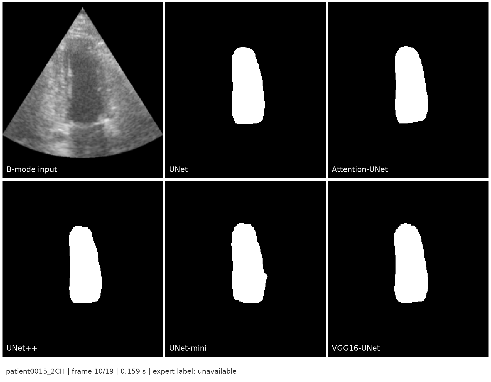
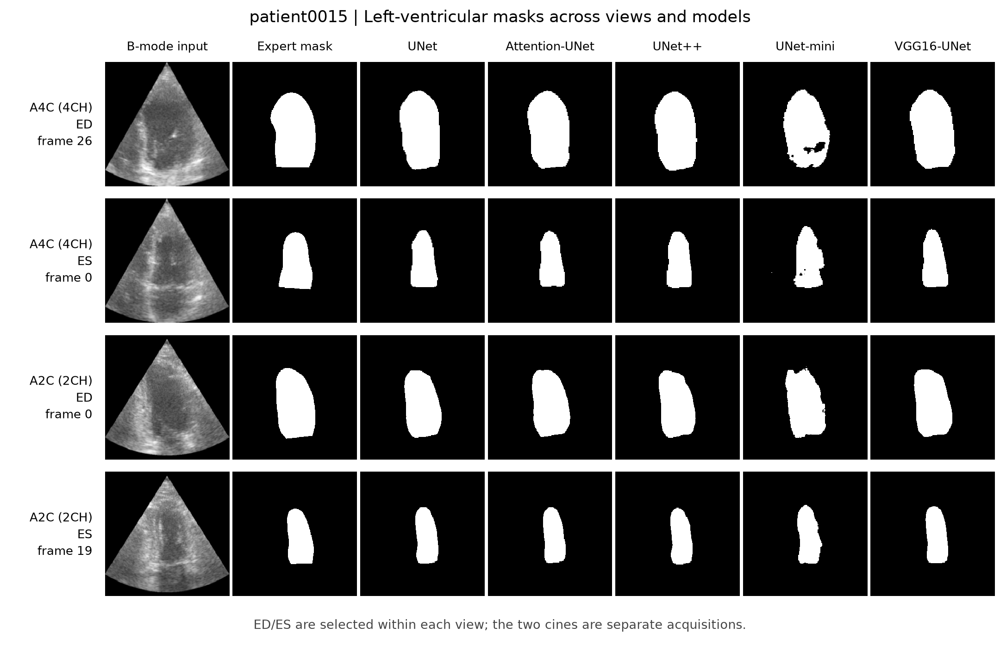
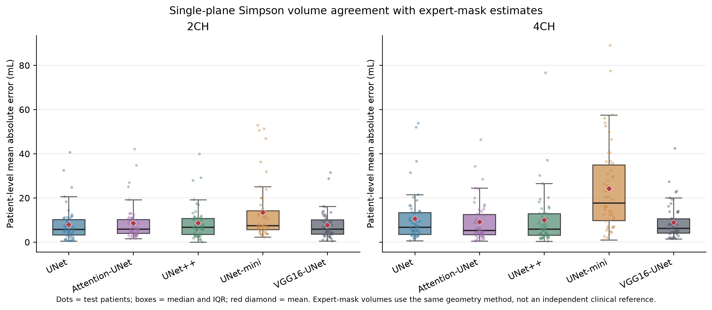

# CAMUS 左心室视频分割与逐帧容积基线

面向 CAMUS 多帧超声心动图的左心室分割基线。模型训练只读取人工标注的 ED/ES 帧；推理按时间顺序处理整段 cine，包括无标签帧。项目当前范围是数据准备、左室分割、逐帧容积和心动指标计算、结果可视化及评价，不包含贴片硬件或波束合成代码。

## 结果预览

### 验证集重复实验选出的基线：Attention-UNet

该测试患者视频由固定测试集的 2CH cine 逐帧推理生成，使用被选基线 Attention-UNet 的代表性 2026 种子权重；绿色为模型掩码，琥珀色轮廓仅在存在专家标注的帧显示。GIF 为便于阅读的慢速预览，MP4 保留源帧率。


[下载源帧率 MP4](reports/lvseg_baselines/assets/best_model_patient0015_2CH.mp4)

### 同一患者的五模型掩膜网格对比

采用“原始 B 超 + 五个模型二值掩膜”的 2×3 网格：左上角为输入图，其余位置为黑底白色左室掩膜。五个模型使用各自 2026 种子的代表性权重，对同一测试患者 patient0015 的 2CH 视频逐帧推理；下图固定展示中间帧（第 10 帧，索引从 0 开始），不按分割得分挑帧。所有面板保留完整视野，按原始宽高比显示，不做掩膜平滑或修补。



<details>
<summary>展开同一布局的全视频逐帧对比</summary>


仅在有专家标签的帧，输入图显示琥珀色专家轮廓；无标签帧只显示预测。GIF 为慢速预览，[MP4 保留源帧率](reports/lvseg_baselines/assets/five_model_patient0015_2CH.mp4)。

</details>

### 同一患者 A4C / A2C 双切面的模型掩膜对比

同一测试患者 patient0015 的 A4C（CAMUS 记为 4CH）与 A2C（2CH）分别展示 ED、ES 帧。每行依次为 B 超输入、专家掩膜以及 UNet、Attention-UNet、UNet++、UNet-mini、VGG16-UNet 的预测掩膜，模型顺序与对比表一致。ED/ES 来自各切面原始标注元数据；所有模型比较同一行的同一帧。



两个切面是独立采集的序列，这里按各自 ED/ES 展示，不表示逐帧同步或双平面容积计算。[双切面高清 PDF](reports/lvseg_baselines/assets/multiview_masks_patient0015.pdf) · [五模型网格高清 PDF](reports/lvseg_baselines/assets/five_model_patient0015_2CH.pdf)

### 分割结果对比

五种基线在固定患者划分下各独立训练 5 次。按跨种子的验证集 Dice 均值选择基线；测试集不用于选模。表中验证 Dice 与测试指标均为跨种子均值；每次测试指标先在患者内平均，再汇总。mIoU 是前景与背景 IoU 的均值，HD95/ASD 使用原始像素间距换算为 mm。测试集 ED/ES 标注帧用于分割评价，整段视频（包括无标签帧）都参与推理和容积曲线。

<!-- SEGMENTATION_METRICS_TABLE_START -->

| 模型 | 验证集 Dice | 测试 Dice | 测试 mIoU | Precision | Recall | HD95 (mm) | ASD (mm) |
|---|---:|---:|---:|---:|---:|---:|---:|
| UNet | 0.9298 | 0.9355 | 0.9346 | 0.9444 | 0.9316 | 4.06 | 1.49 |
| **Attention-UNet** ✓ | 0.9300 | 0.9363 | 0.9353 | 0.9432 | 0.9340 | 3.74 | 1.43 |
| UNet++ | 0.9296 | 0.9349 | 0.9340 | 0.9373 | 0.9379 | 3.98 | 1.48 |
| UNet-mini | 0.8880 | 0.9025 | 0.9035 | 0.9026 | 0.9114 | 10.76 | 2.82 |
| VGG16-UNet | 0.9243 | 0.9321 | 0.9311 | 0.9351 | 0.9344 | 4.10 | 1.53 |

<!-- SEGMENTATION_METRICS_TABLE_END -->

完整均值见 [模型对比 CSV](reports/lvseg_baselines/model_comparison.csv)；逐次实验结果、验证集选择记录和离散程度见 [重复实验报告](reports/lvseg_baselines/repeated_runs.json) 与 [结果报告](reports/lvseg_baselines/RESULTS.md)。

### 逐帧容积波形与时相

每帧分割掩码按原始图像间距计算 20 圆盘单平面 Simpson 容积，并沿真实时间顺序绘制。实心标记为预测容积曲线检测出的 EDV 峰与 ESV 谷；空心标记为数据提供的专家 ED/ES 参考帧，参考标签不参与预测峰谷选择。


CAMUS 提供半周期片段，没有相邻两个 EDV 峰，因此该数据的 HR 和 CO 保留为空。2CH 与 4CH 是不同步采集的序列，不合并计算双平面容积。

### 不同模型的容积估算误差

图中按视图比较每名测试患者有标注帧的平均绝对容积差。预测轮廓和专家掩码使用同一个单平面 Simpson 几何法；因此这是同几何方法的一致性对照，不是独立临床容积准确性验证。



## 数据和评价协议

- CAMUS 官方原始数据：500 名患者，3,500 个发布清单文件全部通过 SHA-256 校验；包含 2CH/4CH 多帧 cine、对应标签和时序/空间信息。原始数据遵循 CC BY-NC-SA 4.0，非商业研究使用，需按 [CAMUS 许可与引用说明](docs/data_sources/CAMUS_LICENSE_TERMS.md)署名。
- 处理后数据：1,000 段 cine、19,232 帧；2,000 帧有 ED/ES 专家掩码。固定患者划分为训练/验证/测试 400/50/50，防止同一患者跨集合。
- 对比模型：U-Net、Attention U-Net、U-Net++、U-Net-mini、VGG16-U-Net；模型选择只用验证集，测试集只用于最终评价。
- 测试集共 50 名患者、100 段 cine、1,961 帧。每个模型都推理全部帧，其中 200 帧有标签、1,761 帧无标签。IoU、Dice、Precision、Recall、HD95、ASD 只在有标签帧上计算。
- 容积波形覆盖推理视频的每一帧。容积 Bland–Altman 对照仅使用带专家掩码的测试帧；预测掩码和专家掩码使用相同 Simpson 几何法。
- 原始影像、处理后数组、模型权重及逐帧缓存不提交到 Git；README 展示所需的轻量图像、GIF 和 MP4 作为结果资产纳入仓库。

## 运行

在 Windows 项目根目录使用项目虚拟环境：

```powershell
.venv\Scripts\python.exe scripts\download_camus.py --workers 4
.venv\Scripts\python.exe scripts\prepare_camus.py
.venv\Scripts\python.exe scripts\run_baselines.py --stage all --device cuda
.venv\Scripts\python.exe scripts\run_repeated_baselines.py --seeds 2026 2027 2028 2029 2030 --device cuda
.venv\Scripts\python.exe scripts\export_readme_assets.py
.venv\Scripts\python.exe -m pytest -q
```

无 CUDA 时将 `--device cuda` 改为 `--device cpu`。EchoNet-Dynamic 仅支持在取得数据访问授权后准备；该数据没有空间标定，不用于报告 mL 容积或绝对 CO。

## 目录

```text
lvseg/                         左室数据、模型、评价、时相和容积
scripts/                       下载、预处理、训练/评价及 README 素材导出
configs/lvseg.yaml             基线模型、数据和评价设置
tests/                         左室分割与心功能指标检查
reports/lvseg_baselines/       结果报告、对比表和 README 展示素材
```

工程检查通过不等于贴片系统验证或临床有效性验证。当前 CAMUS 单平面几何结果不应解释为同步双平面或独立临床容积测量。
