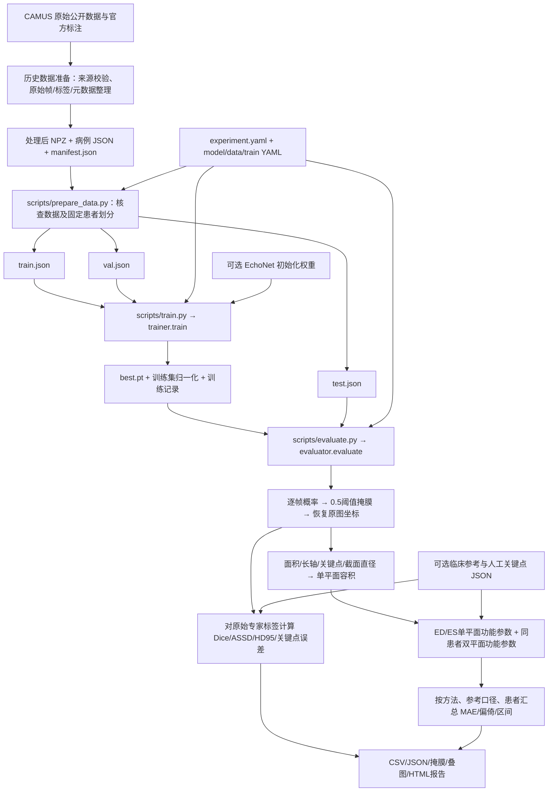

# Echo 项目全链路与逐文件讲解

本文依据当前 `src/` 模块源码和本地处理后数据清单编写。阅读顺序为：任务目标 → 数据来源 → 预处理 → 数据划分 → 训练 → 测试 → 指标 → 结果文件 → 逐文件索引。这里说明代码实际执行的行为，未接入的接口和历史结果会明确标识。完整实际文件树以 README 的自动生成区块为准。

## 1. 这个项目究竟在做什么

项目输入是心尖切面的二维超声心动图序列。当前实际训练任务是：给定一帧灰度超声图，预测每一个像素是否属于左心室腔。网络输出的是左室分割概率图，并不直接输出 EDV、ESV、EF。

随后对预测掩膜做几何测量：面积、长轴、横截面直径、轮廓派生关键点，再估算容积。根据舒张末期 ED 与收缩末期 ES 的容积计算 SV、EF；有可靠心率时计算 CO。专家标注用于监督训练或测试评价，人工关键点/临床参考只用于评价，不输入预测侧几何计算。

当前使用 EchoNet 风格的 DeepLabV3-ResNet50 二维分割架构，初始化权重默认来自 EchoNet。仓库中的上游视频 EF 回归代码不参与当前三阶段流程。当前没有训练一个端到端视频 EF 回归模型，也没有训练一个独立解剖关键点网络。



图中第一段是已有数据的来源链。当前日常入口从已经处理好的 C 开始；它不会自动重新下载并重建整个 CAMUS 数据集。

## 2. 数据下载：下载的到底是什么

### 2.1 CAMUS 和 EchoNet 各自提供什么

| 名称 | 在本项目中的角色 |
|---|---|
| CAMUS 数据 | 当前使用的超声影像、ED/ES 专家分割、帧数/帧率/数据集 EF 等信息 |
| EchoNet 源码 | 上游模型与训练实现的参考，保留源码和 MIT 许可 |
| EchoNet 分割权重 | 当前默认分割模型的初始化参数，可以在 CAMUS 上继续训练 |

因此当前实验可以描述为“EchoNet 分割基线在 CAMUS 上的训练适配”。CAMUS 与 EchoNet 是不同数据集；当前数据目录并不因此包含 EchoNet-Dynamic 原始视频数据。

CAMUS 官方页面：<https://www.creatis.insa-lyon.fr/Challenge/camus/>。

仓库记录的原始数据归档：<https://github.com/KNN334/Echo/releases/tag/camus-data-20261108>。

仓库记录的处理后数据归档：<https://github.com/KNN334/Echo/releases/tag/camus-prepared-v0.3.4>。

上述 Release 地址来自项目已有来源记录；本次说明没有重新下载、核验远端所有归档。CAMUS 使用 CC BY-NC-SA 4.0，项目保留原始许可、署名、逐文件大小和 SHA256 清单。

### 2.2 原始文件的含义

以一个患者为例，原始归档通常包含以下名称：

| 原始名称示例 | 含义 |
|---|---|
| `Info_2CH.cfg`、`Info_4CH.cfg` | 两个切面的帧号、帧率、帧数、图像质量、数据集 EF 等信息 |
| `patient0001_2CH_ED.nii.gz` | 二腔心舒张末期影像 |
| `patient0001_2CH_ED_gt.nii.gz` | 对应专家结构标签；gt 是 ground truth 的缩写 |
| `patient0001_2CH_ES.nii.gz`、`*_ES_gt.nii.gz` | 收缩末期影像和对应标签 |
| `*_2CH_half_sequence.nii.gz` | 二腔心半周期动态图像序列 |
| `*_2CH_half_sequence_gt.nii.gz` | 归档中的对应序列标签文件；项目监督帧身份以保留的 ED/ES 索引为准 |
| 同样的 `4CH` 文件 | 四腔心切面 |

2CH 是心尖二腔心切面，4CH 是心尖四腔心切面。这里是二维超声随时间变化的数据：数组第三个维度可能表示帧序列，并不代表获得了心脏三维体数据。原始 NIfTI 的第三轴间距为 1 也不能直接当作 1 秒。

官方 CAMUS 标签中 0 是背景，1 是左室腔，2 是左室心肌，3 是左房。本项目只把 `label == 1` 当作分割前景，其他结构都是当前二分类任务的背景。因此标签来自专家标注，并非项目随意画的 ROI。

“声窗 ROI”是保留超声有效成像区域、去掉界面区域的范围；“左室标签”是模型要学习的结构。二者用途不同：声窗可包含多个结构，左室标签只包含左室腔。

### 2.3 当前下载代码实际能做什么

`src/data/camus/download.py` 只有可调用函数 `download_archive(url, destination, expected_sha256)`，不是右键运行便能下载全部 CAMUS 的脚本。函数要求明确 HTTPS 地址、保存位置和发布方清单里的完整 SHA256。

执行顺序是：检查参数 → 如已有文件则验证其 SHA256 → 下载到 `.partial` 临时文件 → 再计算 SHA256 → 一致才改为正式文件名 → 写 `.source.json` 来源记录。失败时清理临时文件，不覆盖已有错误文件；不自动解压、不建立训练划分、不绕过原始数据访问授权。对已有且校验一致的文件会直接返回。

当前原始数据整批导入仍缺少一个自动调度层：逐患者解包/读取 cfg、统一帧号、对应 ED/ES 标注、调用处理函数并汇总数据集 manifest。`prepare_case` 接收已经对齐的数组和元数据，它不会自动完成这些原始文件解析步骤。因此源码中的下载/处理函数存在，不等于从任何原始 CAMUS 包开始的一条命令全自动流程已经完整接通。

`scripts/download_weights.py` 下载的则是模型参数，不是影像。它获取官方分割检查点，按 8 MiB 分片、默认 16 个线程下载，要求服务器正确返回字节范围，允许重试和复用已完成分片，合并后核对预期大小 317401511 字节并记录 SHA256。当前主要强制校验来自文件大小与分片范围；最终 SHA256 被记录，没有在代码中与预先固定的可信 SHA256 再比对。默认保存到 `checkpoints/echonet_official.pt`。

## 3. 本地处理后数据：每个文件里有什么

本次读取本地 manifest 得到：

| 子集 | 患者 | 切面序列 | 全部影像帧 | 监督用专家标注帧 |
|---|---:|---:|---:|---:|
| 训练 | 347 | 694 | 13415 | 1388 |
| 验证 | 71 | 142 | 2650 | 284 |
| 测试 | 82 | 164 | 3167 | 328 |
| 全部 | 500 | 1000 | 19232 | 2000 |

每个患者两个切面，每个切面保留 ED/ES 两张专家标注，所以 500 × 2 × 2 = 2000 张监督帧。训练不会把 13415 张训练子集图像全部当成有标签样本。

目录结构：

```text
data/processed/camus/
├── manifest.json
├── patient0001_2CH.npz
├── patient0001_2CH.json
├── patient0001_4CH.npz
├── patient0001_4CH.json
├── ...
└── splits/
    ├── train.json
    ├── val.json
    └── test.json
```

`manifest.json` 是全数据集病例目录，记录 case_id、patient_id、view、split、frames、labeled_frames 和处理问题；不是保存影像像素的文件。病例 NPZ 保存数组，病例 JSON 保存说明和来源。

实际例子 `patient0001_2CH.npz`：

| 数组键 | 本地实际形状/类型 | 用途 |
|---|---|---|
| `frames` | `(18,112,112)`，uint8 | 18 帧处理后灰度超声 |
| `masks` | `(18,112,112)`，uint8 | 对齐到网络输入大小的左室二值标签 |
| `labeled` | `(18,)`，bool | 标明哪些帧有实际专家监督 |
| `original_gt` | `(2,389,549)`，uint8 | 未经过缩放的原始 ED/ES 左室标签，供最终评价 |
| `original_gt_indices` | `(2,)`，int64，内容 `[0,17]` | 上述两张原始标签对应序列第 0、17 帧 |

未标注帧的 `masks` 即使全为 0，也不能当作“专家确认没有左心室”。训练必须先用 `labeled` 筛选。

同一病例 JSON 记录：患者/切面、相位、原始路径、配置、帧率/间距、来源 SHA256、处理参数、坐标变换和审核状态。原始 `input_path` 是来源记录：本机原始缓存已移除，路径不存在也不妨碍从 NPZ 训练。

实际病例的原始图像是高 389、宽 549，处理后为 112×112；间距约为 0.308 mm/像素，帧率为 48.4 fps。Info.cfg 记录 ED=1、ES=18；现有缓存按 Python 从 0 开始的数组索引保存为 ED=0、ES=17。当前 `prepare_case` 要求调用方传入正确的数组索引，不会自行读取 cfg 后减 1。

## 4. 预处理每一步做什么

### 4.1 读原始影像、视频和元数据

`data/medical_io.py` 的 `read_medical` 使用 SimpleITK 读取 NIfTI/MetaImage，转换成 NumPy 帧数组，返回像素间距、方向、原点和源文件摘要。二维图像会补上长度为 1 的帧轴；其他不符合二维序列协议的维度会报错。它不负责解释 CAMUS 文件名、解析 cfg 或拼装 ED/ES 标注。

`read_video` 使用 OpenCV 逐帧解码并转灰度，记录容器 FPS、容器时间戳和摘要，可接受外部 sidecar 元数据。容器时间不是已经验证的生理采集时间。`echonet_traces` 则把 EchoNet 的轮廓 CSV 转成多边形掩膜，并保持 CSV 原始帧号；它不是 CAMUS 标签生成器。

### 4.2 时间和空间校验

`audit_metadata` 检查：像素间距必须是两个有限正数；FPS 如提供必须为有限正数；显式时间戳数量等于帧数、有限且严格递增；若同时有 FPS，则中位帧间隔与 FPS 的乘积偏离 1 超过 5% 会报错。

有显式时间则记录 provided；只有 FPS 时按 `t[i] = i/fps` 生成相对时间并记录 derived_from_fps；都没有则为 null 并附原因。缺少间距也保留 null。

以真实样例计算，帧间隔约为 1/48.4 = 0.02066 秒，第 17 帧相对第 0 帧约 0.35124 秒。这是该段半周期的时间跨度，不能拿它当完整 RR 间期计算 HR，更不能简单乘 2 猜完整周期。

### 4.3 左室标签、声窗和文字

`left_ventricle_mask` 检查多类标签是否合法，取 label 1，生成 0/1 左室腔标签。

`estimate_image_support` 将全序列任意帧非零的像素合并成二维支持区域，找最大连通块并填洞。这个估计只读取图像，不读取专家标签。分离在声窗外的小文字可能因此被去掉；与声窗相连的文字不保证去除。当前没有 OCR 文字识别，也没有训练一个声窗分割网络。

`prepare_case` 先估计候选声窗，再检查该候选是否会擦除专家左室标签；如果会，则不采用自动声窗、记录回退原因。这个检查只保护参考标签，不用标签反推一个新的裁剪形状。显式排除框或裁剪框如果擦掉专家前景会直接报错。

当前模块支持矩形裁剪和矩形排除框，没有实现旧文档提到的任意 keep polygon 参数。必须区分旧缓存审计中的历史字段与当前处理函数实际支持的参数。ROI 默认 `roi_reviewed: false`；自动处理完成不意味着人工已审核。

### 4.4 像素处理与坐标变换

强度按配置的范围裁剪并线性映射为 uint8 0～255，默认范围就是 0～255。声窗外和明确排除区域的影像像素置 0；标签不根据影像亮度清零。

`Transform` 描述原图尺寸、裁剪框 `[x0,y0,x1,y1]`、输出尺寸，x1/y1 为切片上界。先裁剪，再 resize。图像使用双线性插值；标签使用最近邻插值，避免产生 0.2、0.7 等不存在的类别。

映射采用像素中心约定：

```text
sx = output_width / crop_width
sy = output_height / crop_height
x' = (x - x0 + 0.5) * sx - 0.5
y' = (y - y0 + 0.5) * sy - 0.5
```

`matrix` 是原图到处理图的 3×3 齐次坐标矩阵，`points(..., inverse=True)` 可使用其逆变换。`record` 保存正反矩阵和缩放后间距。点坐标的矩阵映射可逆；影像缩小会丢失细节，无法靠逆矩阵恢复被丢弃的图像信息。

样例中 sx≈0.2040、sy≈0.2879，处理图的横向间距≈1.50975 mm、纵向≈1.06975 mm。即使输入成为方形，物理像素间距也不能假定相等。评价前用 `restore_mask` 最近邻放回裁剪位置，再在原图大小上测量。

### 4.5 处理输出与重处理边界

`prepare_case` 输出前述五组数组和审计 JSON；`save_case` 保存单个病例，不允许覆盖同名病例，但不会自动生成全数据集 manifest。`original_gt` 保留左室二值原始参考，并非同时保存全部四类原始结构。

当前正常入口只读取已有缓存。修改 `configs/data/camus.yaml` 的 output_hw、排除框等不会让旧 NPZ 自动变化；当前 prepare 会核查缓存的输出尺寸是否符合声明，其他参数不会自动重放。需要重处理时应在新数据目录显式执行原始数据整理和处理，再生成完整 manifest，审核后使用。

## 5. 配置怎样控制整个项目

`scripts/` 三个入口都先调用 `load_experiment`。默认读取 `configs/experiment.yaml`，也支持 `--config configs/其他实验.yaml`。脚本以文件方式直接运行时会将项目根目录加入 Python 搜索路径，从而支持 PyCharm 右键运行。

| 文件 | 控制内容 |
|---|---|
| `configs/experiment.yaml` | 组件选择、本次训练输出、初始化权重、测试权重和结果目录、可选参考文件 |
| `configs/model/deeplabv3_resnet50.yaml` | 网络名称、三通道输入、单前景输出 |
| `configs/data/camus.yaml` | 适配器、数据路径、患者划分清单、切面、患者数、预处理约定 |
| `configs/train/baseline.yaml` | epoch、batch、学习率、种子、设备、CPU线程、早停 |
| `configs/camus_splits.json` | 每个患者固定属于哪个子集 |

加载顺序是代码内 DEFAULTS → defaults 中列出的组件 → 主实验里的覆盖项。同名映射递归合并，列表/标量/null 由后值替换。组件引用路径相对于当前 YAML；影像、权重和输出路径相对于项目根目录。`paths.project_path` 统一解析路径，不依赖 PyCharm 默认工作目录。

`loader` 使用 safe_load，检查顶层映射、关键字段、患者数和循环引用，同时记录四份 YAML 文件的 SHA256。每个阶段保存合并后的完整配置；虽然输入变成 YAML，输出 `experiment.json` 仍是结果目录里的 JSON 快照，两者用途不同。

当前默认训练设置：30 轮、batch=8、学习率 0.0001、种子 2026、device=auto、CPU线程=2、关闭早停；初始化使用 `checkpoints/echonet_official.pt`。网络配置只允许当前的 DeepLabV3、3 输入通道和 1 输出通道，填写其他模型名会报错。

## 6. 阶段一：prepare_data.py

调用链：

```text
scripts.prepare_data.main
  → load_experiment
  → prepare_split_manifests
  → validate_prepared(check_arrays=True)
  → record_stage
```

`prepare_split_manifests` 读取全数据集 manifest，拒绝空数据/处理失败，核对患者数。优先复用 `configs/camus_splits.json`；没有现有划分时，若病例已有有效 split 则沿用；再没有时才调用 `make_splits`。

`make_splits` 对 `seed:patient_id` 做 SHA256，取前 8 位十六进制转换到 `[0,1)`；小于 0.7 为训练，0.7～0.85 为验证，其余为测试。这是固定概率分配，实际人数不保证精确 350/75/75。当前是 347/71/82。同一患者的两个切面始终共用一个子集，避免患者泄漏。这是自定义研究划分，不是 CAMUS 官方排行榜划分。

每个子集清单包含 split、相对 dataset_root、全 manifest 摘要、患者列表、病例列表。只写路径索引，不复制大型数组。

`validate_prepared` 再检查患者/切面/元数据一致，NPZ/JSON 存在，正反矩阵对应，图像/标签形状正确，标签是 0/1、labeled 是 bool，原始专家标签索引与实际标注帧完全对应，帧数/时间记录与 manifest 一致，三份子集没有缺失或交叉。它检查的是缓存内容与记录的一致性，不代表对原始影像临床正确性作了人工确认，也没有逐像素证明每张缩放标签都等于原标签几何变换。

输出为三个 split JSON 和 `runs/data_preparation/时间戳.json` 审计记录。审计文件名称唯一，不覆盖上一回数据核查。

## 7. 阶段二：train.py

### 7.1 入口检查与加载

入口读取训练和验证清单，检查患者归属、数据文件和元数据，核查 epochs/batch/lr/权重、输出目录和设备，保存实验快照，再调用 trainer。`validate_split_inputs` 只检查当前阶段需要的子集；训练不会读取测试病例图像。它可以读取全 manifest 的摘要和固定患者映射，这不等于用测试影像调参。

`require_new_output` 拒绝已有内容的输出目录，避免覆盖旧权重或混合实验。它不是自动续训；当前没有恢复优化器和继续 epoch 的完整训练功能。

`select_device` 的 auto 优先 CUDA，CUDA 不可用时用 CPU；明确写 cuda 而不可用会报错。CPU线程数只在 CPU 模式应用。

### 7.2 数据适配与监督样本

trainer 通过 `build_adapter` 创建 CAMUS 或通用 prepared 适配器，从清单定位 NPZ/JSON。`CamusAdapter` 继承通用存储读取；`CamusDataset` 继承专家标注帧 Dataset，目前没有增加额外重写逻辑。这两个类是数据集扩展接口。

`AnnotatedFrameDataset` 逐病例读取数组，只留下 `frames[labeled]` 与 `masks[labeled]`，将所有监督帧加载进内存。当前训练有 1388 帧，验证有 284 帧。它满足 DataLoader 的长度/取样接口，不需要依赖原始 CAMUS 文件名。

`DataLoader` 训练 shuffle=True，验证 shuffle=False，num_workers=0。没有在当前代码中做随机翻转、弹性变形等数据增强，也没有类别平衡采样。

### 7.3 归一化与网络形状

均值 μ 和标准差 σ 只由 1388 张训练监督帧的所有像素计算；σ 最小取 1。验证集和测试集复用它们。当前并非由全部 13415 张训练子集帧统计归一化。

`normalize` 将每张灰度图复制成三个相同通道，再执行 `(x-μ)/σ`。输入仍按 0～255 单位计算，不会额外除以 255。三个通道相同，不是三张不同时间帧。

```text
灰度批次 B×112×112
  → 三通道浮点 B×3×112×112
  → DeepLabV3-ResNet50
  → logits：B×1×112×112
监督标签：B×1×112×112，float32，值0/1
```

DeepLabV3 的 ResNet50 提取二维图像特征，空洞空间金字塔聚合不同尺度信息，输出像素分类。实现通过 torchvision 构造网络，不下载 torchvision 默认 ImageNet 权重，关闭辅助输出，再将分类头最后一层换成 1 通道卷积。配置有初始化权重时，从 EchoNet 检查点加载网络参数，然后在 CAMUS 上更新。

当前既不把完整 18 帧序列一起送入时序网络，也不学习帧间运动。序列信息用于推理后的容积曲线分析。

### 7.4 损失和一次参数更新

损失是 `binary_cross_entropy_with_logits`：将 sigmoid 与二元交叉熵合并成数值稳定实现。每个像素有专家标签 y 和预测概率 p，概念公式为 `-[y*log(p)+(1-y)*log(1-p)]`，当前对批次/像素取均值。没有 Dice loss、加权 BCE 或多任务 EF loss。

每个训练 batch 执行：取监督帧 → 标准化 → 放到设备 → 清梯度 → 前向输出 logits → 计算 BCE → backward 反传 → AdamW 更新。AdamW 的 weight_decay=0，学习率保持固定，当前没有学习率调度器、混合精度或梯度累积。

每轮开始 model.train，但把 BatchNorm 的运行统计层改成 eval：冻结 running mean/variance，保留 BN 的可学习缩放/偏移参数参与梯度。这是对小批量训练的既有适配。

固定种子同时覆盖 Python、NumPy、PyTorch、CUDA，关闭 cuDNN benchmark 并开启 deterministic 设置。它提高复现性，不保证不同硬件/库版本完全逐位一致。

1388 张训练帧、batch=8，每轮 174 批，最后一批 4 帧；284 张验证帧每轮 36 批，最后一批 4 帧。30 轮且不开早停时，共 5220 次参数更新。

### 7.5 验证、最佳权重、早停和进度

验证使用 model.eval + inference_mode，不反传、不更新权重。`val_bce` 最低的轮次保存为 best.pt，测试集不选模型。当前 epoch loss 是各 batch loss 的简单平均，尾批与完整批权重相同，不能精确称为按总像素加权的全数据损失。

`BestCheckpoint` 始终保存实际最小验证损失。可选 patience/min_delta 控制多少轮没有达到指定改善后提前停止；默认 null 不早停。即使某次小改善不足 min_delta，只要是实际最小值仍会保存。

`TrainingLogger` 写带时区时间戳的控制台/文本日志。`BatchProgress` 显示 epoch、训练/验证阶段、已完成批次、百分比、loss、平均 loss、秒/批、img/s、ETA；末批按实际帧数计数。读取 loss.item() 会等待本批 GPU 工作完成后统计。整次 ETA 基于已完成轮次估计，不是预先保证的完成时间。

训练输出：

| 文件 | 内容 |
|---|---|
| `experiment.json` | 合并配置、YAML摘要、阶段与数据检查记录 |
| `run.json` | 代码提交/dirty、模型、患者与病例列表、训练参数、归一化、输入/初始化摘要、设备和时间 |
| `training.csv` | 逐轮训练/验证 BCE、时间戳、阶段耗时、轮耗时、累计/预计剩余时间、吞吐量 |
| `training.log` | 可阅读的带时间戳过程文本 |
| `best.pt` | 最佳模型 state_dict、选中轮次、模型配置、mean/std 和 run 来源 |
| `completed.json` | 入口成功结束后记录完成轮数和最佳权重位置 |

best.pt 没有保存优化器状态和随机数状态，所以不能当作完整中断续训快照。`load_checkpoint` 用 weights_only=False 兼容可信旧检查点，并移除 DataParallel 的 module. 前缀，严格核对参数；它只适合加载可信来源的文件。

## 8. 阶段三：evaluate.py

入口只核查测试病例，检查 best.pt、参考文件与新结果目录；如果权重旁有 run.json，会核对训练时 manifest 摘要与当前输入一致。保存测试配置快照，再调用 evaluator。模型配置与检查点记录不一致时拒绝加载。默认归一化取权重保存的 mean/std，也允许显式提供已经审阅的独立 normalization JSON。

### 8.1 推理与阈值

`predict` 对测试病例的全部帧推理，默认每批 16 帧，使用和训练相同的标准化，sigmoid 得到每像素 0～1 概率。测试批大小 16 当前是函数默认值，不由 train.batch_size 自动控制。

`probability >= 0.5` 得到左室掩膜。0.5 是预先固定阈值，没有在测试集搜索最佳阈值。保存 `病例_pred.npz` 时仍是处理后 112×112 坐标。

随后逐帧 `restore_mask` 放回原图尺寸。结构指标拿这个原图预测与 `original_gt` 比较。没有原始专家标签的中间帧仍可预测/提特征，但不能凭空计算逐帧 Dice。

### 8.2 几何清理与关键点

`main_component` 保留预测掩膜最大连通区域并填洞，计算最大块占全部前景比例，供几何测量与质量标志使用。结构 Dice/边界距离使用恢复后的预测掩膜；它没有自动换成几何清理后的掩膜。这一点避免把几何清理效果误当作模型原始分割评价。

`infer_landmarks` 不是神经网络：先将轮廓像素转成物理坐标，求 PCA 主轴，按照标准心尖切面心尖向上约定确定方向。以轴端附近像素估心尖，在偏基底段搜索较宽横截面估左右基底点。旋转、非标准切面、严重分割错误会影响结果。

`mask_features` 对太小区域（少于 10 个像素）、找不到关键点、长轴为 0 等情况返回 invalid 和原因。正常时输出面积、长轴、三点坐标、20 个截面直径、单平面容积、最大块比例和是否触边。面积是清理后像素数 × sx_mm × sy_mm；长轴是心尖到左右基底中点的物理距离。

20 个直径在长轴归一化位置取样，使用横向采样线和掩膜插值估算宽度。`*_features.json` 里有完整 diameters_mm；`frames.csv` 只包含常用列。

### 8.3 质量标志、平滑与心搏

每帧置信度是预测前景内概率均值；没有前景为 0。它不是经过校准的临床可靠性概率。

quality_flags 标记几何无效、左室触边、最大块比例低于 0.9、ROI 未审核、置信度低于 0.65。默认 quality_gate=false，标志会保存但不会额外剔除几何有效帧。开启 gate 后，有任何标志就不作为有效功能测量；当前 ROI 未审核，因此不能期待打开 gate 后仍保留所有病例。

temporal=true 时执行 Savitzky–Golay 平滑，默认窗口最多 5、二阶多项式，只处理连续有效区间，不跨缺口补值；原始 volume_ml 与分析用 analysis_volume_ml 分开保存。当前默认 temporal=false，二者通常相同。无效标记仍需要结合 valid 阅读，某列有数值不等于被接受为有效测量。

detect_beats 仅对 sequence_type 恰为 sequence 的完整序列启用，利用容积峰间隔定位相邻 ED、内部 ES，并要求合理 HR（默认 30～200）与连续有效帧。CAMUS 当前缓存为 half_sequence，不进入完整心搏检测，beats.csv 可以没有数据行；这不等于程序运行失败。

## 9. EDV、ESV、SV、EF、CO 怎样得到

### 9.1 单平面

`single_plane_volume` 使用面积长轴几何近似：

```text
V(mL) = 8 × A(mm²)² / [3 × π × L(mm)] / 1000
```

每帧分割都可以生成该单平面容积估计。缺少空间标定时只保留像素几何量和 pixel³，不输出 mL。

### 9.2 双平面

`biplane_volume` 在同一患者、同一 ED/ES 相位，配对 2CH 和 4CH 的 20 个截面直径；盘厚使用两切面较短长轴/20：

```text
V(mL) = Σ[π × d2CH_i × d4CH_i / 4] × min(L2CH,L4CH) / 20 / 1000
```

两个切面通常先后采集，因此当前只在相同 ED/ES 相位合并，不能把两段逐帧直接拼成同步双平面曲线。代码使用的长轴/基底和盘厚约定是明确的工程实现，不能仅凭“椭圆盘法”名称就宣称与临床软件完全一致。

### 9.3 相位选择的两个任务

第一种直接用元数据中的专家 ED/ES 帧号，测这些帧的预测容积。这隔离了分割/几何误差，但不检验模型自主选相位能力。

第二种从有效预测单平面容积中找全局最大值作为 auto_ed，再只在它之后找最小值作为 auto_es。与真实 ED/ES 比较帧差，有时间戳时附秒差。它仍是有限半序列的极值选择，不是完整心搏检测；若 ED 后没有有效帧则不输出该行。原始采集逆序的序列不会自动倒放。

### 9.4 功能公式与缺失值

```text
EDV：舒张末期容积，mL
ESV：收缩末期容积，mL
SV = EDV - ESV，mL
EF = 100 × (EDV - ESV) / EDV，%
CO = SV × HR / 1000，L/min
```

`functional` 要求 0≤ESV<EDV，且数值有限。否则保留所获得的 EDV/ESV，SV/EF/CO 为 null，记录 invalid_or_missing_EDV_ESV。HR 缺失时仍可算 SV/EF，但 CO 为 null 并附原因。

例如仅用于解释公式，EDV=120 mL、ESV=50 mL，则 SV=70 mL、EF≈58.33%；若有来源可靠的 HR=60，则 CO=4.2 L/min。示例不能填成真实患者参考值。

当前每患者参考相位功能行的 HR 从独立 references JSON 读取；即便将来完整序列检测出心搏 HR，也不会自动回填其他 function.csv 行。完整心搏自身的 HR/CO 位于 beats 输出。

### 9.5 function.csv 的方法与参考口径

| method | 预测值如何来 | ref_* 从哪里来 |
|---|---|---|
| `single_plane_area_length` | 专家 ED/ES 帧上的预测单平面容积 | 原始专家轮廓通过相同单平面公式计算 |
| `single_plane_auto_extrema_2CH/4CH` | 预测曲线自动选 ED 后 ES | 专家 ED/ES 轮廓的同几何法功能参考 |
| `20_disks_shorter_axis` | 同患者两切面 ED/ES 的双平面容积 | 专家轮廓通过相同双平面公式计算 |
| `biplane_vs_CAMUS_reported_EF` | 与上一行相同的双平面预测 EF | Info.cfg 的 CAMUS EF；其他 ref_* 为空 |
| `biplane_vs_supplied_reference` | 同一双平面预测 | 用户提供的独立参考 JSON；默认不产生 |

前几类是用专家轮廓计算的几何参考，不是独立临床 EDV/ESV 金标准。CAMUS EF 标签单独比较；独立临床参考也单独比较，不能把这些结果混为一列。

外部参考格式按患者组织，键名如 EDV、ESV、SV、EF、HR、CO。人工关键点 JSON 按病例/帧组织，包含 apex、base_left、base_right，坐标是原始图像像素中心。当前默认二者为 null，所以不会生成真正人工解剖关键点精度或独立 CO MAE。

## 10. Dice、边界距离、关键点和 MAE

### 10.1 结构误差

`segmentation_metrics` 对有专家标注帧计算：

| 字段 | 解释 | 越大/越小 |
|---|---|---|
| dice | `2×交集像素数/(预测像素数+参考像素数)` | 越大越好，1完全重合 |
| assd | 双向边界点到另一边界最近距离，合并后取均值 | 越小越好 |
| hd95 | 合并双向边界距离的95百分位 | 越小越好 |
| hd_max | 合并双向边界距离最大值 | 越小越好 |

边界通过二值腐蚀提取，距离使用欧氏距离变换。NumPy 数组轴是 y,x，所以要将元数据的 x,y 间距交换顺序传入。标定存在输出 mm，没有则输出 pixel，汇总时分开保存。

预测为空、参考非空时 Dice=0，边界距离为 null 并记录状态；两者都为空 Dice=null；不能把不可定义边界距离当作 0。

`landmark_errors` 对三个对应点计算物理或像素欧氏距离：人工点存在才有 manual_*；对专家轮廓也执行同一 PCA 估点得到 contour_* 代理误差。每帧平均三个点得到 manual_keypoint_error 或 contour_derived_keypoint_error。二者不能互换名称。

summary 的结构指标先在每个患者内部平均，再跨患者平均，使每个患者权重相同；有 null 的项按可用数据处理，因此必须结合有效数量、失败和覆盖率阅读。

### 10.2 功能误差和不确定性

`mae_summary` 按 method、必要时再按 view 分组。每种参数只保留预测与 ref_ 都有限的配对，先计算患者内平均绝对误差，再跨患者平均；bias 则是患者内有符号差值均值的跨患者均值。

```text
error = prediction - reference
absolute_error = |error|
MAE = mean(每位患者自己的平均absolute_error)
bias = mean(每位患者自己的平均error)
```

患者级 bootstrap 重采样 1000 次，取 2.5% 和 97.5% 分位数作为 MAE 区间。只有一位患者时区间不可估计。还输出患者内平均差值的均值±1.96倍患者间标准差，不能当作逐搏重复测量一致性界限。

EF MAE 单位是百分点，例如预测 50%、参考 60%，误差 10 个百分点；CO 是 L/min。没有有效参考时 mae=null、n_patients=0，原因 no_valid_paired_reference。coverage_of_attempted_patients 是该指标有效患者数/本次尝试患者数，不是临床合格率。

目前代码没有实现多模型配对 t 检验，也没有 U-Net、U-Net++、Attention U-Net、ViT 的训练比较。MAE/bootstrap 与 t 检验是不同分析，不可把当前区间当成模型间显著性。

## 11. 每张输出表如何阅读

默认新实验的结果目录是 `runs/camus_modular_baseline/`。当前本地这套默认配置尚无 best.pt/summary.json；下面是运行成功后应产生的产物，并不表示该目录已完成训练。

| 文件 | 一行/一个文件代表什么 | 来源 |
|---|---|---|
| `frames.csv` | 一个病例的一帧 | 全帧分割→原图几何→质量标志/可选平滑 |
| `structure.csv` | 一张有专家标签的帧 | 原图预测与原始专家标签/可选人工点比较 |
| `function.csv` | 一名患者一个切面/双平面、一种方法与参考口径 | ED/ES或自动相位→容积→功能公式 |
| `beats.csv` | 一次检测出的完整有效心搏 | 完整序列的相邻ED峰和内部ES |
| `summary.json` | 整次评价的指标、配对数、覆盖、失败与来源 | 各表按患者/方法汇总 |
| `病例_pred.npz` | 一个病例的全部处理图坐标二值预测 | 固定0.5阈值 |
| `病例_features.json` | 一个病例的逐帧完整几何与原元数据 | 特征计算+原始/处理坐标审计 |
| `病例_帧号_overlay.png` | 一张人工查看的专家/预测对照图 | 左预测、右专家，显示关键点与长轴 |
| `report.html` | 可离线浏览的汇总页 | summary.json、frames.csv和叠图 |
| `experiment.json` | 本次评价配置快照 | 入口阶段记录 |

frames.csv 中 case_id/patient_id/view/frame 标识病例与帧；frame 从0开始。time_s 是相对时间；volume_ml/area_mm2/long_axis_mm 是原图物理测量；*_x_original、*_y_original 是原图像素坐标。confidence 是前景概率均值；quality_flags 用分号拼接；valid 表示该版本规则接受的几何/门控结果；analysis_volume_ml 和 temporal_filtered 说明是否经过时序分析。

structure.csv 的 distance_unit 与 keypoint_unit 要一起读；空的 manual_keypoint_error 是缺少人工标签，不是零误差。当前测试集有 3167 帧，但专家参考只有328帧，不能期待 structure.csv 有3167条真实标签评价。

function.csv 中 patient_id 不唯一：一个患者会有多个方法行。阅读时至少同时看 view、method、reference_scope、phase_selection。不能把所有行直接混合求“总 EF MAE”。ref_EDV 等列是对应参考量，不是训练时输入给预测网络的数值。auto_extrema 行额外记录 ED/ES 帧号、帧误差，新版还会记录有时间戳时的秒误差。

JSON 的 null 写进 CSV 后通常表现为空格子。当前 `write_csv` 从实际行收集字段，因此没有心搏时 beats.csv 甚至可能只有空行、没有完整表头。这属于当前实现的输出形式。

叠图只为前16张成功参考结构帧保存，并非给每一位患者都生成图。HTML 为每个病例画灰色原始容积、蓝色分析曲线，横轴是 frame index，纵轴 mL；无效分析段断开。它展示有限预览，不能代替逐病例人工审查。

病例异常会写入 summary.failures，并撤销该病例已追加的表格行；之前保存的 NPZ/JSON/PNG 可能仍在目录中。因此目录里存在预测文件不等于病例完整成功，应看 cases_failed 和 failures。入口如果有失败病例会报错结束，仍保留审计结果供定位。

summary.timing_seconds 和 end_to_end_fps 的当前计时从模型/归一化/参考加载后开始，包含病例处理、部分输出和统计，但在最终 CSV/summary/HTML 落盘前停止；它不是纯模型吞吐，也不是从进程启动到所有文件写完的完整耗时。

## 12. 用一条真实历史结果串起来

下面的数据来自旧的 `runs/full_baseline`，只演示怎样读表，不是 v0.5.0 新训练结果：

患者 patient0004 的双平面 `20_disks_shorter_axis` 一行：预测 EDV≈59.423 mL、ESV≈29.842 mL，所以 SV≈29.581 mL、EF≈49.780%。专家轮廓通过相同几何法得到 ref_EDV≈63.586、ref_ESV≈21.858、ref_SV≈41.727、ref_EF≈65.624。

因此该患者这行的 EDV 绝对误差约4.163 mL，ESV约7.984 mL，SV约12.147 mL，EF约15.844个百分点。全体82名有效患者的同一方法误差再平均，才是历史 summary 中的总体 MAE；不能把这一位患者的误差称为全测试集 MAE。

该行 HR 与 CO 都为空，issues 为 missing_full_cycle_or_reference_HR_no_CO。这不是“模型预测CO=0”，而是没有足够信息计算。

同一患者 2CH 第0帧的历史结构行 Dice≈0.9520、ASSD≈1.2213 mm、HD95≈3.0800 mm；人工关键点误差为空，轮廓派生平均关键点误差≈2.2722 mm。不能用后一列替代人工定位精度。

历史完整实验保存了30轮记录，验证 BCE 最低在第6轮。旧实测汇总为患者均值 Dice≈0.9125、ASSD≈1.9439 mm、HD95≈4.7562 mm；双平面同几何法参考的 EDV/ESV/SV/EF MAE≈8.9058 mL/6.1107 mL/8.0488 mL/9.6188个百分点。与CAMUS独立标明的 EF 标签比较，MAE≈9.6685个百分点。CO MAE、人工点误差不可计算。

这些历史记录标明旧训练/评价提交以及 working_tree_dirty=true，项目另存 source_integrity/input_equivalence 作为当时的审计。不能把旧记录中的提交或 dirty 状态改写成当前版本的清洁运行，也不能拿它作为当前新目录已完成训练的证明。

## 13. src/ 下每个实现文件的角色

| 文件 | 关键函数/类 | 实际作用与调用位置 |
|---|---|---|
| `src/__init__.py` | __version__ | 包标识与当前0.5.0版本，无训练循环 |
| `config/loader.py` | deep_merge、_load_yaml、load_config、load_experiment | 递归合并、安全读取、校验、摘要、--config参数；三个入口共用 |
| `config/paths.py` | PROJECT_ROOT、project_path | 路径解析，不负责创建数据 |
| `data/base.py` | DatasetAdapter、PreparedDatasetAdapter、AnnotatedFrameDataset、build_adapter、build_dataset | 抽象病例读取、NPZ/JSON协议、标注帧选取和数据工厂；训练/评价调用 |
| `data/camus/dataset.py` | CamusAdapter、CamusDataset | CAMUS扩展类，目前继承通用协议，没有额外训练算法 |
| `data/camus/download.py` | download_archive | 可选独立归档下载与摘要核对；正常入口不调用 |
| `data/camus/prepare.py` | left_ventricle_mask、estimate_image_support、prepare_case、save_case | 多类标签取LV、图像声窗、裁剪/缩放/审计与单病例写出；正常入口不重新执行 |
| `data/manifests.py` | read_split_manifest | 验证子集类型，解析dataset_root，核对来源manifest摘要 |
| `data/prepare.py` | prepare_split_manifests、validate_prepared、validate_split_inputs | 固定患者清单生成、完整缓存审计、分阶段输入检查 |
| `data/splits.py` | make_splits | 仅无已有划分时按患者哈希生成70/15/15固定分配 |
| `data/medical_io.py` | read_medical、read_video、echonet_traces | 原始医疗影像/视频/上游轮廓读取工具，正常NPZ流程不调用 |
| `data/metadata.py` | audit_metadata | 时间空间核查与缺失原因，不推造HR/CO |
| `data/transforms.py` | Transform、normalize | 几何坐标/掩膜还原，灰度三通道与训练统计标准化 |
| `models/deeplabv3.py` | deeplabv3_resnet50 | torchvision网络定义和单logit分类头 |
| `models/build.py` | build_model、load_checkpoint、predict | 模型工厂、严格参数加载、分批概率推理 |
| `models/losses.py` | segmentation_loss | 均值BCE训练损失 |
| `engine/trainer.py` | train | 串起数据、网络、优化、验证、回调和训练来源 |
| `engine/evaluator.py` | evaluate | 串起推理、坐标还原、特征、参考、指标和最终结果 |
| `engine/callbacks.py` | TrainingLogger、BestCheckpoint、BatchProgress、timestamp、duration | 日志、最佳权重/早停、逐批速度与时间格式 |
| `geometry/mask_features.py` | main_component、infer_landmarks、mask_features | 几何清理、PCA代理点、面积/长轴/盘径/单平面特征 |
| `geometry/volume.py` | single_plane_volume、biplane_volume | 单/双平面容积公式与标定要求 |
| `geometry/functional.py` | functional | EDV/ESV→SV/EF/可选CO与异常原因 |
| `metrics/segmentation.py` | segmentation_metrics、landmark_errors | Dice/ASSD/HD95/HDmax和三点距离 |
| `metrics/cardiac.py` | mae_summary | 按患者的功能MAE、bias、bootstrap与差值范围 |
| `metrics/temporal.py` | phase_errors | 自动ED/ES与专家相位的帧差/秒差 |
| `temporal/smoothing.py` | smooth_curve | 连续有效片段内Savitzky–Golay平滑 |
| `temporal/quality_gate.py` | quality_flags | 生成质量标志，实际是否剔除由evaluator的gate控制 |
| `temporal/beat_detection.py` | detect_beats | 完整峰间周期检测、HR与逐搏功能；半序列不调用 |
| `visualization/overlay.py` | overlay | 绿色LV、橙色点、黄色长轴/基底连线 |
| `visualization/plots.py` | volume_curve_svg | 容积曲线SVG字符串，保留分析无效段断点 |
| `visualization/report.py` | build_report | 根据已计算结果生成离线HTML，不再次训练或评价 |
| `utils/io.py` | read/write_json、write_csv、read/write_npz | UTF-8结构数据、Excel兼容CSV、禁止NPZ pickle读取 |
| `utils/hash.py` | sha256、provenance | 文件摘要、Git提交与dirty状态；不自动验证所有远端数据 |
| `utils/device.py` | select_device | CUDA/CPU选择与CPU线程数 |
| `utils/seed.py` | seed_everything | Python/NumPy/torch/CUDA种子与cuDNN设置 |
| `utils/run.py` | require_new_output、record_stage | 输出目录保护、阶段配置与来源快照 |
| `utils/project_structure.py` | render_tree、structure_block、update_readme、main | 按实际文件生成/核查README源码树，避免改目录后说明过期 |

各子目录 `__init__.py` 目前主要提供包说明和Python包识别，不是需要单独运行的步骤。`DatasetAdapter` 的抽象方法、继承类和工厂负责扩展边界，不应误以为每个文件都必须包含一段独立的训练程序。

## 14. scripts/、tests/ 与上游代码

### 14.1 scripts/

| 文件 | 运行角色 |
|---|---|
| `prepare_data.py` | 阶段一入口，核查已有缓存并固定患者划分 |
| `train.py` | 阶段二入口，校验配置后调用训练引擎 |
| `evaluate.py` | 阶段三入口，校验权重/测试输入后调用评价引擎 |
| `download_weights.py` | 可选获取EchoNet初始化权重，不下载CAMUS |
| `fix_windows_torch_runtime.py` | Windows/Anaconda旧C++运行库冲突的专项修复，在当前虚拟环境写sitecustomize.py优先加载系统运行库；不是每次训练必跑 |
| `__init__.py` | scripts包说明 |

前三个入口的 main 返回结果以便测试；cli 调用 main 但不返回结果，避免控制台安装入口把结果对象误当错误退出码。直接运行文件时进入 cli。

结果表格、指标和离线 HTML 由 evaluator 自动生成，无需再运行额外的历史报告/打包脚本。固定旧版字段和版本号的整理脚本已清理，其历史实现可通过 Git 查看。

### 14.2 tests/

| 文件 | 检查什么 |
|---|---|
| `test_camus.py` | 官方标签取LV、原始标签/索引/变换保留、去分离文字、声窗保护回退 |
| `test_config.py` | YAML合并/摘要、循环引用/非法结构拒绝、合成病例与小网络串通三个真实入口 |
| `test_experiment.py` | 缓存覆盖、患者划分、原始标签身份、输出覆盖保护、通用切面 |
| `test_preprocess.py` | 非等距坐标往返、时间不伪造、固定患者划分 |
| `test_io.py` | EchoNet轮廓多边形与原帧号对应 |
| `test_geometry.py` | 容积随尺度变化、功能公式、边界距离、空掩膜、缺口/周期、参考缺失 |
| `test_model.py` | 实际DeepLabV3输出形状和带module.前缀的检查点兼容 |
| `test_pipeline.py` | 已知模拟预测的完整结果导出、缺失CO和人工点的处理 |
| `test_training_progress.py` | 末批实际吞吐量、日志时间、两轮小网络训练、验证选模、不读测试影像、早停 |
| `test_project_structure.py` | README结构与实际文件一致、保留说明文档的相对链接存在 |

目前26项是测试函数/用例数，不是文件数。工程测试不是PyCharm断点调试，也不是对真实患者训练出来的Dice/EF验证。合成病例小网络检查程序衔接；真实DeepLabV3测试检查架构和参数读写；历史全量实验是另一类证据。

### 14.3 vendor/echonet/

这些文件保存上游源码，不在当前 src 三阶段流程中直接导入执行。当前使用 torchvision 复建兼容架构并加载上游权重。

| 上游文件 | 作用 |
|---|---|
| `echonet/__init__.py` | 上游click命令组，注册segmentation/video任务与包导出 |
| `echonet/__main__.py` | 上游python -m echonet入口 |
| `echonet/__version__.py` | 上游版本号 |
| `echonet/config.py` | 查找echonet.cfg等上游配置，设置原始EchoNet数据路径 |
| `echonet/datasets/echo.py` | EchoNet视频、临床目标、标注帧和轨迹的数据集；不是当前CAMUS Dataset |
| `echonet/datasets/__init__.py` | 导出上游数据集类 |
| `echonet/utils/__init__.py` | 视频读写、均值标准差、自助采样、绘图风格、Dice辅助函数 |
| `echonet/utils/segmentation.py` | 上游分割训练/评价命令run、单轮run_epoch和视频批次整理 |
| `echonet/utils/video.py` | 上游视频EF等回归的run/run_epoch，默认视频网络；当前未接入 |
| `setup.py`、`requirements.txt` | 上游自己的打包/依赖清单；本项目根包已使用pyproject.toml |
| `README.md`、`example.cfg`、`LICENSE` | 上游使用说明、样例路径与MIT许可 |

`vendor/echonet_source.json` 记录上游仓库、固定提交和归档摘要。上游还有pandas/scikit-learn/click等依赖，根requirements为当前src流程准备，不等于完整安装上游所有命令。

## 15. 其余重要文件和维护规则

| 文件/目录 | 作用 |
|---|---|
| `README.md` | 当前项目用途、目录与启动入口 |
| `requirements.txt` | 当前完整本地运行依赖；不固定CPU/CUDA包来源 |
| `pyproject.toml` | 包名/版本/Python要求、核心/可选依赖、三个控制台入口、pytest设置和src/scripts发现 |
| `.run/*.run.xml` | PyCharm三个现成运行配置，指定虚拟环境、新脚本路径和工作目录 |
| `.github/workflows/tests.yml` | GitHub推送/PR上的核心测试；只安装test可选依赖，模型依赖没有安装时相关项会跳过 |
| `.gitignore` | 忽略本地data/checkpoints/runs、虚拟环境、缓存等；已被Git跟踪的旧文件不因忽略规则自动删除 |
| `.gitattributes` | 源码文本换行和医疗影像/模型等LFS类型规则；有规则不代表每份数据都已上传 |
| `docs/pycharm_run.md` | 新手的三阶段操作说明 |
| `docs/code_walkthrough.md` | 当前完整流程、模块职责、流程图与输出字段说明，即本文 |
| `docs/measurement_protocol.md` | 当前坐标、指标、临床参考和功能计算口径 |
| `docs/data_sources/` | 原始文件/患者索引、大小/SHA、预处理来源、许可、EchoNet权重来源 |
| `reports/full_baseline/` | 历史实验的汇总、训练记录和患者特征，不等于每次运行的新结果 |
| `reports/input_equivalence.json` | 当时处理后发布包与本地输入等价核查 |
| `reports/source_integrity.json` | 当时评价代码/输入一致性解释，不能替代新版本重跑 |
| `reports/release_artifacts.json` | 当时结果归档/权重大小与SHA |
| `.venv/` | Python解释器和依赖；属于环境，不是项目算法源码 |
| `.work/`、`__pycache__/`、egg-info | 临时检查/构建缓存，不是科研数据或模型输出 |

当前依赖采用最低版本约束，没有一份完全固定版本的锁文件。相同配置、种子与旧权重帮助复现，但更换库版本、GPU和驱动仍可能改变数值。训练结果应连同实际依赖版本、配置、输入和代码来源共同保存。

## 16. 在 PyCharm 里怎样照着这条链读代码

先读 `configs/experiment.yaml` 确定本次输入/输出，再读三份组件配置。打开 `data/processed/camus/manifest.json` 找一条病例，查看它的JSON了解时间、坐标、标签身份。

接着从 `scripts/prepare_data.py` 进入 `src/data/prepare.py`，看它如何核对并建立清单；从 `scripts/train.py` 进入 `src/engine/trainer.py`，沿 `build_adapter → build_dataset → normalize → build_model → segmentation_loss → BestCheckpoint` 阅读；从 `scripts/evaluate.py` 进入 `evaluator.py`，沿 `predict → restore_mask → mask_features → functional → segmentation_metrics/mae_summary → build_report` 阅读。

在项目根目录的 PyCharm 终端可依次执行：

```powershell
python scripts/prepare_data.py
python scripts/train.py
python scripts/evaluate.py
```

确认终端使用项目虚拟环境；也可直接右键上述三个脚本，或使用右上角01/02/03运行配置。不要单独右键执行 `src/` 内使用相对导入的模块。要检查工程用 `python -m pytest -q`；要看新实验的结果，先打开对应run目录的report.html，再按病例查看frames/structure/function，最后看summary的总体指标、参考口径和覆盖率。

本说明未启动新的完整训练，也未重新下载原始影像。已实现的可复现主线是本地处理后数据→固定患者清单→监督分割训练→固定测试评价→CSV/JSON/HTML；从任意原始包自动构建数据集、多模型比较、配对t检验、真实人工关键点/独立CO评价仍需各自的数据与实现，不能因为目录中有扩展位置就视作已经完成。
