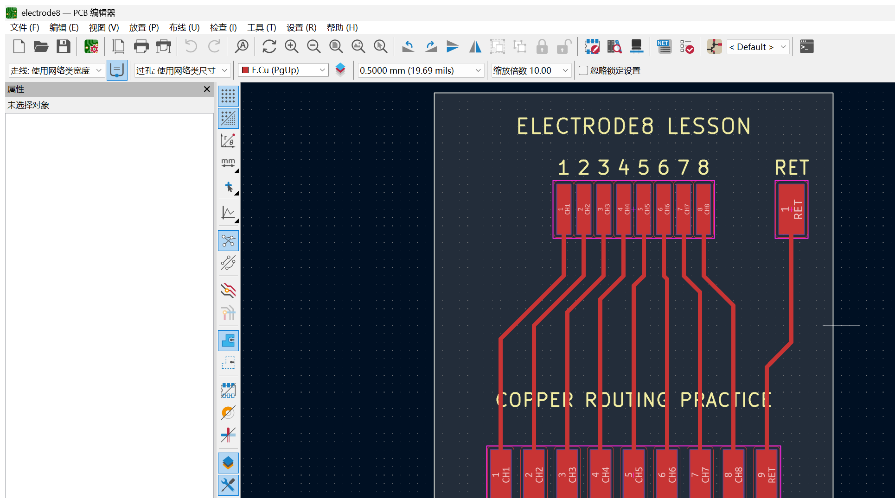

# KiCad 中文使用说明

贴片超声项目的第一份入门手册 · Windows · KiCad 10.0.8 · 2026-11-22

## 1. 先认识你现在使用的软件

KiCad 是免费、开源的电子设计软件。你可以用它画电气连接关系、设计焊盘和电极接点、排列阵列、绘制铜引线，并导出 PCB 或平面图形文件。本次安装采用 KiCad 官网 Windows 下载页列出的清华镜像，界面设置为简体中文。

安装位置：`C:\Users\LEN\AppData\Local\Programs\KiCad\10.0`。如果桌面没有快捷方式，可在该目录的 `bin` 子目录双击 `kicad.exe`。教学工程位于本项目的 `hardware/kicad/electrode8/`，双击 `electrode8.kicad_pro` 打开。

中文设置：在工程管理器顶部的“设置”（英文 Preferences；部分版本译作“偏好设置”）中找到“语言 / Language”，选择“简体中文”。如部分已打开窗口未刷新，保存并重新打开该窗口。语言只影响菜单和提示；`F.Cu`、`Edge.Cuts` 等层名以及工程后缀保持原名，这是正常现象。

本教程使用教学参数。论文 Hu 等《A wearable cardiac ultrasound imager》（Nature 2023）正文描述的是液态金属电极、四层上电极、公共地电极、绝缘层及激光图案化等结构；正文没有检索到 KiCad 软件名称，因此不能确认论文使用了 KiCad。KiCad 能辅助表达平面接点和布线，但单张 PCB 图不包含完整的压电换能器工艺。[3]

## 2. 工程里有哪些工具

| 工具 | 解决什么问题 | 第一次练习怎么用 |
| --- | --- | --- |
| 工程管理器 | 管理一个工程的各类文件 | 先打开 `.kicad_pro` |
| 原理图编辑器 | 定义“哪个引脚与哪个引脚相连” | 建立 CH1–CH8、RET 连接关系 |
| 符号编辑器 | 制作原理图中的逻辑图形 | 本次先用工程自带的接点符号 |
| 封装编辑器 | 定义真实焊盘的形状、尺寸和间距 | 从一个矩形焊盘做出阵列 |
| PCB 编辑器 | 定义实际位置、铜线和外形 | 排列电极、拉线、检查间距 |
| Gerber 查看器 | 查看导出的每一层图形 | 独立核对导出结果 |

“符号”表示电气功能，“封装”表示实际图形。原理图中的 1 号引脚，必须对应封装中的 1 号焊盘。把元件拖到板上，只完成了摆放；把相同网络的焊盘用铜线连通，才完成布线。

## 3. 哪些文件要保存

| 文件或目录 | 内容 | 是否应保留 |
| --- | --- | --- |
| `.kicad_pro` | 工程和设计规则 | 是 |
| `.kicad_sch` | 原理图和连接关系 | 是 |
| `.kicad_pcb` | 电极接点、铜线和板外形 | 是 |
| `.kicad_sym` | 原理图符号库 | 使用自建符号时保留 |
| `.pretty/` 内的 `.kicad_mod` | 封装库和单个封装 | 使用自建封装时保留 |
| `fp-lib-table`、`sym-lib-table` | 工程引用哪些库 | 是 |
| `exports/` | SVG、DXF、Gerber 和检查报告 | 交付或核对时保留 |
| `.kicad_prl`、备份目录 | 个人视图状态和自动备份 | 不替代正式工程文件 |

复制工程时复制整个工程文件夹。只发一张截图，别人无法继续编辑；只发 `.kicad_pcb`，也可能丢失原理图、规则或自建库。工程自带的库使用 `${KIPRJMOD}`，意思是“当前工程所在文件夹”，方便整体移动。

首次启动提示配置符号库或封装库时，可选推荐的默认库。若只练习本示例，自带的 `PatchLesson` 工程库已经提供所需符号和封装。在“设置 → 管理符号库/管理封装库”的“工程专用库”页检查它们，不要把个人练习库误设成全局库。

## 4. 看懂 PCB 编辑器

图 1. 已打开的中文 PCB 编辑器。上方为菜单与工具栏，中间为电极接点与走线，右侧图层列表在完整窗口中显示。

中央是画布，右侧通常是“外观”面板，上方是工具栏，下方显示单位、光标位置、网格等状态。绘图前先确认当前层、单位和网格。图层颜色取决于主题，红色或蓝色本身不定义材料。

| 层名 | 含义 | 本示例中的用途 |
| --- | --- | --- |
| `F.Cu` | 正面铜层 | 全部电极接点和引出线 |
| `B.Cu` | 背面铜层 | 留空，未设计背面电极 |
| `F.Mask` | 正面阻焊开窗 | 接点处开窗，允许露铜/表面处理 |
| `F.Paste` | 正面焊膏钢网层 | 本练习不用，不为接触电极开焊膏窗 |
| `F.SilkS` | 正面丝印 | 数字、名称和说明，不导电 |
| `F.CrtYd` | 封装占位边界 | 提示接点区域，不是板边 |
| `Edge.Cuts` | 板的外形边界 | 一个闭合的 24 × 30 mm 矩形 |

注意：把电极画在 `F.SilkS` 上只会得到文字/油墨图形；画成没有网络的铜图形，也不等于完成了电气连接。需要参加连接检查的接点应使用有编号、有网络的焊盘，需要连接的线路应使用走线工具。

第一次练习选择毫米。PCB 布局使用 0.1 mm 网格，便于输入 1.2 mm 间距等尺寸；原理图使用默认的电气连接网格，例如 50 mil（1.27 mm），不要把 PCB 网格直接套到原理图。

## 5. 最常用的操作

| 操作 | 常用默认按键 | 使用位置与提示 |
| --- | --- | --- |
| 缩放 | 鼠标滚轮 | 光标附近缩放 |
| 结束当前工具 | `Esc` | 常需按两次退回选择状态 |
| 保存/撤销 | `Ctrl+S` / `Ctrl+Z` | 修改后及时保存 |
| 修改属性 | `E` | 光标放在目标上；重叠时先选对对象 |
| 移动/旋转 | `M` / `R` | 留意鼠标是否指向焊盘或整个封装 |
| 复制 | `Ctrl+D` | 复制后核对编号，不能默认编号一定正确 |
| 删除 | `Delete` | 先确认删的是走线还是封装 |
| 原理图添加符号 | `A` | 在原理图编辑器中 |
| 原理图画导线/标签 | `W` / `L` | 标签必须落在导线上 |
| PCB 开始布线 | `X` | 在已有焊盘上开始 |
| 从原理图更新 PCB | `F8` | 更新前检查符号的封装字段 |
| 搜索动作 | `Ctrl+Shift+A` | 菜单找不到时搜索动作名称 |

快捷键可以被用户修改。若按键无效，先切换为英文输入法，再从顶部“设置”菜单打开设置窗口，在“快捷键”页查看当前绑定。教程中所有坐标均可用属性窗口核对，不要求只靠鼠标目测。

## 6. 推荐的完整工作顺序

先用文字写清通道数、间距、接点尺寸和输出接口；随后建立原理图，给引脚命名并分配封装。再进入 PCB 编辑器设置规则、外形和位置，最后连接同一网络的焊盘。

布线前，屏幕上的细连线是“飞线”：它表示还需要建立连接，不是实际铜线。布线后飞线应消失。关闭飞线显示只改变视图，不会修复断线。

完成后先运行原理图电气规则检查（ERC），再运行 PCB 设计规则检查（DRC），并检查原理图与 PCB 的一致性。修改原理图后要再次更新 PCB；修改封装库后要明确执行从库更新封装，不能以为现有板子自动使用新尺寸。

每次练习结束，保留一个可打开的工程和一次检查报告。你可以在教程工程的副本中练习，也可以按第二份教程建立全新工程。第一次建议先看完成示例，再从空白开始复画。

## 7. 导出时如何选择格式

| 格式 | 适合用途 | 导出后必须核对 |
| --- | --- | --- |
| SVG | 教学插图、矢量检查、排版 | 层、尺寸、是否包含说明文字 |
| DXF | 与机械 CAD 或图案加工软件交换 | 单位、比例、轮廓/填充、坐标和镜像 |
| Gerber | 按层表达 PCB 铜、阻焊、丝印等 | 每层内容、外形、开窗、工艺要求 |
| PDF | 阅读、打印与审阅 | 打印应为实际大小，不能“适合页面” |

在 PCB 编辑器中使用“文件 → 绘制”选择格式和图层；不同格式的选项会变化。导出电极铜图时先只选 `F.Cu`，不要把丝印或板边混进需要加工的电极层。说明图可以叠加 `F.Cu`、`F.SilkS` 和 `Edge.Cuts`。

本示例无通孔和过孔，因此没有生成钻孔文件。若你在练习中加入孔、过孔或真实连接器，要按对应工艺补充钻孔文件及定义。Gerber 文件能打开，不代表材料、柔性叠层、表面处理或电气性能已经合格。

## 8. 初学者问题排查

看不到电极时，先缩放到适合对象，再检查 `F.Cu` 是否显示、封装是否被过滤。看得见铜却仍有飞线时，用 `E` 查看焊盘的编号和网络，放大检查走线端点是否真正落在焊盘上。

提示封装库不存在时，确认是否移动了完整文件夹，并在工程专用库表中检查 `${KIPRJMOD}/PatchLesson.pretty`。不要从网络上随机下载同名封装替换，因为尺寸可能不同。

画线只能拐弯、不能随意穿过另一个电极，是交互布线器正在维护间距。应调整路线或布局；不要通过关闭规则来“解决”。复制电极后出现同名焊盘，要回到封装编辑器核对 pad 编号。

如果看到 `/CH1`，前面的 `/` 是顶层原理图局部标签的路径前缀；它对应本教程的 CH1。RET 是这里定义的返回接点名称，没有被指定为保护地或人体参考电极。

## 9. 从软件练习到你的贴片硬件

下一步应先和导师或加工方确定：这是压电片上的薄膜电极、柔性互连层、液态金属图案，还是外部转接 PCB。四者的材料、堆叠、输出格式和最小特征要求不同。

需要确认的真实参数包括阵元数与中心距、压电单元尺寸、上下电极连接方式、工作频率、通道映射、连接器与线缆、绝缘与封装、弯折/拉伸条件。教学工程没有提供这些实物参数的验证结果。论文工艺需另做材料和设备可行性确认，不能把本例的阻焊层当成论文的 SEBS 绝缘层。

推荐学习顺序：先完整画出本例并通过检查；再改为 4 通道验证你理解了编号和映射；最后在已确定的工艺规则下调整到真实阵列。用于人体的原型须由课题组按实际设备完成电气隔离、温升和相关实验条件审查；本例仅完成绘图教学。

## 10. 官方资料与来源

[1] KiCad 官方 Windows 下载页：https://www.kicad.org/download/windows/ 。本次下载版本 10.0.8，安装包数字签名验证通过。

[2] KiCad 10 中文入门手册：https://docs.kicad.org/10.0/zh/getting_started_in_kicad/getting_started_in_kicad.html 。PCB 编辑器完整手册：https://docs.kicad.org/10.0/en/pcbnew/pcbnew.html 。界面翻译和菜单位置以安装版本为准。

[3] Hu H, et al. A wearable cardiac ultrasound imager. Nature 613, 667–675 (2023). DOI: 10.1038/s41586-022-05498-z。开放全文：https://pmc.ncbi.nlm.nih.gov/articles/PMC9876798/ 。查阅正文的方法描述；未据此认定使用了 KiCad。

下一份：[从零绘制电极图教程](02_从零绘制电极图教程.md)。
