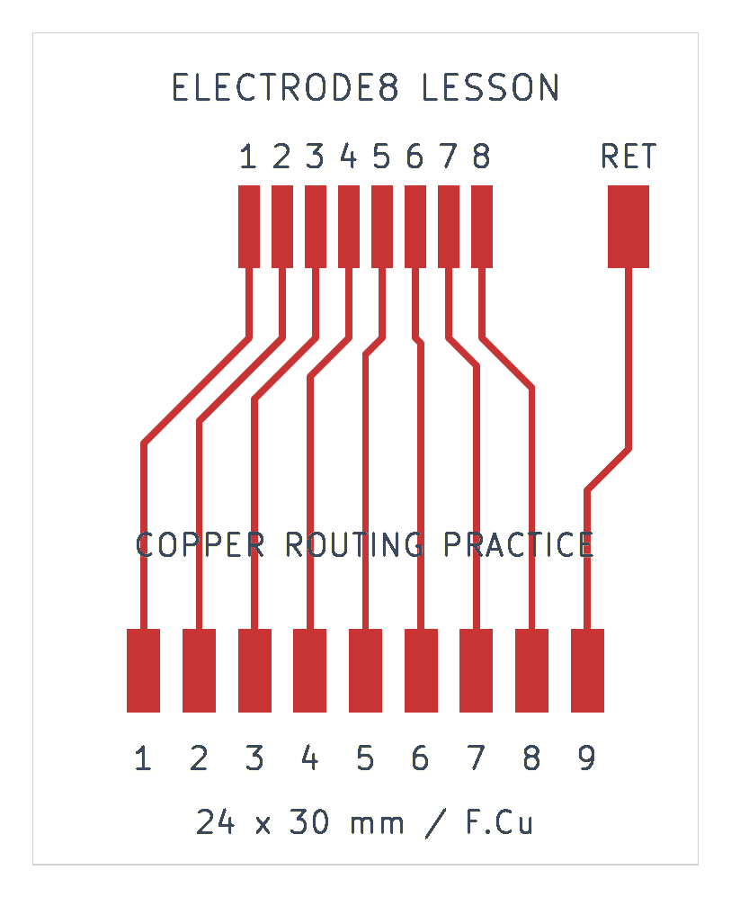
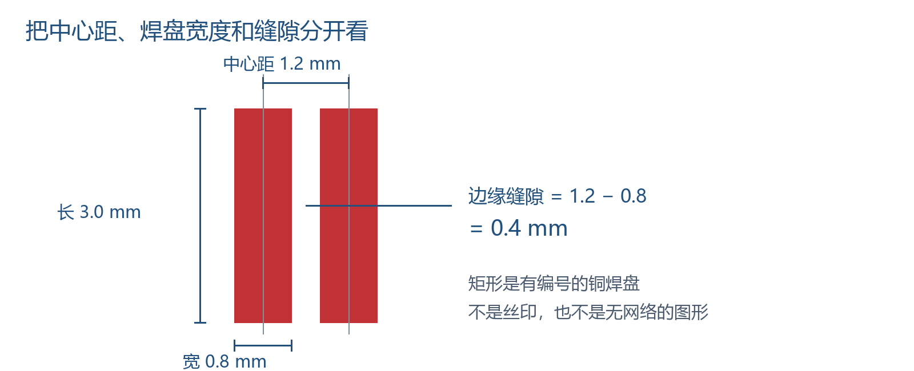
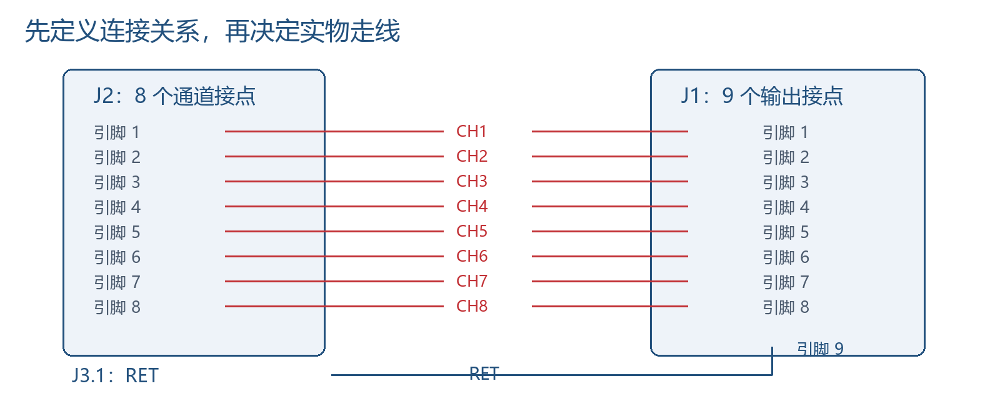

# 从零绘制电极图教程

8 通道电极接点与引出线 · KiCad 10.0.8 中文界面 · 2026-11-22

## 1. 这次要画成什么样

这次绘制一块用于学习的平面电极接点布局：上方 J2 是 8 个独立接点，右上方 J3 是公共返回接点，下方 J1 是 9 个输出接点。CH1–CH8 分别引出，RET 接到第 9 个输出接点。示例只使用正面铜层，不包含实际超声发射、接收电路或压电片堆叠。

图 1. 教学电极布局。上方为 8 个通道接点，右上为 RET，下方为 9 个输出接点。图示不能用于量取加工尺寸，尺寸以工程和参数表为准。

完成目标是：你能自己建立工程，画出一个焊盘、复制成阵列，建立电气连接，摆放封装并布线，最后通过连接与间距检查，导出可编辑和可检查的文件。建议分两次学习：第一次约 60–90 分钟完成接点与原理图，第二次约 45–60 分钟完成布局与导出；时间仅作学习安排。

本教程尺寸全部是教学设定，未采用论文的阵元间距或液态金属加工参数。这里的长方形电极接点不是一个已经完成声学设计的压电阵元；J1 是自定义裸露接点排，不代表任何市售 FPC 连接器的兼容封装。

## 2. 把参数先写清楚

| 项目 | 教学数值 | 解释 |
| --- | --- | --- |
| 板外形 | 24 × 30 mm | 左上角 (88,77)，右下角 (112,107) |
| J2 阵元接点数 | 8 | 编号 1–8，各自独立 |
| J2 接点尺寸 | 0.8 × 3.0 mm | X 方向宽，Y 方向长 |
| J2 中心间距 | 1.2 mm | 相邻中心之间的距离 |
| J2 阵列中心 | (100,84) mm | 封装中心位置 |
| J1 输出接点数 | 9 | 1–8 为通道，9 为 RET |
| J1 接点尺寸/间距 | 1.2 × 3.0 mm / 2.0 mm | J1 封装中心 (100,100) |
| J3 返回接点 | 1.5 × 3.0 mm | 中心 (109.5,84) |
| 走线宽度/最小间距 | 0.25 mm / 0.20 mm | 本练习规则，未对应加工厂规格 |
| 接点图层 | F.Cu + F.Mask | 允许开窗，不启用 F.Paste |

中心距不等于缝隙。J2 相邻铜接点的名义边缘间距是 1.2 − 0.8 = 0.4 mm。八个接点最外侧边缘之间的宽度是 7 × 1.2 + 0.8 = 9.2 mm。

图 2. 接点尺寸、中心距与边缘缝隙的关系。尺寸均为本教程设定。

PCB 坐标向右为 X 增大，向下为 Y 增大。本教程使用绝对坐标，不把你临时设定的局部原点当作板的绝对原点。若状态栏读数不同，可打开对象属性检查绝对位置。

## 3. 步骤一：新建空白工程

在 KiCad 工程管理器选择“文件 → 新建工程”，命名为 `my_electrode8`，保存到一个单独的练习文件夹。不要直接覆盖随附的完成示例。确认文件夹内有 `.kicad_pro`、`.kicad_sch`、`.kicad_pcb`。

本次采用自带的被动接点符号，避免第一次学习时同时制作符号和封装。把完成示例中的 `PatchLesson.kicad_sym` 复制到你的新工程文件夹。在“设置 → 管理符号库 → 工程专用库”中添加它，库昵称设为 `PatchLesson`，路径可设为 `${KIPRJMOD}/PatchLesson.kicad_sym`。

你可以复制整套 `PatchLesson.pretty` 先熟悉流程；要真正练习从零画电极，请按下面步骤新建 `MyElectrode.pretty`，不要只修改完成图。封装库是图形容器，本身不是一张 PCB。

本步完成后：新工程能打开，添加符号时能搜到 `PatchLesson:Contact_8`、`Contact_9` 和 `Contact_1`。

## 4. 步骤二：从一个矩形焊盘开始

从工程管理器打开“封装编辑器”。选择“文件 → 新建库”，保存到当前工程目录，命名为 `MyElectrode.pretty`，加入工程专用库。再新建封装，名称为 `Array_8_P1.20`，封装类型选择 SMD。

将单位设为 mm，网格设为 0.1 mm。选择右侧“添加焊盘”工具，在原点附近放一个焊盘，按 `Esc` 退出工具。将光标放到焊盘上按 `E`，核对你打开的是焊盘属性。

把焊盘设为：编号 1；类型“表面贴装 / SMD”；形状“矩形”；尺寸 X=0.8 mm、Y=3.0 mm；位置 X=−4.2 mm、Y=0 mm；铜层为正面。技术层保留 `F.Mask`，取消 `F.Paste`。阻焊开窗的局部扩展量设为 0.05 mm。不要给它添加钻孔。

这里用 SMD 焊盘，是为了让图形带有编号并参与网络检查。没有勾选 F.Paste，是因为本练习演示裸露接触区域，不为它制作回流焊膏钢网。F.Mask 表达 PCB 阻焊开窗，不能用它代表液态金属图案的绝缘层厚度。

保存，放大检查。你应看到一个纵向的长方形铜接点，而不是只有一圈轮廓线。只画图形矩形无法替代有编号的焊盘。

## 5. 步骤三：复制成八个接点

把光标放在 1 号焊盘上，按 `Ctrl+D` 复制，再按 `E` 精确修改编号与坐标。逐个操作即可，不要求第一次就使用阵列工具。所有焊盘尺寸保持 0.8 × 3.0 mm、Y=0。

| 焊盘号 | 封装内 X / mm | 封装内 Y / mm | 对应网络 |
| --- | --- | --- | --- |
| 1 | −4.2 | 0 | CH1 |
| 2 | −3.0 | 0 | CH2 |
| 3 | −1.8 | 0 | CH3 |
| 4 | −0.6 | 0 | CH4 |
| 5 | 0.6 | 0 | CH5 |
| 6 | 1.8 | 0 | CH6 |
| 7 | 3.0 | 0 | CH7 |
| 8 | 4.2 | 0 | CH8 |

封装中的焊盘一般还没有工程网络；上表最后一列表示稍后应通过原理图得到的映射。不要在封装库里把 8 个焊盘都命名为“1”，否则它们会被视为同一引脚的多个接触区。

在 `F.CrtYd` 上绘制矩形占位边界：X=−4.85 到 4.85，Y=−1.75 到 1.75，线宽 0.05 mm。它用于表达封装占位；不能用作导电电极，也不是板外形。将 Reference 和 Value 文字移出接点区域或隐藏，再保存封装。

本步完成后：有且只有 8 个焊盘，编号 1–8，各中心相差 1.2 mm，最外侧边缘宽度为 9.2 mm。

## 6. 步骤四：画输出接点和返回接点

在同一封装库中新建 `Tail_9_P2.00`。按上一方法放置 9 个矩形 SMD 焊盘，编号 1–9，尺寸都为 1.2 × 3.0 mm，Y=0，X 依次为 −8、−6、−4、−2、0、2、4、6、8 mm。

这些接点同样使用 F.Cu 和 F.Mask、取消 F.Paste、局部阻焊扩展 0.05 mm。占位边界可设为 X=−8.85 到 8.85、Y=−1.75 到 1.75，线宽 0.05 mm。保存。

再新建 `Return_Contact`，只放一个编号为 1 的焊盘，尺寸 1.5 × 3.0 mm，位置 (0,0)，图层设置同前。占位边界为 X=−1 到 1、Y=−1.75 到 1.75。保存。

本步完成后：库里有 3 个封装。若已经复制了示例库，应使用你自己建的 `MyElectrode` 库进行后续分配，以确认你画出的封装确实被工程采用。

## 7. 步骤五：建立原理图连接

回到工程管理器，打开原理图编辑器。保持默认的 50 mil 电气连接网格。按 `A` 添加 `PatchLesson:Contact_8`，放在左侧；再添加 `Contact_9` 放在右侧，`Contact_1` 放在左下方。

按 `E` 修改位号：8 引脚符号为 J2，9 引脚为 J1，1 引脚为 J3。如果原有位号冲突，使用“工具 → 标注原理图”先处理，再检查位号。将其“封装”字段分别设为 `MyElectrode:Array_8_P1.20`、`MyElectrode:Tail_9_P2.00`、`MyElectrode:Return_Contact`。已提供工程使用库名 `PatchLesson`，你的自建练习使用 `MyElectrode`。

在 J2 的 1 号引脚端按 `W` 拉一小段导线，单击确定终点，按 `Esc`。按 `L` 添加局部网络标签 `CH1`，将标签的连接锚点准确落在这段导线上。依次对 J2 的 2–8 号引脚添加 CH2–CH8。

对 J1 的 1–8 号引脚添加相同名称的 CH1–CH8，9 号引脚添加 RET。对 J3 的 1 号引脚添加 RET。相同名称的局部标签，在同一张原理图内表示同一个网络，不需要跨画面再拉一条长线。

| 网络 | 第一个端点 | 第二个端点 |
| --- | --- | --- |
| CH1–CH8 | J2 的 1–8 号引脚 | J1 的 1–8 号引脚，一一对应 |
| RET | J3 的 1 号引脚 | J1 的 9 号引脚 |

不要只放文字：必须是网络标签，并且锚点贴在引脚或导线上。本教学连接有 9 个网络，每个网络包含 2 个焊盘，共 18 个焊盘。没有把 8 个通道之间相互连接。

图 3. 原理图连接示意。CH1–CH8 分别引出，RET 单独连接 J3.1 和 J1.9，图中的横线不是 PCB 的实际走线位置。

保存，运行电气规则检查 ERC。若报离网格、未连接或库不一致，先逐项定位并修复。本例全部引脚为被动类型，不需要用电源标记掩盖真实连接问题。

## 8. 步骤六：导入 PCB 并设置规则

按 `F8` 或选择“工具 → 从原理图更新 PCB”。查看更新列表，确认导入 J1、J2、J3 三个封装；确认没有封装字段为空或找不到库的问题。应用更新并把封装放到画布上。

打开“文件 → 电路板配置”，找到设计规则中的约束和网络类。将最小铜间距设为 0.20 mm、最小线宽设为 0.25 mm；Default 网络类的间距设为 0.20 mm、走线宽度设为 0.25 mm。可将 0.25 mm 加入预定义走线宽度列表。铜到板边的最小间距采用 0.50 mm。

选择毫米和 0.1 mm PCB 网格。这是教学工程的平面几何规则；真实生产时以加工方可实现的材料、线宽和间距为准。PCB 默认厚度仅是软件默认板模型，本示例没有把它定义为超声压电层。

## 9. 步骤七：画外形并精确摆放

在右侧选择 `Edge.Cuts`。使用矩形工具，先画一个外形，再按 `E` 精确修改角点；也可以画四条连续线段。左上角为 (88,77)，右下角为 (112,107)，线宽 0.05 mm。确认外形闭合，无重复边。

切回 `F.Cu`。依次选中封装按 `E`，设置：J2 中心 (100,84)、旋转 0°；J1 中心 (100,100)、旋转 0°；J3 中心 (109.5,84)、旋转 0°。本例全部放在正面，不翻面。

选中整个封装时的位置，表示封装原点；选中单个焊盘时的位置，可能显示相对位置。不要把封装内的 −4.2 mm 当成整板绝对 X。J2 的 1 号接点最终应在 (95.8,84)，J1 的 1 号接点最终应在 (92,100)。

本步完成后：8 个通道接点在上方，9 个输出接点在下方，RET 接点在右上方；屏幕上仍有待连接的飞线，这是布线前的正常状态。

## 10. 步骤八：拉出第一根真实铜线

确保当前层是 `F.Cu`，走线宽度是 0.25 mm。光标指向 J2 的 1 号焊盘，按 `X` 开始布线。先向下走，再向左下转 45°，最后连接到 J1 的 1 号焊盘。到达目标焊盘后单击完成，再按 `Esc` 退出。

要复现完成示例，CH1 路径依次为 (95.8,84) → (95.8,88) → (92,91.8) → (92,100)。实际交互布线时可在焊盘边缘开始，由软件连到焊盘铜区；不要求你在每个焊盘中心额外插入节点。

放大查看接头。看起来接触但仍有飞线，通常意味着端点没落在同一网络的铜区。用 `E` 检查两端分别是 `/CH1`。前面的斜线代表原理图路径，和标签 CH1 对应。

不要用“绘制图形线段”代替走线工具。图形看起来相似，但无法按同样方式表达网络和进行连接检查。

## 11. 步骤九：完成其余通道和 RET

按照编号一一连接。下表列出参考折点；起点 Y=84，终点 Y=100。每条线先到第一折点，再到第二折点，最后到对应输出接点。采用其他不交叉且符合规则的路线也可通过练习。

| 网络 | 起点 X | 第一折点 (X,Y) | 第二折点 (X,Y) | 终点 X |
| --- | --- | --- | --- | --- |
| CH1 | 95.8 | (95.8,88) | (92,91.8) | 92 |
| CH2 | 97.0 | (97.0,88) | (94,91.0) | 94 |
| CH3 | 98.2 | (98.2,88) | (96,90.2) | 96 |
| CH4 | 99.4 | (99.4,88) | (98,89.4) | 98 |
| CH5 | 100.6 | (100.6,88) | (100,88.6) | 100 |
| CH6 | 101.8 | (101.8,88) | (102,88.2) | 102 |
| CH7 | 103.0 | (103.0,88) | (104,89.0) | 104 |
| CH8 | 104.2 | (104.2,88) | (106,89.8) | 106 |
| RET | 109.5 | (109.5,92) | (108,93.5) | 108 |

RET 从 J3.1 连接到 J1.9，不与 CH1–CH8 短接。本例没有画一整片公共底电极；J3 仅表示一个公共返回接点，未来如何与实际换能器另一电极连接，需要另行确定。

本步完成后：共 9 条连接路径；示例每条由 3 段直线组成，共 27 段；没有过孔、没有背面走线，未连接数量应为 0。

## 12. 步骤十：加上说明并完成检查

切到 `F.SilkS`，添加通道号、RET、工程名称等文字。文字高度至少使用 0.8 mm，线宽可用 0.12 mm；放在接点开窗之外，不遮住接触区域。图层颜色只是显示方式，丝印不是导体。

在“检查 → 设计规则检查器”中运行 DRC，并启用原理图一致性检查。应逐项确认：无短路、无未连接项目、间距与线宽符合规则、板边闭合、封装与原理图位号/引脚/网络一致。初学时不要只看一个“完成”提示，要看违规列表。

若提示网络不一致，检查是否改了原理图却未更新 PCB；若提示库封装变化，确认板中封装与保存的库版本一致；若提示文字高度或丝印压焊盘，应移动或修改文字。不要通过忽略所有警告来制造通过结果。

教学完成示例的检查结果见 `exports/erc.json` 与 `exports/drc.json`。这些报告检查的是所声明规则下的工程连接与几何；没有验证超声频率响应、通道串扰、柔性疲劳或人体测量效果。

## 13. 步骤十一：导出电极图

先保存工程。在 PCB 编辑器选择“文件 → 绘制”。导出 SVG 时只选 `F.Cu` 得到纯电极铜图；另导出包含 `F.Cu`、`F.SilkS`、`Edge.Cuts` 的说明图，供阅读使用。两种文件要分别命名。

导出 DXF 时使用毫米，按 1:1 输出并保持未镜像。导入接收方软件后，用已知的 1.2 mm 接点中心距或 24 mm 外形宽度核对比例。只有铜层的文件不带板边时，应使用中心距或接点尺寸核对。DXF 的填充/轮廓语义需与加工软件确认；不能把屏幕上看到的线宽直接当成切割路径或烧蚀区域。

导出 Gerber 时分别勾选 F.Cu、B.Cu、F.Mask、B.Mask、F.SilkS、Edge.Cuts。本例背面层为空，但保留它们可以练习逐层核对。使用 Gerber 查看器重新加载输出层，确认铜、开窗、丝印和外形各自正确。本例没有钻孔文件，因为未使用孔或过孔。

用于印刷版阅读时，PDF 可以放大缩小；需要纸上尺寸核对时，打印选择“实际大小 / 100%”，关闭自动适合页面。加工交接仍应提供完整工程及图层、材料和工艺说明，而不是从 PDF 截图。

## 14. 三个练习，检验是否真正学会

练习一：把阵元数改为 4。相应更换/制作 4 引脚符号、4 接点封装和 5 接点输出排，重新建立网络并检查。不能只删除图上的四个矩形、留下旧原理图。

练习二：把 J2 中心距从 1.2 改为 1.0 mm，仍保持宽度 0.8 mm。计算边缘间距变为 0.2 mm，并检查阻焊扩展、占位边界和布线是否还可接受。这个练习显示：只改一个数值会同时影响多项约束。

练习三：在工程副本中改变 J1 位置。重新布线，保持网络正确并运行 ERC、DRC。能独立修复断线和间距问题，再考虑把接点改成真实阵列的几何。

完成自查：能解释焊盘与图形的区别；能解释中心距与缝隙；能正确对应 J2.1 和 J1.1；能从零画出 8 个独立编号的接点；能导出并再次查看 F.Cu；知道软件检查通过不等于换能器或临床验证通过。

## 15. 以后如何接近论文的硬件

Hu 等论文正文描述液态金属图案化、多层上电极、公共地电极及层间绝缘/互连。要复刻其结构，应继续阅读其方法和补充材料，逐层整理真实尺寸、材料、对准标记、互连和加工条件。本例没有生成论文的四层上电极，也没有用普通铜板冒充液态金属弹性电极。

下一步可以把工作分成两个明确对象：一是实验室实际能加工的电极/互连层图案；二是与采集设备连接的转接 PCB。它们可以分别设计，再用共同的通道编号、尺寸基准和接口定义衔接。若实际采用柔性或可拉伸层，还需由工艺规则确定线型、弯折区域、绝缘和封装，而非直接将此矩形板设置为“柔性”即可。

开始真实版前，请补齐：阵元几何、接点位置、通道总数与顺序、公共返回策略、输出连接器完整型号、频率与驱动条件、基底和导体材料、最小线宽/间距、层间对准公差、弯折/拉伸要求。未知项记录为待确认，不从本教学参数自动继承。

## 16. 配套文件和参考资料

完成工程：`hardware/kicad/electrode8/electrode8.kicad_pro`。参数表：同目录 `lesson_parameters.json`。原理图：`electrode8.kicad_sch`。布局：`electrode8.kicad_pcb`。导出图形与报告：`exports/`。

KiCad 10 官方中文入门：https://docs.kicad.org/10.0/zh/getting_started_in_kicad/getting_started_in_kicad.html 。PCB 编辑器手册：https://docs.kicad.org/10.0/en/pcbnew/pcbnew.html 。下载：https://www.kicad.org/download/windows/ 。

论文：Hu H, et al. A wearable cardiac ultrasound imager. Nature 613, 667–675 (2023). DOI: 10.1038/s41586-022-05498-z；开放全文：https://pmc.ncbi.nlm.nih.gov/articles/PMC9876798/ 。本次核查正文，未确认其绘图软件。

配套阅读：[KiCad 中文使用说明](01_KiCad中文使用说明.md)。
