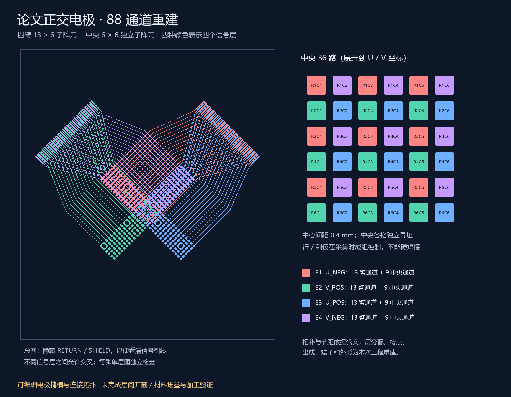

# 在 KiCad 中复现论文正交 88 通道电极

日期：2026-11-22。适用 KiCad 10.0.8 简体中文界面。工程：[orthogonal88.kicad_pro](../../hardware/kicad/orthogonal88/orthogonal88.kicad_pro)。

本次完成的是论文明确连接拓扑与节距的可编辑重建，并补充了一套经过二维规则检查的四层引线方案。论文没有公开完整 CAD，因此不能把它称为作者原版加工文件。实际加工还需完成材料堆叠、垂直开窗、对位与键合设计。

## 1. 网页讲什么，本次采用哪部分

你提供的 [CSDN 文章](https://blog.csdn.net/weixin_46881784/article/details/165618469)讲的是“用 AI 接入 KiCad”，没有给出这篇超声论文的电极尺寸或电路。本文采用其“大量重复单元用脚本生成原生文件，再用 KiCad 导出网表校验”的流程。

文章推荐的 Huaqiu `kicad-mcp` 源码采用自定义 JSON 命令和 `kicad_sdk_pair-*` 通信入口；当前安装的官方 KiCad 使用的公开 IPC 协议为 Protocol Buffers / NNG。不能仅添加那两段配置就宣称已连接成功。本次没有更换你的 KiCad 发行版，也没有宣称 MCP 实时连接成功；工程由 KiCad 自带的绘图组件和原生文件方式构建，并实际在中文软件中打开。

相关原始资料：[Huaqiu 源码](https://github.com/Huaqiu-Electronics/kicad-mcp)、[KiCad 官方 IPC](https://dev-docs.kicad.org/en/apis-and-binding/ipc-api/)。无需先安装该 MCP 才能使用本工程。

## 2. 先弄清论文的 88 路

论文：Hu et al., *A wearable cardiac ultrasound imager*, Nature 613, 667–675 (2023)，[DOI](https://doi.org/10.1038/s41586-022-05498-z)。本次依据你提供的主文及《补充信息.pdf》。下文“PDF 页”按阅读器从第 1 页计数，不等于印刷页码。

- 主文 PDF 第 14 页，Extended Data Fig.1：四臂、中央共享区、六个小片组成一个长阵元、每方向 32 阵元、中心间距 0.4 mm，图中标示孔径 12.7 mm。
- 补充 PDF 第 21 页（印刷第 20 页），Discussion 3.1：每臂 13 通道，每通道 6 个子阵元短接；中央 36 个子阵元独立寻址；物理连接到系统的是 88 通道。
- 补充 PDF 第 58 页（印刷第 57 页），Fig.6：四层液态金属电极、公共返回及屏蔽的光学图，提供结构参考，不能直接读出逐线精确坐标。
- 主文 Methods 的 “Fabrication of the device” 段（PDF 第 10 页）：四层上电极、公共接地电极、SEBS 层间绝缘、激光垂直互连接入、额外接地屏蔽。
- 主文 Methods 的声场仿真段（PDF 第 12 页）：阵元宽 0.3 mm、长 2.3 mm、中心频率 3 MHz、32 阵元等。这是仿真输入，不能直接当作实物接点加工图。

通道数：`4 × 13 + 6 × 6 = 88`；实体小片数：`4 × 13 × 6 + 36 = 348`；每方向逻辑阵元数：`13 + 6 + 13 = 32`。

中央同一行或同一列的 6 路由采集系统协调激活。若同时把行和列永久短接，中央信号会连成一个网络，就失去了论文的独立寻址结构。本工程的 `C_R1C1` 到 `C_R6C6` 始终是 36 个独立网络。

## 3. 哪些数值来自论文

| 项目 | 数值 / 处理 | 依据与边界 |
|---|---|---|
| 阵元中心间距 | 0.4 mm | 论文明确值 |
| 每臂通道数、每臂通道子片数 | 13、6 | 论文明确值 |
| 中央子阵元 | 6 × 6，独立寻址 | 论文明确值 |
| 孔径 | 12.7 mm | Extended Data Fig.1 标注；与仿真 0.3 mm 宽及 31 个间距相符 |
| 小片外形轮廓 | 0.3 × 0.3 mm | 以仿真宽度及 6 片的 2.3 mm 总长作示意推定；不是作者公开的实物 CAD |
| 本次电接点 | 0.22 × 0.22 mm | 工程选择，预留接点开窗附近的走线空间 |
| 线宽 / 最小间距 | 0.03 / 0.03 mm | 本次名义设计规则；论文报道的最小工艺能力不代表每条原始引线尺寸 |
| 四层分配 | 每层 13 臂通道 + 9 中央通道 | 本次交错分配，未恢复作者原始分层 pin map |
| 信号端子 | 0.12 × 1.2 mm；每层间距 0.4 mm | 本次两个斜向接点组，同组两层错位 0.2 mm；不是已选型连接器 |
| 总图外框 | 28 × 32 mm | 本次绘图范围 / 掩模边界，不是论文贴片外形 |
| RETURN / SHIELD 外形 | 21 × 27 mm 矩形 | 本次占位示意，不是从照片精确测量 |
| 液态金属 / 介质 / 压电材料 | 不指定制造堆叠 | KiCad 六铜层只用于存储掩模，不构成材料剖面 |

未确定的项目包括：每层绝缘厚度、开窗孔径与深度、真实压电片加工公差、液态金属接触面、伸缩互连和连接器/线缆 pin map。论文四层照片中的曲线走向没有被宣称逐线复刻。

## 4. 在你的 KiCad 中查看

1. 打开 `hardware/kicad/orthogonal88/orthogonal88.kicad_pro`。在工程管理器双击同名 `.kicad_pcb` 进入 PCB 编辑器。
2. 在右侧“外观”的图层列表查看 `LM_E1` 至 `LM_E4`。它们分别对应 F.Cu、In1.Cu、In2.Cu、In3.Cu。
3. 临时隐藏 `LM_SHIELD` 和 `LM_RETURN`，以免整片返回/屏蔽图形遮挡信号层。用鼠标滚轮缩放到中央 X 形区域；Home 通常可适应显示整个图形。
4. `User.2` 是 348 个小片的轮廓；`User.1` 是本工程输出端子号。改变可见性不改变网络连接。
5. 单独打开 `masks/E1.kicad_pcb`：这里全部信号都在 F.Cu，一次只检查一张液态金属掩模。E2、E3、E4 同理。
6. 回到管理器，双击同名 `.kicad_sch`。根页有 J001–J088 信号接点，J089 是公共返回接点，J090 是接地屏蔽接点；后两者连接到同一 RETURN 网络。
7. 在原理图导航中进入 U_NEG、U_POS、V_NEG、V_POS、CENTER。四个臂页各有 78 个两端压电符号，中央页有 36 个。符号只表达电气连接，没有填写未经测量的压电等效阻抗。
8. 用 `channel_map.csv` 查通道到端子号，再用 `geometry.json` 的 `schematic_subelements` 查具体压电位号。`logical_axis_groups.json` 提供两个方向的 32 个逻辑阵元分组。

总图是掩模抽象，**不要按 F8 直接从原理图更新 PCB**。原理图符号设置为不进入 PCB，内层接点采用铜区而非普通封装焊盘；不能拿常规器件封装同步当作检查方法。

## 5. 从零手画一小段，再扩展到完整阵列

先复制工程到新的练习目录。下面的尺寸沿用本次重建参数，不能当作制造定稿。

1. **先画一个臂通道。** 在新的练习板中选 F.Cu，放一个无孔矩形接点，大小 0.22 × 0.22 mm；复制成 6 个，中心沿一条直线每隔 0.4 mm 放置。给这 6 个接点同一网络，例如 U_NEG_01，用 0.03 mm 引线连接。此时是 1 通道、6 小片。
2. **复制成一条臂。** 沿垂直于这 6 个接点的方向复制 13 列，列中心间距 0.4 mm；每列使用独立网络 U_NEG_01…13。不要将整条臂做成同一网络。一个臂页上应有 78 个子片、13 路信号。
3. **理解未旋转坐标。** 两条阵列沿 U / V 轴相交。每条长轴的 32 个位置为 `-6.2, -5.8, …, 6.2 mm`；臂占两端各 13 个，中央占中间 6 个。短边的 6 个位置为 `-1.0, -0.6, -0.2, 0.2, 0.6, 1.0 mm`。
4. **补中央与另外三臂。** 中央放 6 × 6 个独立接点，网络名依次 C_R1C1…C_R6C6。另三臂分别用 U_POS、V_NEG、V_POS 网络，各臂 13 通道，每通道 6 个接点。
5. **形成论文的 X 形。** 整体旋转 45° 即可从“十”字变为“X”形；旋转改变显示朝向，仍要保留每组小片之间的 0.4 mm 实际中心距。生成器使用 `x=(u-v)/√2, y=(u+v)/√2`，布局中心在 KiCad 坐标 (100,100) mm。
6. **分层布线。** 先只练一张 E1。每层有 13 臂通道 + 9 个交错中央通道；中央先逃线到小片间隙，避开所有其他通道的接点开窗投影，再在阵列外扩展间距。不同层交叉需要绝缘；同一层不同网络不能相交。
7. **复制到单层掩模练习。** 内层普通贴片焊盘会触发“没有外形层”等规则错误。总图用铜区表示内层接点，而每张单层图把该层整体放在 F.Cu，用合法接点和网络检查。同一个臂通道的 6 个子接点可共用同一接点号 1，输出接点用 2。
8. **检查两类错误。** 用原理图 ERC 和网表核查 88 路是否独立；用 PCB DRC 核查每张掩模的间距和漏连。最后检查端子表与原理图标签一致。光看图像相似不能替代这两步。

完整工程已按上述结构生成；你可以先修改一条引线并重复单层 DRC，再调整一个小区域。原有 [KiCad 中文使用说明](01_KiCad中文使用说明.md) 和 [从零绘制电极图教程](02_从零绘制电极图教程.md) 可用于练习焊盘、复制、网络与基本走线操作。

## 6. 如何导出与理解检查结果

`exports/E1.svg` 至 `E4.svg`、RETURN.svg、SHIELD.svg 是六张单层图；相应 `*_mm.dxf` 为毫米制轮廓。所有单层图从同一布局坐标导出，SVG 为 1:1 尺度设置。打印时关闭“适合页面”，并实际测量 0.4 mm 节距；加工导入时仍须核查单位、镜像方向、注册对位点和轮廓闭合。未设计注册孔，不要靠自动裁边后的图片边界对位。

检查记录：

- ERC：0 个违规。
- 网表：438 个符号（348 压电 + 90 接点）、89 个网络（88 信号 + RETURN）。每个臂信号网络 7 个引脚节点；每个中央信号网络 2 个；RETURN 350 个。
- 六张单层图：DRC 0、未连接 0。
- 六层总图：0 错误、199 个 `isolated_copper` 警告、未连接 0。警告保留在 `main_drc.json`，没有被屏蔽；无常规焊盘锚点的掩模铜区会触发这类提示。总图“未连接 0”不代表真实层间开窗已经完成。
- 四层引线到全部其他通道接点开窗投影：最小名义间距 0.035 mm。它仅覆盖二维图形，不覆盖实际钻深、材料绝缘和对位误差。
- 项目核心测试：12 passed；硬件生成文件独立于算法、数据划分和模型工作。

没有进行常规原理图—PCB 封装一致性检查，没有验证加工、声学、伸缩可靠性或临床性能；本工程没有提供可直接下单的 Gerber。下一步制造设计应由压电片和液态金属工艺能力确定接点/开窗尺寸、SEBS 层序、屏蔽与返回的真实外形、线缆键合和公差，之后再更新掩模并加工测试。

重建与复查命令见[工程 README](../../hardware/kicad/orthogonal88/README.md)。复查结果为 [validation_summary.json](../../hardware/kicad/orthogonal88/exports/validation_summary.json)，原始报告和可放大的 [六页原理图 PDF](../../hardware/kicad/orthogonal88/exports/orthogonal88_schematic.pdf) 位于同一目录。
