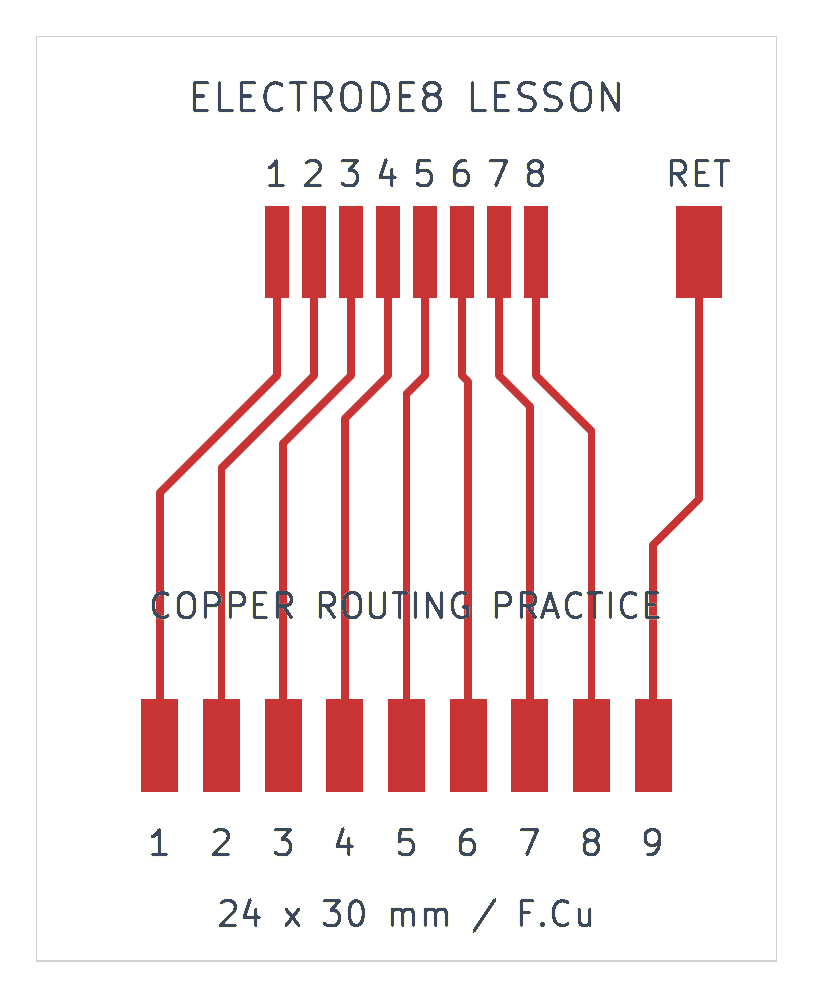

# KiCad 中文入门与电极绘图

适用软件：KiCad 10.0.8，Windows 简体中文界面。教学日期：2026-11-22。

## 阅读顺序

1. [软件使用说明（Word）](documents/01_KiCad中文使用说明.docx) / [PDF](documents/01_KiCad中文使用说明.pdf) / [Markdown](01_KiCad中文使用说明.md)
2. [从零绘制电极图（Word）](documents/02_从零绘制电极图教程.docx) / [PDF](documents/02_从零绘制电极图教程.pdf) / [Markdown](02_从零绘制电极图教程.md)
3. [打开可编辑教学工程](../../hardware/kicad/electrode8/electrode8.kicad_pro)，并在新工程中跟随第二份教程重画。

示例包含 8 路信号接点、1 路返回接点、9 个输出接点、原理图、工程自带符号/封装库，以及 SVG、毫米制 DXF 和分层 Gerber。全部几何尺寸为教学设定，未宣称复刻论文的多层液态金属电极。

## 安装记录

安装目录：`C:\Users\LEN\AppData\Local\Programs\KiCad\10.0`。入口程序：该目录 `bin/kicad.exe`。已将公共界面语言设为“简体中文”，并实际打开工程管理器与 PCB 编辑器核对。

官方来源：<https://www.kicad.org/download/windows/>。下载采用该页面列出的清华镜像：<https://mirror.tuna.tsinghua.edu.cn/kicad/windows/stable/kicad-10.0.8-x86_64.exe>。

安装包保存在项目的 `.work/kicad_setup/kicad-10.0.8-x86_64.exe`，没有加入 Git；大小 969,079,176 字节。SHA-256：`5652b9ed52fca4aa63ec2ec61c8bfd4fab4f6a2fbfdb441def2972b0e9b2dfc7`。本地 Windows 数字签名验证结果为 Valid，签名方为 KICAD SERVICES CORPORATION。该 SHA-256 是下载文件的本地计算值，没有将其称为与官方发布校验清单的比对结果。

语言配置位于 `%APPDATA%/kicad/10.0/kicad_common.json`，`system.language` 值为 `简体中文`，使用 KiCad 本身所识别的语言显示名称。首次设置前若存在同名配置文件，会保留一份备份。

## 检查记录

- KiCad 10.0.8：ERC 0 个违规；DRC 0 个违规；未连接项目 0；原理图与 PCB 一致性问题 0。原始 JSON 在工程 `exports/` 中。
- 布局清单：3 个封装、18 个焊盘、9 个网络、27 段走线、0 个过孔；铜线仅使用 F.Cu，B.Cu 为空。
- 文档：使用本机 Microsoft Word 导出 PDF，再使用 Poppler 渲染并检查中文、插图、表格与分页。系统没有 LibreOffice，因此使用 Word 完成实际文档渲染。
- 核心测试：默认 `python -m pytest -q` 因系统 Python 未安装 torch 而在收集时中止；使用项目已有虚拟环境执行 `.venv/Scripts/python.exe -m pytest -q --basetemp=.work/pytest-kicad-lesson`，8 passed。

这些检查属于软件工程、图形与连接规则检查，不代表换能器制造验证、声学验证或临床验证。没有更改现有算法、患者划分或数据文件；硬件教学文件独立保存在 `hardware/` 和 `docs/hardware/` 中。
