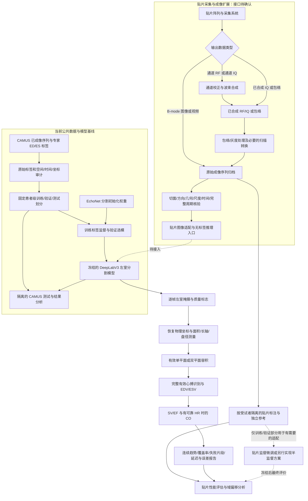

# 从贴片回波到心功能参数：波束合成与更新后的项目流程

本文结合当前源码、已保存实验和超声成像第一手资料解释项目全链路。当前确认的信息是“学长正在采集贴片数据并编写波束合成代码”；设备导出的数据类型、阵列布局和发射序列尚未确认。因此，下文给出条件分支，所有采样率、阵元尺寸和发射参数示例均不代表你们的设备配置。

2026年11月21日作者进一步明确，真实贴片数据尚未收到，当前先以公开数据推进分析，必要时考虑独立仿真实验补充模块真值。最新[研究主线、证据分支与图表候选](patch_study_design.md)以“采集→波束合成→深度学习解剖→中间指标→独立功能验证”为顺序；[输入记录模板](templates/patch_record.template.yaml)预留不同格式的交接字段。两者均为设计材料，不表示已实现贴片读取或运行声学仿真。

## 1. 为什么现在要写波束合成

现有 CAMUS 工作从**已经成像的超声图像**开始。商用超声系统已把阵元接收的回波经过成像处理，CAMUS 才会提供灰度影像、动态图像序列以及专家 ED/ES 标注。项目模型学习的是“灰度图像中的哪些像素属于左心室腔”。它没有学习直接把多通道电信号重建成图像。

自研贴片的输出可能更靠近信号采集端。假如它保存每个接收阵元各自的 RF 回波或 IQ 信号，你拿到的是“各个阵元在各个时刻接收到了什么”，还没有得到“心脏的每个位置有多强的回声”。波束合成结合阵元位置、发射方式、声速和传播时间，把这些通道信号重建到空间坐标上，生成可继续处理的超声图像。[1–3]

所以，学长这项工作的直接目标是**把贴片的采集结果变成可用、可标定、可追溯的心脏影像**。后面的分割与容积估计才能连接上来。它本身不产生专家标签，也不增加独立患者数量；采用普通延时求和也不需要训练神经网络。

| 数据处于什么阶段 | 能否直接输入当前分割模型 | 还需要什么 |
|---|---|---|
| 原始 ADC/RF 通道信号 | 不能 | 解析通道和发射事件，信号校正，波束合成，包络与灰度显示，空间坐标转换 |
| 未合成的通道 IQ | 不能 | 按 IQ 的解调约定做相位补偿和波束合成，再进行幅值、压缩与坐标处理 |
| 已经波束合成的复数 IQ 图 | 不能直接作为当前灰度输入 | 通常无需重复空间聚焦，需取幅值、灰度压缩，并确认是否已做扫描转换 |
| 已成像的包络图 | 需要图像适配 | 确认动态范围、坐标网格、尺度和时间后转为模型约定的灰度输入 |
| B-mode 图像或视频 | 可在预处理后进入模型 | 保留原图、确认切面和方向，处理显示区域，核验空间/时间信息及跨设备性能 |

RF 是保留超声载频振荡的射频回波；IQ 是正交解调后的复数基带表示。**“IQ”不等于“已经成像”**，必须继续确认它是逐通道 IQ，还是已经合成到像素网格的 IQ。[2,3]

## 2. 波束合成怎样把信号变成图像

### 2.1 同一个组织点的回波不会同时到达所有阵元

把阵列想成多个位置不同的接收器。心室壁上的同一个小区域反射回声，到不同阵元的距离不同，因此到达时间不同。直接把所有通道在同一采样时刻相加，会把不同空间位置的回波混在一起；同一反射的振荡也可能相互抵消。

延时求和（delay-and-sum，DAS）的办法是：对一个候选成像位置，先计算从发射到该位置、再返回各接收阵元所需的时间；从每个通道取出相应时间的信号，经过插值、加权后相加。依次处理整个成像网格，便得到聚焦后的空间图。[2,5]

### 2.2 先计算传播时间，再插值求和

记成像点为 \(\mathbf p\)，第 \(m\) 个接收阵元位置为 \(\mathbf r_m\)，第 \(e\) 次发射的已知传播模型为 \(\tau_{\mathrm{tx},e}(\mathbf p)\)，采用的声速为 \(c\)。在直线传播和均匀声速近似下：

\[
\tau_{e,m}(\mathbf p)=\tau_{\mathrm{tx},e}(\mathbf p)
+\frac{\|\mathbf p-\mathbf r_m\|}{c}.
\]

RF 延时求和可写为：

\[
b_e(\mathbf p)=\sum_{m\in\mathcal A(\mathbf p)}
w_{e,m}(\mathbf p)\,s_{e,m}\!\left(\tau_{e,m}(\mathbf p)\right).
\]

这里 \(s\) 是通道回波，\(\mathcal A\) 是参与接收的孔径，\(w\) 是加窗权重。权重用于控制旁瓣等成像特性，并不等同于神经网络学习到的权重。

实际数组需要把传播时间换成采样索引，例如 \(u=(\tau-t_{\mathrm{sample},0,e})f_s\)。其中 \(t_{\mathrm{sample},0,e}\) 是相对于同一发射参考时刻的首样本时间，\(f_s\) 是采样率。它通常不是整数，所以需要插值；触发延迟和采样起点的符号约定必须与采集系统一致。只有接收距离而遗漏发射传播时间，通常会聚焦错误。

若做 IQ 波束合成，还需根据解调频率、采样起点和相位参考补偿传播相位，不能把复数 IQ 当作普通 RF 或灰度数组直接平移求和。补偿的正负号取决于具体 IQ 定义。[2]

**计算示例，仅用于理解：**成像点在阵列中心正下方 30 mm，另一个接收阵元横向相距 10 mm。取 \(c=1540\,\mathrm{m/s}=1.54\,\mathrm{mm/\mu s}\)，两条接收路径相差：

\[
\Delta t=\frac{\sqrt{30^2+10^2}-30}{1.54}
\approx1.054\,\mu\mathrm s.
\]

若采样率假设为 20 MHz，就相差约 21.1 个样本。同一次发射对同一成像点的发射传播时间相同，在这两个通道的相对延迟中抵消。这个例子说明了为什么不能直接在同一个数组索引上相加。

### 2.3 发射方式决定延迟模型和帧率

| 发射方式 | 需要怎样的处理 | 对本项目的影响 |
|---|---|---|
| 逐线聚焦发射 | 使用实际发射焦点、扫描线和发射延迟模型；一幅图可能需要多次发射 | 不能只凭接收通道数推断帧率 |
| 平面波发射 | 对每个角度建立发射传播时间，再做接收聚焦；可按方案多角度复合 | 发射次数较少时可获得较高时间分辨率，复合次数增加会占用采集时间 |
| 发散波发射 | 根据虚拟源/实际发射延迟建立传播模型，再接收聚焦和复合 | 可覆盖较宽扇区，但要权衡分辨率、视野和心脏运动 |

以阵列位于 \(z=0\) 的简化二维平面波为例，传播时间可写为 \((x\sin\theta+z\cos\theta)/c\)，还要按实际发射时序加入一致的时间参考。该式不能直接替代聚焦波或发散波的模型。

多次发射若进行相干复合，应在相位一致的 RF/IQ 层相加；先取包络再平均是另一种处理，先压成 8 位图片再叠加也不是相干复合。运动可能使各次发射间的信号失配，所以多角度复合并非角度越多越好。[1,2,6]

若每幅最终图像需要 \(N_{\mathrm{tx}}\) 次顺序发射，在连续采集、帧间不重用发射事件、忽略额外等待和传输开销的简化条件下，\(F_{\mathrm{image}}\approx\mathrm{PRF}/N_{\mathrm{tx}}\)。实际还受发射交错、深度、切面切换、传输及计算影响；滑窗重叠复合还需另行区分输出更新率与独立采集时间窗。**通道采样率、脉冲重复频率、最终图像帧率和视频播放帧率是四个不同概念。**

### 2.4 合成后的信号还要变成 B-mode 图像

一个常见的条件流程是：

```text
通道 RF
  → 按设备需要进行去直流/带通、通道校正及增益处理
  → 按发射和接收传播时间做 DAS
  → 若采集方案需要，做多次发射复合
  → 包络检测
  → 对数压缩与显示灰度映射
  → 必要时扫描转换到笛卡尔网格
  → 带空间和时间信息的 B-mode 序列
```

若先把各通道 RF 解调成 IQ，则在通道 IQ 上执行带相位补偿的合成。对合成后的 IQ，包络为 \(a=\sqrt{I^2+Q^2}\)；对合成后的 RF，可用解析信号的幅值取包络。一个常见灰度表示是 \(20\log_{10}(\max(a,\epsilon)/a_{\mathrm{ref}})\)，再按声明的动态范围裁剪映射。[2,3]

滤波、增益和扫描转换的具体顺序要服从采集系统和所用算法。不能把上述示意当作设备已经执行过的固定步骤。必须记录增益、压缩动态范围、参考幅度和输出尺度；相同信号采用不同显示参数，也会明显改变模型看到的外观。

## 3. 为什么波束合成会影响后续的 EF 和 CO

延迟、通道顺序、采样起点或阵元位置错误，会造成离焦、伪影、目标位置偏移。左室边界变差后，分割、面积与长轴测量都会受到影响。探头视野不完整或切面缩短，也会让一个外观平滑的掩膜对应错误的容积。

柔性贴片还可能改变阵元间的实际空间关系。平直阵列的坐标不一定适合弯曲后的贴片；如何测量或补偿实际几何，要按你们的装置确定，不能直接套用其他论文的弯曲半径或通道参数。[1]

项目当前单平面容积公式为：

\[
V=\frac{8A^2}{3\pi L},\qquad
SV=EDV-ESV,\qquad
EF=\frac{EDV-ESV}{EDV}\times100\%.
\]

其中面积 \(A\) 用 mm²、长轴 \(L\) 用 mm 时，\(V\) 的结果是 mm³，还需除以 1000 得到 mL。双平面则在同患者、匹配 ED/ES 相位的两个有效切面间使用圆盘法，详见 [测量口径](measurement_protocol.md)。

如果空间长度被统一错误放大为原来的 \(k\) 倍，面积会放大为 \(k^2\)，单平面容积会放大为 \(k^3\)。例如长度尺度偏大 10%，容积会偏大约 33.1%。这说明“图像能显示”与“可用于绝对容积测量”是两件需要分别验收的事。

理想情况下，EDV 和 ESV 被同一常数倍缩放时，该倍数会在 EF 比值中抵消。但离焦、切面缩短、时相变化和非等比例形变不会因此消失。当前实现也要求先获得有效的标定容积，才计算这一路的功能参数；不能把没有标定的结果自动写成已经验证的临床 EF。

连续序列在可靠时间戳和完整相邻 ED 间期下，可以计算：

\[
HR_k=\frac{60}{t_{ED,k+1}-t_{ED,k}},\qquad
CO_k=\frac{SV_k\,HR_k}{1000}\quad\mathrm{L/min}.
\]

因此，HR 和 CO 要用最终复合图像的真实时间，不能把原始采样率或发射 PRF 填为视频 FPS。多次发射构成一幅图时，应声明帧时间取事件组的哪个参考时刻，并保留其采集时间跨度；快速运动时还需考虑组内失配。容积差计算的 CO 也不能无条件视为有瓣膜反流情况下的前向有效流量。

## 4. 更新后的全项目流程

项目应保留两条数据入口：公共数据支撑图像分析基线，贴片采集补上信号成像及跨设备验证。**CAMUS 不需要重新做波束合成；贴片是否需要，由采集输出的数据层级决定。**



这张图是更新后的研究和接口流程。贴片各模块的连接表示需要完成的工作，不表示仓库已经接入真实贴片、实现波束合成，或完成临床连续监测。CAMUS 的半周期结果仍走已有评价流程，不作为图中的完整心搏证据。

### 4.1 公共数据与模型基线：已经具备的部分

当前数据是 500 位 CAMUS 患者、1000 个切面序列。固定划分为训练 347、验证 71、测试 82 位患者；实际训练只使用训练集合中有专家标签的 ED/ES 帧，验证只用于模型选择。未标注中间帧没有因为推理过就变成训练标签。

当前模型为 EchoNet 分割权重初始化的 DeepLabV3-ResNet50，在 CAMUS 左室标签上继续训练。训练有图像/标签同步增强、AdamW 权重衰减、冻结 BN 运行统计及验证早停。统一项目 `.venv` 后的 `camus_regularized_v2` 完成 14 轮，最低验证 BCE 为 0.0363108074；其归档明确没有执行新的测试集评价，不能把历史测试图集当作它的新测试结果。记录见 [实验说明](../reports/training/camus_regularized_v2/RUN_NOTES.md)。

### 4.2 贴片成像：学长本周工作的所在位置

首先识别输入数据层级，再针对实际发射序列实现或核验波束合成。输入至少要包括通道数据、阵元与通道对应关系、阵元坐标、发射延迟/角度/虚拟源等描述、采样率和采样起点。

建议先做参数可解释的离线 DAS 基线，以点靶或已知尺寸的仿体验证几何位置和聚焦，再在真实心脏片段检查视野及时间连续性。之后才有依据决定加速、复合方式或更复杂的成像方法。不能依据最终测试受试者上的分割分数反复挑选成像参数。

如果设备已有可用的 B-mode，学长这项工作也可能是重新实现/改进成像，或者提取特定切面；并不必然说明现有文件完全不能看。任务的具体边界需要由采集格式和设备端已有处理确认。

### 4.3 图像接入：你这边需要补的中间层

应交付“图像序列 + 坐标/时间/采集参数”，避免只有压缩 MP4。保留原始数据及未裁剪原图，在新目录建立贴片数据版本。核验心尖切面、方向、心尖和瓣环是否完整、深度和尺度，再做声窗处理、裁剪、缩放及坐标变换。

对扇形网格或弯曲阵列，原始坐标映射可能不是一个固定横纵像素间距。需明确扫描转换后的笛卡尔物理网格，或保留完整的像素到物理坐标映射；当前几何代码接受固定的 `spacing_xy_mm`，不能直接把非均匀网格塞进这一字段。

现有 `read_video` 只负责解码，容器 FPS 不自动等于经过验证的采集帧率。`PreparedDatasetAdapter` 能复用已有数组读取协议，但当前 `evaluate.py` 是带标签和相位参考的评价入口：需要读取 `original_gt` 等字段，部分统计以标注帧计算。**仅改数据目录并不足以完成无标签贴片部署。**还需新增或明确贴片导入、无标签推理、切面检查和正确统计受试者/帧数的路径。

### 4.4 模型适配：先测能否迁移，再决定如何训练

贴片图像的噪声、视野、频率、动态范围和运动伪影可能与 CAMUS 不同。首先用冻结的 CAMUS 模型，在事先划定的贴片开发集合上检查边界和失败模式；这一步是跨设备推理，不会自动改善模型。

后续若需要适配，可以只标注部分受试者的关键帧，进行监督微调。若还让未标注训练数据通过一致性损失、教师模型或伪标签参与参数更新，才构成实际的半监督学习方案。当前仓库未实现这些半监督训练机制。波束合成和对无标签视频逐帧推理，都不等于扩大了专家标签量。

同一个人的不同视频、相邻帧、重复采集和不同切面必须放在同一研究分组。贴片最终测试受试者应预先隔离；波束合成的经验参数、预处理、伪标签阈值和模型选择不得通过这些人的最终评价反复调整。外部独立测试若已做成像质量或算法调参，应按协议重新界定其用途。

### 4.5 连续参数计算：需要完整成像周期和有效切面

逐帧分割后在物理坐标测量左室面积、长轴及盘径，再估算容积曲线。有效相邻 ED 峰之间应有 ES，才构成这一算法的完整周期；质量缺口不能用任意插值跨过去。空间标定缺失时不输出 mL；时间或完整周期不足时，不从该片段猜测 HR/CO。若另有可靠来源的参考 HR，必须单独记录来源和对应时间。

一个贴片如果只能得到单个合适二维切面，只能先走单平面几何估计。不能把同一切面复制成 2CH 和 4CH。若能获得两个有效且相位匹配的切面，才研究双平面；若先后切换采集，不能直接称为同步逐帧双平面曲线。二维矩阵阵列、两条正交子阵列和三维体成像也不能画等号。[1]

探头移动造成切面变化时，即使模型仍能画出轮廓，容积趋势也可能混有切面变化造成的假趋势。应保留质量标志、有效监测覆盖率和失败片段，不把“模型持续输出数字”当作持续有效监测。

### 4.6 评价：分开回答“图像成得好不好”和“参数测得准不准”

| 层次 | 建议评价内容 | 需要的参考 |
|---|---|---|
| 成像/几何 | 点靶位置、轴向/横向点扩散函数、已知距离、旁瓣和伪影；有合适仿体时分析对比度 [4] | 已知位置/尺寸仿体、同原始数据的可信成像实现 |
| 解剖可用性 | 切面是否有效、心尖和瓣环是否完整、掉帧和运动问题 | 专业人员审阅及预先定义的标准 |
| 分割 | Dice、ASSD、HD95，按受试者汇总 | 贴片图像上的专家标签 |
| 心功能 | EDV/ESV/SV/EF 误差和一致性；有独立参考再评价 CO | 同步条件明确的临床或其他独立参考；同法轮廓参考另行命名 |
| 连续性与部署 | 有效覆盖率、逐搏成功率、心率误差、漂移、总延迟、处理吞吐量 | 可靠时间/参考信号及实际运行记录 |

波束合成与后续模型应分别保存参数和版本。仅测神经网络推理速度，不能代表包含采集、传输、复合、成像、分割和时序处理的总延迟。离线处理成功之后，还需要测吞吐量与延迟，才能判断能否实时工作。

## 5. 学长与你需要对齐的交付接口

| 应确认/交付的内容 | 为什么需要 |
|---|---|
| 文件格式、数组轴顺序、数据类型、单位及一份样本 | 区分“采样×通道×发射事件×时间组”和“时间×高×宽”；轴顺序由设备确定 |
| 输入是通道 RF、通道 IQ、已合成 IQ 还是 B-mode | 确定接入位置，避免遗漏或重复波束合成 |
| 阵列形状、有效通道映射、阵元间距/坐标及弯曲状态 | 计算正确传播延迟；区分单切面、多切面和体成像能力 |
| 发射序列、发射延迟、角度/虚拟源/焦点、事件分组 | 确定发射传播模型及哪些事件属于同一图像 |
| ADC 采样率、首样本时间、解调频率和 IQ 相位约定 | 正确找样本和相位补偿；这些不能用视频 FPS 代替 |
| 声速假设、通道校正、孔径/加窗、滤波和复合参数 | 复现成像和排查离焦、旁瓣、失配 |
| 未裁剪的 B-mode 序列、物理网格与方向 | 做分割输入和真实尺度的容积测量 |
| 每幅最终图像的采集时间及复合跨度、丢帧记录 | 构造真实时间轴，计算 HR 并识别不连续区间 |
| 受试者/会话/切面标识、姿态/运动条件、参考检查对应时间 | 做受试者隔离与跨设备、连续监测评价 |
| 少量点靶/仿体及心脏样例、参数文件和运行日志 | 先确认成像正确，再分析模型表现 |

不知道的数据留空并记录原因，不用论文中的参数填补。原始通道数据量较大时可以分块存储，但要保存块与时间、事件的对应关系和校验清单。

Python 端的数据整理、图像分析、训练和绘图继续使用 PyCharm 的项目 `.venv`。学长若用设备 SDK、MATLAB 或采集硬件程序，应记录各自软件和版本，通过明确文件接口交接；这些工具不等于为你的 Python 实验另建一个环境。

## 6. 目前的实现边界与下一步

| 模块 | 当前状态 |
|---|---|
| CAMUS 数据核验、固定患者划分、图像分割训练/评价、日志和结果图 | 已有实现；不同实验的训练与测试记录需逐一匹配 |
| 单/双平面几何、SV/EF、条件式 HR/CO、基础完整周期检测 | 已有算法实现，但不等于已在贴片数据验证 |
| 贴片采集与波束合成 | 根据用户提供的信息由学长开展；本仓库未发现已接入实现 |
| 贴片成像文件导入、无标签部署、专用切面/质量验证 | 待接口确认并接入 |
| 贴片监督适配/半监督训练、独立参考与连续监测验证 | 待数据、标签和实验方案；不能预先写成完成结果 |

近期最有用的顺序是：确认数据层级和采集参数 → 用一段样本及仿体核验波束合成 → 交付带物理坐标和真实时间的序列 → 验证切面与冻结模型表现 → 按受试者确定标注/适配方案 → 冻结流程后完成贴片独立测试和连续指标分析。这样能区分成像问题、切面问题、模型迁移问题和几何测量问题。

## 7. 依据与查阅范围

[1] Hu H, et al. *A wearable cardiac ultrasound imager*. Nature 613, 667–675 (2023). [论文全文](https://www.nature.com/articles/s41586-022-05498-z)，DOI: [10.1038/s41586-022-05498-z](https://doi.org/10.1038/s41586-022-05498-z)；[补充材料](https://static-content.springer.com/esm/art%3A10.1038%2Fs41586-022-05498-z/MediaObjects/41586_2022_5498_MOESM1_ESM.pdf)。用于核查可穿戴心脏超声的采集—成像—分析链、柔性几何、多次发射复合与多切面能力；其中的具体硬件和算法不代表本项目已经采用。特别是补充 Discussion 3 说明装置获取两个二维切面、两个方向依次采集，不能仅根据主文的概括性表述认定严格同步或三维体成像。

[2] MUST 官方 [DAS 文档](https://www.biomecardio.com/MUST/functions/html/das_doc.html)。用于核查 RF/IQ 延时求和、采样率、发射延迟、阵元间距、声速、采样起点和 IQ 相位处理。

[3] MUST 官方 [BMODE 文档](https://www.biomecardio.com/MUST/functions/html/bmode_doc.html)。用于核查已合成 IQ 幅值、动态范围和 8 位灰度成像。

[4] [PICMUS 官方说明](https://www.creatis.insa-lyon.fr/Challenge/IEEE_IUS_2016/overview)。挑战输入为多个发射角度的未合成阵元信号，评价包含分辨率、对比度、几何失真和散斑，用于说明成像质量评价与后续心功能评价的层次差别。

[5] Perrot V, Polichetti M, Varray F, Garcia D. *So you think you can DAS? A viewpoint on delay-and-sum beamforming*. Ultrasonics 111, 106309 (2021). [作者全文](https://www.biomecardio.com/publis/ultrasonics21.pdf)。式 (2) 与 (9)–(10) 支持发射/接收传播时间和 IQ 相位补偿的说明；本文使用与采集端参考时刻一致的等效表达，不直接照搬时间零点符号。

[6] Porée J, et al. *High-Frame-Rate Echocardiography Using Coherent Compounding With Doppler-Based Motion-Compensation*. IEEE TMI 35(7), 1647–1657 (2016). DOI: [10.1109/TMI.2016.2523346](https://doi.org/10.1109/TMI.2016.2523346)，[作者全文](https://www.biomecardio.com/publis/ieeetmi16a.pdf)。用于支撑连续发射之间的组织运动可能影响相干复合，不代表本项目已实现文中的运动补偿。

项目实现依据：[全链路讲解](code_walkthrough.md)、[测量口径](measurement_protocol.md)、`src/data/base.py`、`src/data/medical_io.py`、`src/engine/evaluator.py`、`src/geometry/volume.py`、`src/temporal/beat_detection.py` 以及本地训练归档。本文没有读取你们尚未提供的贴片通道样本，不能据此判断设备格式、实际成像质量或采集参数。
