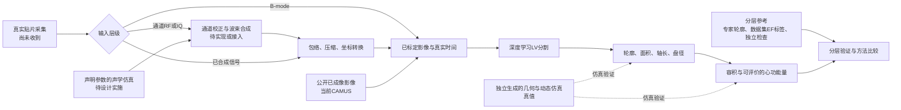

# 贴片采集—成像—解剖—心功能研究设计

更新于2026年11月21日。依据作者本轮澄清，本文取代此前讨论稿中以“解剖与时序量化”为起点的主线建议，不改变冻结审阅、历史实验或现有图件。

## 1. 作者确认的研究主线

**贴片采集 → 波束合成与成像 → 深度学习解剖量化 → 中间测量指标 → 心功能估计 → 独立参考验证。**

研究目标是检验这一处理链能否支持准确、可重复的心功能测量，并在真实完整记录上支持连续监测。当前尚未收到真实贴片数据，设备输出层级和参数待确认。公开数据先承担能够实际支持的模块验证，仿真用于建立可控实验及其已知真值，真实贴片承担后续完整链验证。

现阶段保留作者原题“基于贴片式超声探头的心脏功能参数连续监测与分析”。这是研究目标，不是现有CAMUS实验已经完成贴片连续验证的结论。具体方法贡献仍需由算法设计、文献核查和公平对照建立，不预先给未实现模块命名。

| 统一术语 | 本项目中的含义 | 使用约定 |
|---|---|---|
| 通道RF／通道IQ | 按阵元及发射事件保存的射频／复基带信号 | 具有成像所需元数据后，进入相应波束合成分支 |
| 已合成IQ | 已聚焦到图像网格的复数数据 | 核验已有处理后取包络、压缩和必要的扫描转换，不默认再次聚焦 |
| B-mode | 已成像的超声灰度图像 | CAMUS在此层接入，不能恢复为真实通道回波 |
| 解剖量化 | LV腔轮廓及有独立依据的解剖轴／位置测量 | 目前轮廓派生点仍称代理点，不称人工解剖真值 |
| 独立参考 | 不由待评价预测结果或同一几何流程生成的对应参考 | 分别记录测量方法、时间、对象和配对关系；不由文件名认定独立性 |
| 仿真真值 | 由显式生成模型确定的几何、时间或声学参数 | 只作为仿真实验真值，不填入真实患者缺失参考列 |

## 2. 三条证据分支及接入位置

图中未收到或未实现模块保持明确标记。声学仿真还需单独将散射体／几何描述转换为通道信号，图中的连接不是已实现功能。公开影像不经过虚构的波束合成步骤；若只有图像退化实验，应称图像扰动或数据增强，不称声学通道仿真。

| 证据分支 | 现在能做什么 | 不能替代什么 | 当前状态 |
|---|---|---|---|
| 公开CAMUS影像 | ED/ES分割、原坐标测量、半序列中间指标、同法轮廓一致性及标签EF比较 | 波束合成、完整逐搏验证、贴片佩戴实测 | 已有冻结基线，后续开发限定训练／验证资料 |
| 其他公开完整周期／原始通道数据 | 在确有数据、标注、时间或采集元数据时，补对应模块验证 | 不自动同时提供心脏、贴片、独立容积与完整周期证据 | 候选资源待核验及获取，不计为现有资产 |
| 几何／动态仿真 | 独立已知容积、虚拟解剖点和规定时序下的算法验证 | 临床参考、真实运动或佩戴有效性 | 仅方案，未生成数据 |
| 声学仿真 | 明确前向模型下的通道信号、成像比较及误差传递 | 真实贴片声场、实测散斑或临床迁移表现 | 仅方案，工具与参数待定 |
| 真实贴片与独立参考 | 全链路、域迁移、完整周期和独立功能验证 | 当前尚不存在可报告的结果 | 资源预计可得，尚未收到 |

## 3. 预留输入处理分支

已有[贴片采集与波束合成说明](patch_acquisition_workflow.md)给出传播时间、成像处理与原实现边界。新增[输入记录模板](templates/patch_record.template.yaml)用于采集方交接信息，不是可以直接运行的训练配置，也不表示已经接入文件解析器。

| 输入层级 | 预留处理方法 | 继续处理前需要的信息 | 信息缺失时 |
|---|---|---|---|
| 通道RF | 文件解析与通道校正 → 按发射模型DAS基线 → 合成后包络／压缩 → 必要时扫描转换 | 通道映射和阵元坐标、发射事件和时序、采样率／采样起点、声速假设及校正 | 保留原文件及原因，不猜测传播延迟或生成伪成像 |
| 通道IQ | 按设备IQ约定的相位补偿与波束合成 → 幅值／压缩 | RF分支相关信息，另需解调频率、相位与时间参考 | IQ约定不明时暂停该分支，不当作普通灰度或RF |
| 已合成RF／IQ | 核验聚焦与复合步骤 → RF解析包络或IQ幅值 → 压缩／扫描转换 | 图像网格、信号表示、已做处理、动态范围和时间分组 | 不重复执行未知的合成或压缩 |
| 包络／B-mode图像 | 保留原数据与尺度 → 声窗／坐标核验 → 模型预处理 | 空间映射、方向／切面、强度定义、原始帧时间 | 可做范围受限的图像检查；无标定不输出mL，无可靠时间不输出HR／CO |
| B-mode视频 | 解码 → 保留原帧及时间映射 → 同上 | 核实采集时间与容器时间是否一致，丢帧／复合窗口 | 播放FPS不直接视作采集帧率；缺口保留 |

后续算法的公共入口应是“影像＋物理坐标＋时间＋来源与处理记录”，而不是仅替换一个训练文件夹。柔性阵列弯曲状态、不同切面、强度域和采集方式变化时，需要重新核验成像与模型适配。是否重训、微调或直接使用冻结模型，在贴片开发受试者上判断；最终测试受试者隔离。

## 4. 中间指标与参考层级

| 层次 | 拟输出 | 对应验证 | 当前限制 |
|---|---|---|---|
| 成像 | 已知目标位置、点扩散函数、轴向／横向分辨率、合适条件下的对比度 | 点靶／仿体、声明前向模型的仿真或可信重建 | CAMUS灰度不能验证通道波束合成 |
| 解剖 | LV轮廓、面积、轴长、代理盘径剖面；有人工点后再验证解剖点 | 专家轮廓、人工点或独立虚拟几何点分别评价 | 代理点误差不冒称真实解剖定位精度 |
| 动态形态 | 实测有效帧上的面积／长度／直径和容积过程 | 中间帧标注、完整周期参考或独立动态仿真 | 当前CAMUS仅半序列，缺失时段不补造 |
| 心功能 | EDV、ESV、SV、LVEF；满足条件后才有HR／CO | 同法轮廓、数据集EF标签、仿真真值、独立检查分开 | 同法参考不升级为临床容积标准；所有口径各报n |
| 连续可用性 | 有效覆盖、相位正确性、重复性、变化跟踪与延迟 | 真实完整记录、独立参考时点及实际运行日志 | 程序有输出不等于测量有效 |

HR／CO在当前CAMUS患者结果中继续为null并记录原因。即使未来在仿真中规定了周期和流量，也只能报告对应的仿真检验，不能据此补出真实患者HR／CO或增加临床验证样本数。

## 5. 仿真怎样补充真值

仿真适合补齐“某个模块在已知条件下是否正确”的实验。缺失的真实患者标签仍保持缺失，另建立独立的仿真样本、编号、划分与结果表。不得用待评价几何算法输出充当仿真容积真值，再用同一算法证明自身正确。

| 仿真实验 | 真值的独立来源 | 重点检验 | 必须披露的假设 |
|---|---|---|---|
| S-G 几何与标定 | 已知三维形状的解析体积或独立高精度体素积分，虚拟心尖／基底 | 面积、轴长、20盘离散积分、标定与裁剪变换 | 理想形状不等于真实LV；不能只采用恰好满足面积—长度公式的椭球 |
| S-T 动态与周期 | 显式三维运动模型、规定时间轴及逐帧真实体积 | 相位、完整周期、幅度和响应、丢帧／缺口处理 | 不反射CAMUS半序列；规定运动不等于实测生理过程 |
| S-A 声学与成像 | 已知散射体／目标位置、阵列和发射模型；前向模拟产生通道信号 | DAS与待明确成像方法的聚焦、空间标定及计算代价 | 工具、版本、声速、边界、衰减、噪声与散射假设全部记录 |
| S-E 模块误差传递 | 保持同一虚拟对象及真值，控制成像／几何扰动 | 成像差异是否影响解剖测量与最终功能量 | 区分前向真值与重建假设；不得让重建程序直接访问真值 |

优先顺序为S-G，再按可用工具开展S-A；S-T用于完整周期算法的独立工程验证，S-E在前述模块可运行后接通。点靶实验不必先训练分割网络；几何实验不必等待真实贴片。声学工具尚未选定或运行，本轮不把任何生成图像称为已完成的声学结果。

几何仿真应同时覆盖满足和偏离估算假设的形状。以椭球为解析校验例时，真实体积可用三维定义计算；这只证明理想条件下的公式与单位实现。复杂形状须用与待评价二维估算法不同的独立体积计算。训练与测试不得仅使用同一个三维对象的不同噪声帧；按基础几何／运动对象划分，并另设未参与调参的条件。

声学仿真先选择一个明确标为“通用仿真设置”的参数组，不能用别篇论文的硬件参数冒充本贴片。尽量采用不同的前向／重建实现，并主动检验声速、阵列形变、切面缩短和噪声失配，避免模型假设完全一致造成过于容易的验证。动态声学仿真还需声明散射体运动与时序相关性；逐帧重新加随机噪声不能替代真实运动散斑建模。

每次仿真保存生成配置、随机种子、前向和重建版本、原始信号、真值、处理日志与校验和。仿真条件、虚拟对象、噪声重复及帧数分别计数，不把它们当成独立患者。数据增强参与训练时单独记录，不能同时称为未暴露测试。

## 6. 公平对照与主要终点

波束合成的候选对照先保留可解释的DAS；改进成像方法和改进解剖方法尚未明确，不凭空填入模型名称。对照应沿整条链追踪收益，避免只挑有利成像图或只报告Dice。

若未来同时研究成像与解剖方法，可采用以下成对设计，具体方法确定后再冻结协议。

| 对照组 | 成像 | 解剖／量化 | 回答的问题 |
|---|---|---|---|
| A | DAS基线 | 冻结基线 | 完整基准 |
| B | 候选成像方法 | 与A相同的冻结基线 | 在相同下游模型下，成像方法带来什么变化 |
| C | 与A相同的DAS | 候选解剖／量化方法 | 在相同成像下，下游方法带来什么变化 |
| D | 候选成像方法 | 候选解剖／量化方法 | 组合是否获益，是否存在相互作用 |

各组使用相同原始采集、相同有效对象及参考口径，缺失与拒绝片段一并报告。若研究的是各成像域分别训练后的最佳组合，应另列实验，并保持受试者划分、标注预算、调参预算和评价协议一致，不能与冻结模型实验混为成像单因素收益。当前CAMUS没有原始通道信号，无法执行A／B的真实声学对照。

最终独立参考下的LVEF准确性仍保留为主要终点候选，尚未得到作者明确确认。容积、SV、连续变化跟踪与覆盖等终点按实际参考资源和临床用途选定；不因缺参考而换成仿真终点后宣称完成临床验证。接受界值、采集规模与样本量在先导资料和参考重复性明确后确定。

## 7. 按主线重排的图表候选

正文暂保留4图2表预算。以下为新一轮候选清单，含尚无数据的目标面板，不覆盖已有已确认图，也不把空白部分用仿真冒充实测。参考结构来自[既有逐图核查](../figures/planning/literature_breakdown.md)，不是新完成的文献检索。

| 项目与拟定标题 | 参考结构 | 子图与资产 | 核心信息、状态及位置 |
|---|---|---|---|
| Fig.1 从采集到独立验证的全链路 | Hu 2023 Fig.5a、SI Fig.15 | a采集输入分支；b波束合成／深度学习；c中间量→功能；d三类数据及参考层级。复用原Fig.1流程资产 | 说明各模块怎样连接。✅ 可先画带状态的研究框架；设备实物及真实结果❌未收到。正文P0 |
| Fig.2 成像与解剖可测性 | Hu Fig.2、ED Fig.6 | 2×2分区，成像／已知靶验证、轮廓定性与患者级分割；复用Fig.2和R1，新增仿真声学部分独立标识 | 成像能否支持边界和测量。CAMUS分割✅；声学／几何验证⚠️需新计算；真实贴片❌。正文P1 |
| Fig.3 从左室形态到中间指标的动态量化 | Hu Fig.5b、ED Fig.7，仅借鉴过程组织 | a轮廓与解剖轴；b直径热图或已认可配色曲面择一；c面积／轴长／容积过程；d独立几何或动态仿真验证。复用R1／R2／R3和真实半序列 | 解释功能参数从何而来。观测半序列✅；新几何／仿真⚠️；完整佩戴过程❌。正文P1 |
| Fig.4 心功能估计与独立参考验证 | Ouyang 2020 Fig.2a、Hu Fig.5c | 2×2，标签EF散点、一致性、同口径方法比较及真实独立参考／连续配对；当前与未来证据分开成版，不留伪结果面板 | 回答最终功能量是否可靠。CAMUS标签EF✅；同法容积仅另分面；独立贴片❌，方法比较⚠️。正文P1 |
| Table 1 数据、采样与参考来源 | 现有Table 1统计结构 | 公共队列、仿真条件、未来贴片队列分别列出；各用真实统计单位 | 当前可核实部分✅；仿真及贴片待补。缺失信息说明原因，不填零值特征行。正文P1 |
| Table 2 分层功能终点与方法结果 | 现有Table 2／Table S1统计规范 | 同法轮廓、数据集标签、仿真真值、独立参考分区；n、单位、区间和覆盖 | 防止混用参考。现有统计✅；新方法／仿真／独立参考⚠️或❌。正文P1 |
| Fig.S-G 独立几何真值与标定验证 | 新实验设计，不虚构对应参考图 | 真值形状、坐标变换、不同形状的容积及虚拟点验证 | ⚠️待生成和核验，补充P0；若改变核心测量结论则相关证据进入正文 |
| Fig.S-A 波束合成条件与下游测量 | Hu Fig.2、ED Fig.2，仅借组织方式 | 成像条件→空间指标→同一对象解剖／功能变化 | ⚠️待通道仿真或真实原始数据，补充P1 |

低分、失败、宽一致性限和改变结论的测量限制保留必要正文呈现。更完整的分层、消融、误差诊断、版本溯源与效率明细放补充材料；同一数据的曲面和热图不重复计算验证次数。若后续波束合成本身构成独立核心贡献，可再讨论是否增加正文图，而非现在凑面板。

## 8. 近期执行顺序与停止点

1. 先确认本轮图表清单及优先模块，不要求作者现在提供未知设备参数。
2. 用训练／验证资料明确几何测量定义，并完成独立已知形状验证；保留当前冻结基线。
3. 在单独仿真实验中明确前向模型、真值与比较方法，先试运行可检查的小规模样本，再冻结正式条件和分析。
4. 公共数据继续推进成像后的链路；完整周期或通道公开数据先核验可用范围、许可和预训练重叠，再决定是否引入。
5. 真实贴片到位后填入输入模板，核验成像、标定和时间；建立受试者级开发／测试隔离，再决定模型适配并完成独立参考验证。

当前没有生成新仿真、训练新模型或改写旧图。图表仍按每批1–2张、每批确认推进。此次先交付研究设计与接口预留，待新清单确认后再开展对应实现和一轮更新。
