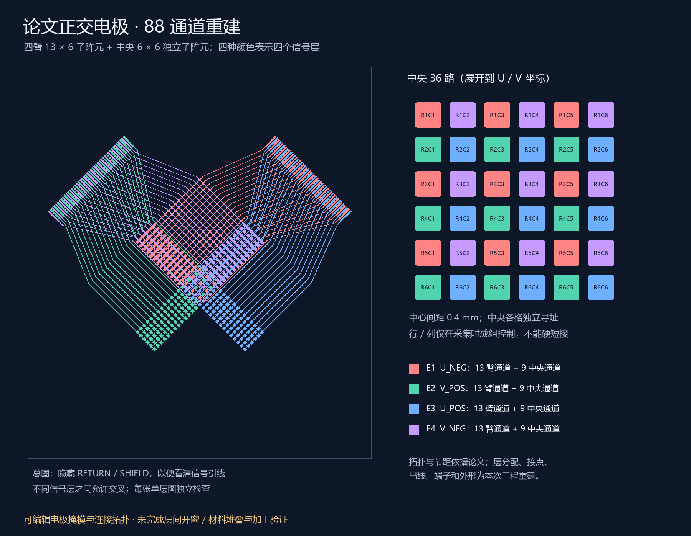

# 论文正交 88 通道电极重建

打开 [orthogonal88.kicad_pro](orthogonal88.kicad_pro)，进入 PCB 编辑器查看总图，进入原理图编辑器查看电气连接。适用 KiCad 10.0.8。



这是依据 Hu 等 Nature 2023 主文 Extended Data Fig.1、Methods 与补充 Discussion 3.1 / Fig.6 建立的**拓扑与掩模布局重建**。论文未附原始 CAD、逐线坐标、完整端子表，因此本工程没有宣称恢复作者原版加工文件。详细来源、参数边界和手动操作见 [中文复现说明](../../../docs/hardware/03_论文正交88通道复现.md)。

另附[中文说明 PDF](../../../docs/hardware/documents/03_论文正交88通道复现.pdf)和[中文 KiCad 实际界面截图](exports/kicad_chinese_view.png)。

## 文件

- `orthogonal88.kicad_pcb`：四层信号电极、公共返回电极和屏蔽层的总图。User.2 是子阵元轮廓，User.1 是本工程端子编号。显示信号时可隐藏 LM_RETURN / LM_SHIELD。
- `orthogonal88.kicad_sch`：88 个信号接点、2 个返回/屏蔽接点，以及 5 个子页中的 348 个压电子阵元。两端被动符号表达连接关系，没有捏造压电等效电路参数。
- `masks/E1…E4.kicad_pcb`：四张独立信号掩模；每张用 F.Cu 表示一层液态金属图案。
- `masks/RETURN.kicad_pcb`、`masks/SHIELD.kicad_pcb`：公共返回与接地屏蔽的外形示意，含假定的键合接点。
- `channel_map.csv`：88 路通道、图层与本工程端子号；`geometry.json`：接点、引线、压电元件位号的完整关联。
- `logical_axis_groups.json`：U / V 各 32 个逻辑阵元的通道组。中央行/列分组是采集控制关系，**不是永久短路**。
- `exports/`：六层 SVG、毫米制 DXF、总图 SVG、六页原理图 PDF、原始 ERC/DRC、XML 网表及审核结果。

每个信号掩模有 13 × 6 + 9 = 87 个子阵元接点，另有 22 个输出接点。四层共 348 个子阵元接点和 88 个信号输出。输出分为两个斜向接点组；每层接点间距 0.4 mm，两层错位后投影间距 0.2 mm。它不是一个已选型的标准连接器，层间接点的最终露出与键合结构尚未设计。

## 图层约定

| KiCad 标识 | 显示名称 | 本工程含义 |
|---|---|---|
| F.Cu | LM_E1 | U_NEG 的 13 路 + 中央 9 路 |
| In1.Cu | LM_E2 | V_POS 的 13 路 + 中央 9 路 |
| In2.Cu | LM_E3 | U_POS 的 13 路 + 中央 9 路 |
| In3.Cu | LM_E4 | V_NEG 的 13 路 + 中央 9 路 |
| In4.Cu | LM_SHIELD | 接地屏蔽示意 |
| B.Cu | LM_RETURN | 公共底返回电极示意 |

这六个 KiCad 铜层用于存储独立掩模，不表示论文的真实物理层序、介质厚度或普通 FR4 六层板。返回电极在压电材料另一侧，屏蔽层在器件外侧，不能把 KiCad 的层表当作完整器件剖面。

文件中的 1.6 mm 板厚是 KiCad 默认占位值，不是论文器件厚度；3D 预览也不能用于读出真实材料厚度。

## 检查与限制

网表审计：88 信号通道、348 子阵元、89 网络、438 个符号，RETURN 含 350 个引脚节点；每方向 32 个逻辑阵元。ERC 0；六张单层图 DRC 0、未连接 0。总图 DRC 0 错误、199 个 `isolated_copper` 警告，原始报告未屏蔽：内层接点使用无常规焊盘锚点的铜区，独立单层图负责电气连接审核。总图显示的未连接 0 不能用于证明真实层间互连。

另行检查四层所有引线到其他通道接点开窗投影的距离，最小 0.035 mm，超过本工程的 0.03 mm 间距。这只检查名义二维几何，没有验证激光开窗深度、对位公差、SEBS 绝缘厚度、键合和可靠性。

**不能用 F8 将原理图同步为这张掩模总图。** 符号被设为不进入 PCB；总图采用铜区抽象，独立掩模中的接点也不是普通器件封装。没有宣称通过原理图与 PCB 常规封装一致性检查。未提供可直接下单的 Gerber 或普通通孔替代物。

## 重建和复查

在项目根目录，先用普通 Python 生成布局清单，再用 KiCad 自带 Python 构建；会覆盖本目录生成文件，修改练习请先复制到其他工程。

```powershell
python hardware/tools/build_orthogonal_patch.py plan
& "$env:LOCALAPPDATA/Programs/KiCad/10.0/bin/python.exe" -u hardware/tools/build_orthogonal_patch.py build
powershell -NoProfile -ExecutionPolicy Bypass -File hardware/tools/check_orthogonal_patch.ps1
python hardware/tools/render_orthogonal_preview.py
```

预览图需要 Pillow。其余规划与网表审计仅需 Python 标准库，构建需要 KiCad 的 `pcbnew`；检查脚本默认 KiCad 安装于当前用户目录，可用 `-KiCadBin` 指定其他位置。
