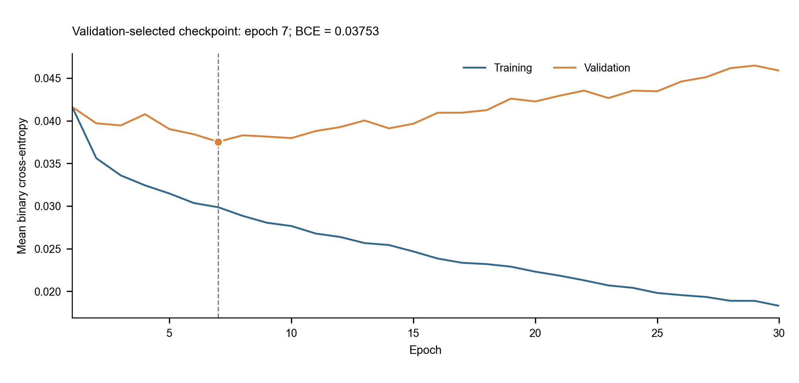
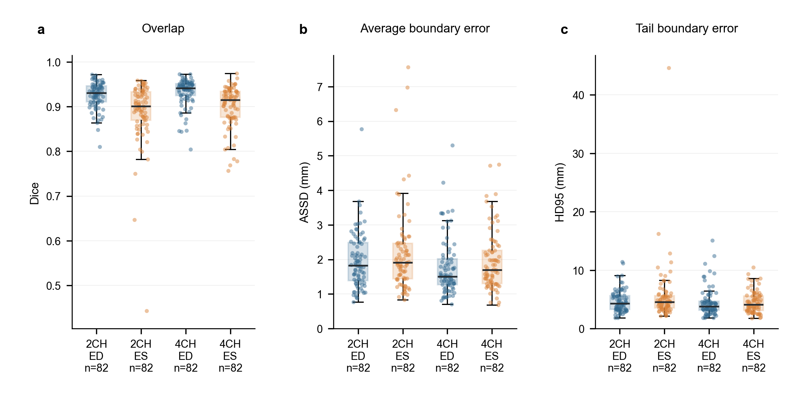
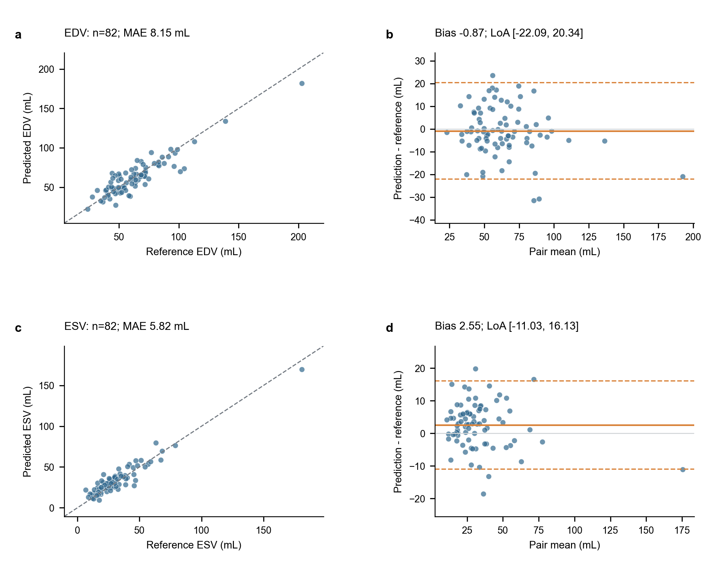
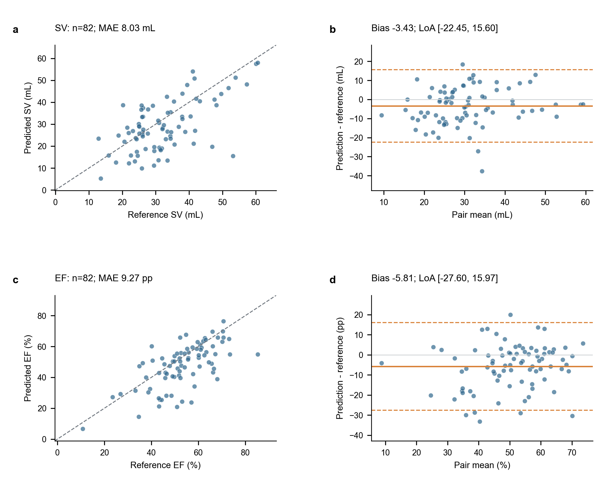
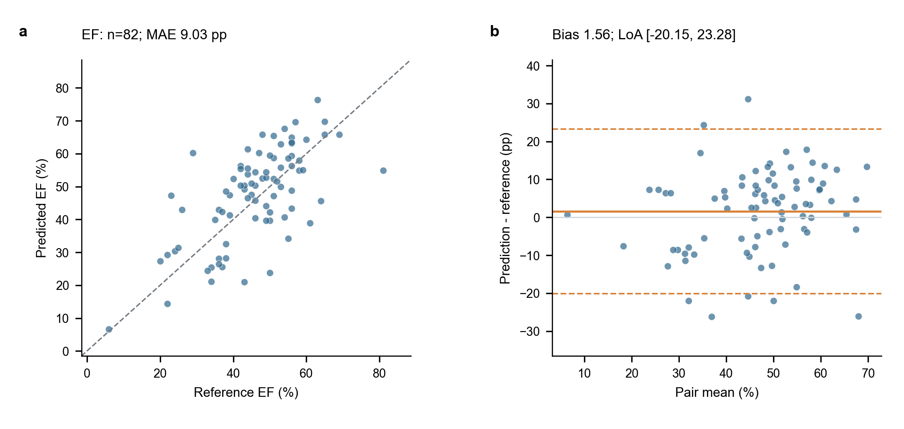
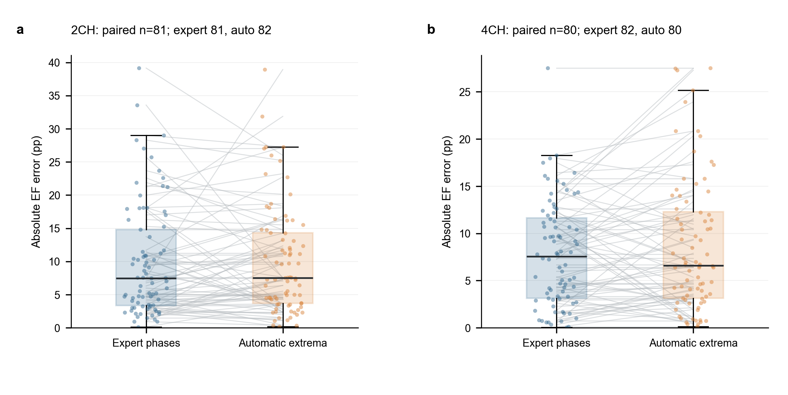
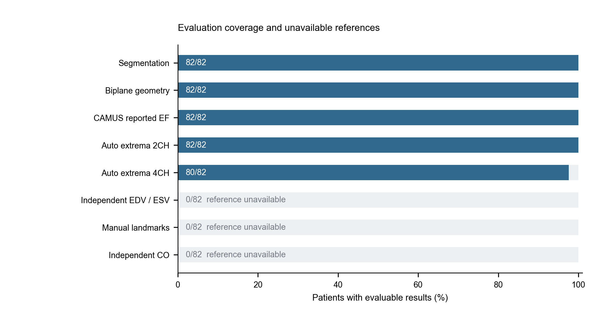
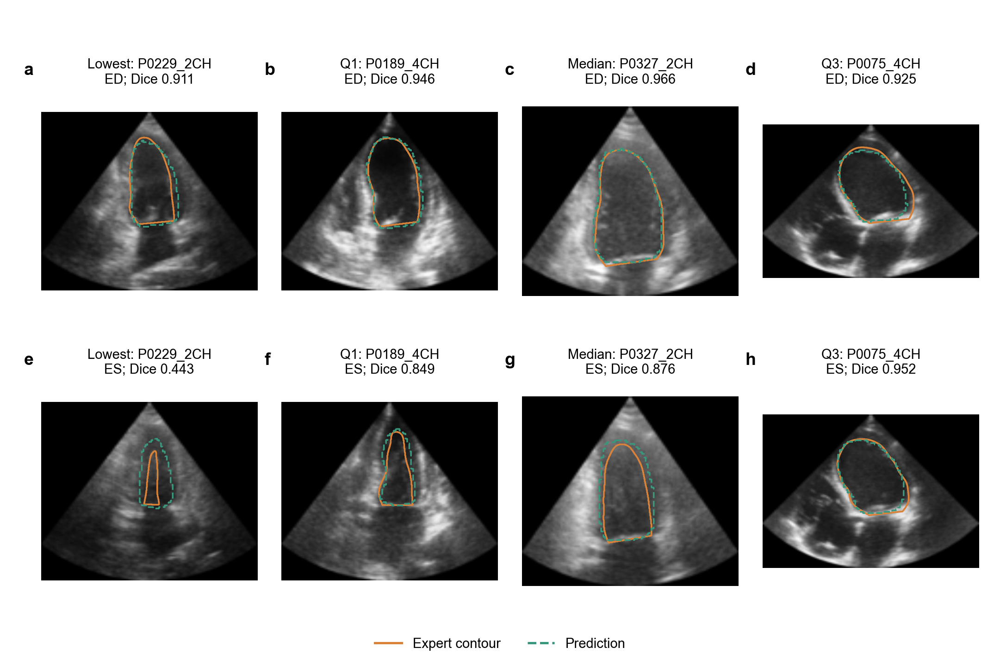
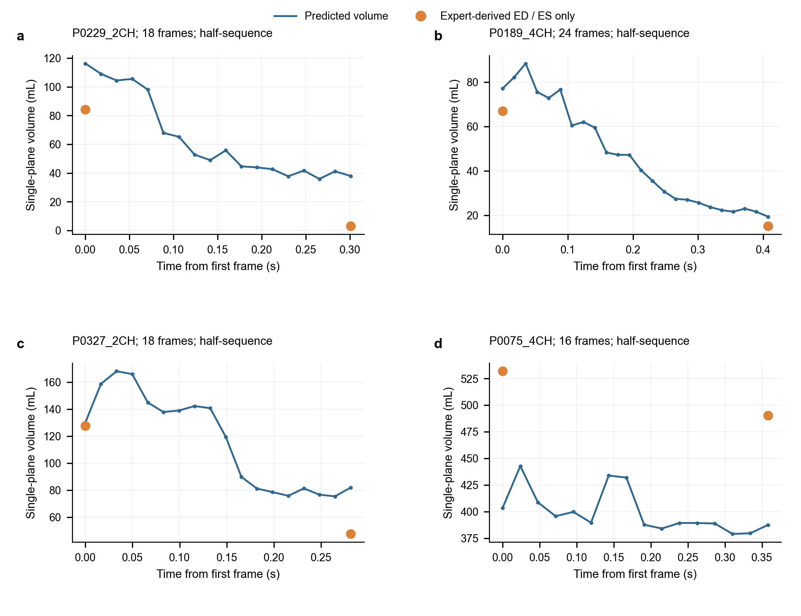
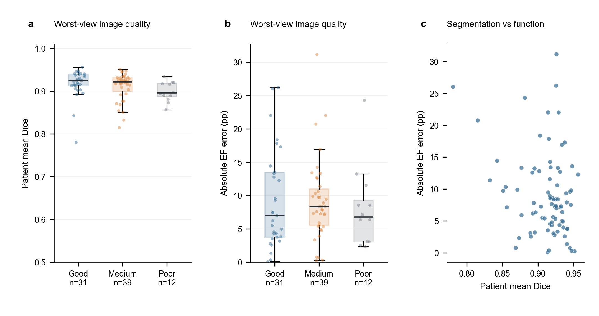

# CAMUS 结果分析与图件解读

## 固定实验与主要结果

本报告只使用 `camus_cuda_progress` 及匹配训练记录。测试权重 SHA256：`b0e8b724ca453c4801fb651163ad0353cec495c0a8d745ada1dbab9067b607c9`。没有重跑训练、调节测试阈值或混入历史 full_baseline 结果。测试 82 位患者、164 个切面、328 张专家标注帧，失败切面 0。

- 验证 BCE 最低轮次：7，值 0.03753。训练后期出现训练/验证损失分离，应使用验证选择的检查点。
- 患者平均 Dice：0.9119；ASSD：1.963 mm；HD95：4.811 mm。
- 双平面 EF 对 CAMUS 报告 EF 的 MAE：9.032 个百分点，患者 bootstrap 95% 区间 [7.632, 10.476]；偏倚 1.561 个百分点；描述性一致性界限 [-20.153, 23.276]。
- 这同时说明分割重叠较高与功能误差仍然明显可以共存。需要检查基底/心尖、长轴、几何假设与选相位，不能只用 Dice 评价整条链。
- 完整心搏数：0；人工点和独立 CO 参考仍缺失。没有据此绘制 HR、CO、数分钟连续曲线或声称临床等效。

## 关键结果如何解读

| 参考来源 | 指标 | 患者数 | MAE | 偏倚：预测减参考 | 描述性一致性界限 |
|---|---|---:|---:|---:|---|
| 专家轮廓经同法计算 | EDV | 82 | 8.15 mL | -0.87 mL | [-22.09, 20.34] mL |
| 专家轮廓经同法计算 | ESV | 82 | 5.82 mL | 2.55 mL | [-11.03, 16.13] mL |
| 专家轮廓经同法计算 | SV | 82 | 8.03 mL | -3.43 mL | [-22.45, 15.60] mL |
| 专家轮廓经同法计算 | EF | 82 | 9.27 pp | -5.81 pp | [-27.60, 15.97] pp |
| CAMUS 报告 EF | EF | 82 | 9.03 pp | 1.56 pp | [-20.15, 23.28] pp |

图 3–5 显示，接近零的平均偏倚可以与较宽的个体差值分布同时存在。两种 EF 参考对应的偏倚不同，说明参考定义会影响结论，不能交换命名。图 1 的验证损失最低点已用于选模，之后的训练/验证分离不能由继续训练的低训练损失抵消。

图 6 的 2CH 共同有效患者 n=81：专家相位与自动极值的平均绝对 EF 误差分别为 9.93、10.06 个百分点；配对平均变化为 +0.14 个百分点。这是当前半周期内的探索性比较，不等同于完整心搏定位或经过独立验证的自动相位识别。

图 6 的 4CH 共同有效患者 n=80：专家相位与自动极值的平均绝对 EF 误差分别为 7.82、8.66 个百分点；配对平均变化为 +0.84 个百分点。这是当前半周期内的探索性比较，不等同于完整心搏定位或经过独立验证的自动相位识别。

图 8–9 应联合阅读：最差切面的 ES 轮廓明显失配；另有较高 Dice 的切面仍显示很大的单平面容积与参考差值。这些数值是当前算法输出，不能解释为患者真实心室容积或疾病诊断。面积–长度法含面积平方及长轴分母，而双平面法依赖长轴与盘径；PCA 轮廓关键点尚无人工点验证，共享几何参考也可能共享系统误差。应在新训练/验证研究中复核空间标定、长轴与心尖/基底定位，当前图集保留异常值。

图 10 的质量分层和 Dice–EF 误差关系仅作探索。质量组数不同、样本较少，也没有混杂校正，不能据散点或箱体重叠作因果、显著性或质量无影响的结论。图 7 的 100% 可计算率也不等于临床合格率。

## 全部图件及可直接使用的中文图注

### 01_training

图 1｜训练和验证损失。训练集 347、验证集 71 位患者；最小验证 BCE 出现在第 7 轮（0.03753）。虚线和圆点标识验证选模轮次。后期训练损失继续下降而验证损失上升，提示过拟合。这是单次运行的实测记录，不显示虚构的重复实验区间，也没有使用测试损失选模。

### 02_segmentation

图 2｜切面和相位分层的左室分割性能。每组最多 82 位患者，每个点是一位患者在该切面/相位上的一张标注帧。全部有效观测均显示；箱体为四分位范围，横线为中位数，须延伸至 1.5×IQR 范围内的最远点。ASSD 和 HD95 在原始坐标、原始像素间距下计算，单位 mm；非毫米或不可定义的边界距离不混入。四组来自相同患者，不是四个独立队列。

### 03_volume_agreement

图 3｜EDV、ESV 的患者级一致性。参考为专家 ED/ES 轮廓经过相同双平面几何法计算的参考值；它不是独立临床容积真值。每点一位患者；左侧虚线为恒等线。右侧为 Bland–Altman：横轴为预测/参考均值，纵轴为预测减参考，橙实线为偏倚，橙虚线为偏倚±1.96×患者差值样本标准差。EF 的误差单位为百分点 pp，EF 水平单位为 %；这些描述性界限不是预先定义的临床等效界值，也不是逐搏重复测量界限。MAE 的患者 bootstrap 95% 区间、n 和全部配对数据见 source_data。

### 04_function_agreement

图 4｜SV、EF 的患者级一致性。参考为专家 ED/ES 轮廓经过相同双平面几何法计算的参考值；它不是独立临床容积真值。每点一位患者；左侧虚线为恒等线。右侧为 Bland–Altman：横轴为预测/参考均值，纵轴为预测减参考，橙实线为偏倚，橙虚线为偏倚±1.96×患者差值样本标准差。EF 的误差单位为百分点 pp，EF 水平单位为 %；这些描述性界限不是预先定义的临床等效界值，也不是逐搏重复测量界限。MAE 的患者 bootstrap 95% 区间、n 和全部配对数据见 source_data。

### 05_reported_ef

图 5｜EF 的患者级一致性。参考为CAMUS Info.cfg 记录的 EF；它与同法轮廓参考分开评价，不称为独立前瞻临床金标准。每点一位患者；左侧虚线为恒等线。右侧为 Bland–Altman：横轴为预测/参考均值，纵轴为预测减参考，橙实线为偏倚，橙虚线为偏倚±1.96×患者差值样本标准差。EF 的误差单位为百分点 pp，EF 水平单位为 %；这些描述性界限不是预先定义的临床等效界值，也不是逐搏重复测量界限。MAE 的患者 bootstrap 95% 区间、n 和全部配对数据见 source_data。

### 06_phase_selection

图 6｜专家相位与自动极值选相位的 EF 误差配对比较。灰线连接同一患者；参考均为该切面专家 ED/ES 轮廓经单平面面积–长度法计算的 EF。仅在两种方法都有效的患者上比较，完整可用数和配对数写在标题。因此有意排除不能成对的患者，并在 source_data/coverage.csv 保留方法总覆盖数。自动相位只在现有半序列内寻找 ED 后的 ES，不能解释为完整周期识别。未进行显著性检验。

### 07_coverage

图 7｜有效评价覆盖率。分母为全部尝试测试患者；条内标注有效数/尝试数。独立临床容积、人工关键点和独立 CO 的零覆盖意味着没有参考标签，不代表零误差或测量准确。几何可计算率不等于经人工确认的临床有效覆盖率。

### 08_examples

图 8｜预先声明排名规则选择的失败与典型病例。对全部测试切面按 ED/ES 平均 Dice 排序，选择最差、25%、50%、75% 位置（排序稳定，见 example_selection.csv）；并非随机抽样或独立成功率证据。上排 ED，下排 ES；橙实线为原始专家轮廓，绿虚线为本轮预测掩膜恢复后的轮廓。图像为已有 112×112 处理帧重采样至原始显示坐标，不是恢复出原始图像细节；原始专家标签没有缩放后再充当真值。显示范围按物理空间补至方形，保留横纵比例；图中所有 Dice 均在原始标签上重新核对。

### 09_half_sequences

图 9｜与图 8 相同病例的原始半周期单平面容积预测。横轴在元数据支持时使用由 Info.cfg 帧率推导的时间，并非设备原始采集时间戳。蓝线为本轮逐帧预测，断点保留无效/缺失帧；橙点仅在专家 ED/ES 帧上，由专家轮廓经相同单平面公式计算，不连接或插值成中间真值。保留原始帧序，不反转、反射或拼接成完整心搏。不同病例独立，不连接成长期趋势；不推导 HR/CO。

### 10_error_associations

图 10｜患者级探索性误差关联。每位患者的图像质量按其两个切面中较差等级汇总（Good<Medium<Poor），Dice 为该患者全部标注帧的平均，EF 误差对 CAMUS Info.cfg EF 计算。各患者仅计一次。箱线图定义同图 2；右图用于检查分割重叠和功能误差是否一致变化，不进行因果推断或显著性筛选。质量等级不平衡和几何假设都可能影响结果；高 Dice 不能自动证明 EF 准确。

## 排除、缺失与统计说明

定量图未按美观删去极端值。定性图只显示按公开排名规则选出的示例；这不影响总体统计。

每图统计源于同一实验。箱线图保留全部有限点，不把缺失值补零。MAE 区间用 2,000 次患者 bootstrap、固定种子 2026；与历史摘要的 1,000 次 bootstrap 次数不同，点估计和患者数逐项核对，不能要求随机区间末位完全一致。Bland–Altman 用患者差值的样本标准差，不把连续帧当独立样本；界限未附临床合格阈值。所有关联均为探索性，不反馈为测试集模型选择。图像质量来源于 CAMUS 元数据，不是新训练的质量分类器。

原始数据完整下载未在本次重新验证；预处理全量状态来自既有记录，实际绘图仅核查使用到的病例缓存。训练完成状态、测试计数、权重一致性和绘图输入 SHA256 分别保存在 analysis_manifest.json。该记录不表示已经在当前重构后的代码上重新跑完模型实验。

## 署名与许可

图中超声图像源自 CAMUS。S. Leclerc et al., Deep Learning for Segmentation Using an Open Large-Scale Dataset in 2D Echocardiography, IEEE TMI 38, 2198–2210 (2019), DOI: 10.1109/TMI.2019.2900516。CAMUS 为 CC BY-NC-SA 4.0；含该数据图像的派生图件应保留署名、非商业与相同方式共享条件。官方 EchoNet 代码采用 MIT；不将该代码许可误写为 CAMUS 数据许可。
