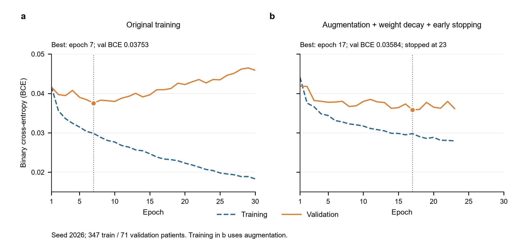

# CAMUS 训练过拟合：处理结果与证据边界

本次加入训练期同步增广、AdamW 权重衰减和验证损失早停后，最低验证 BCE 从 **0.037530 降至 0.035836（下降 4.51%）**；验证分割指标略有改善。新模型在第 17 轮取得最低验证损失，第 23 轮早停。结论是本次运行的过拟合得到缓解，尚不能声称彻底消除或所有心功能指标均改善。



矢量稿：[PDF](training_comparison.pdf)、[可编辑 SVG](training_comparison.svg)。完整图注见 [training_comparison.caption.md](training_comparison.caption.md)。

## 原实验的问题

比较对象为 `camus_cuda_progress` 与 `camus_regularized`，不是历史 `full_baseline`。原实验第 7 轮最低验证 BCE 为 0.037530；到第 30 轮，训练 BCE 降至 0.018294，验证 BCE 升至 0.045882，比最低值高 22.25%。这是训练拟合继续加强、验证表现恶化的实际记录。

原流程本来就按验证损失保存 `best.pt`，因此原来的最佳权重对应第 7 轮，并非最后一轮。新增早停主要避免在验证表现不改善时继续优化；本次最佳验证损失的额外降低来自正则化组合实验。尚未做单因素消融，不能把改善全部归功于其中某一项。

模型容量相对于独立患者数较大、训练中缺少外观/几何变化及持续优化，是合理的可能因素；现有两次训练不足以证明各因素的独立因果作用。

## 实际改动

1. **只对训练帧做在线同步增广。** 图像与左室掩膜共享同一随机仿射变换，图像双线性插值、掩膜最近邻插值，掩膜保持二值。旋转 ±5°；采样尺度 0.95–1.05；亮度增益 0.9–1.1。`translation_fraction=0.04` 使用 `affine_grid` 的归一化坐标，实际位移约为宽/高的 ±2%；显示缩放是采样尺度的倒数。原始 ED/ES 数组和预处理坐标审计不被改写。
2. **AdamW 的 `weight_decay` 从 0 改为 0.0001。** 学习率保持 0.0001，batch=8，随机种子=2026，最多 30 轮，冻结 BN 运行统计的策略保持一致。
3. **按验证 BCE 早停。** `patience=6`、`min_delta=0.0002`；连续六轮未达到累计改善阈值便停止。最佳权重仍按所有轮次的实际最低验证 BCE 保存，即使改善小于 `min_delta` 也保存；早停阈值不会吞掉小幅最佳改进。

验证/测试不做随机增广，归一化只从原始训练帧计算，其他集合复用。当前依然是专家 ED/ES 标签上的**监督微调**：没有新增人工标签，没有伪标签或无标签一致性损失，不能称为半监督方法。

## 公平比较与实际结果

固定患者级 train/val/test = **347/71/82**，互不重叠。训练使用 1388 张专家标注帧，验证使用 284 张，测试标注 328 张；其余中间帧没有加入监督损失。两实验训练/验证患者列表、预处理 manifest 和官方初始化权重摘要一致。

预处理 manifest SHA256：`e8603f1862c321c0ece99bbfb34c530e3512ff78ee1b2484c615fcafb08445a6`。

| 训练记录 | 原实验 | 正则化实验 |
|---|---:|---:|
| 最低验证 BCE | 0.037530 | 0.035836 |
| 最佳轮次 | 7 | 17 |
| 实际完成轮数 | 30 | 23 |
| 最后记录的验证 BCE | 0.045882 | 0.036155 |

| 验证分割指标，71 位相同患者 | 原最佳权重 | 新最佳权重 |
|---|---:|---:|
| 患者均值 Dice ↑ | 0.902091 | 0.903628 |
| ASSD，mm ↓ | 2.230120 | 2.131304 |
| HD95，mm ↓ | 5.707634 | 5.310481 |

这只是一次固定种子对照，分割改善幅度有限，未进行多种子重复或显著性检验。新训练损失包含增广，原训练损失不包含；并且训练损失来自一轮内不断更新的参数，验证损失来自当轮固定权重。因此训练/验证损失差只作描述，不能据此定量声称泛化差距减少多少。

### EF 没有一致改善，且覆盖人数发生变化

新模型在验证患者 `patient0039` 上输出的双平面 EDV/ESV 分别为 5.731/9.396 mL，违反 `0 ≤ ESV < EDV`，故 EF 为 null，原因 `invalid_or_missing_EDV_ESV`。该患者仍保留在分割评价中；双平面 EF 的有效覆盖率由 71/71 降为 70/71，不能静默删除后当作全部成功。

按两个模型均有效的**相同 70 位患者**重新配对：

| EF 参考口径 | 原模型 MAE | 新模型 MAE | 单位 |
|---|---:|---:|---|
| 专家 ED/ES 轮廓经同一双平面几何法计算 | 9.3355 | 8.9643 | 百分点 |
| CAMUS `Info.cfg` 报告 EF | 8.2443 | 9.8289 | 百分点 |

原结果摘要按所有可用患者汇总，第一行原 MAE 为 9.3452（n=71），第二行为 8.1352（n=71）；此处配对比较的分母不同，不能混用。全部配对值、遗漏患者及其原因均保留于 `source_data`。同法轮廓参考反映分割误差经几何法传播，不是独立临床金标准。

## 锁定最佳权重后的测试结果

既有最终评价输出来自 `runs/camus_regularized`，与第 17 轮权重摘要一致。本次整理报告只读取已保存结果，没有重跑测试推理，没有用测试分数修改超参数或再选权重。

| 测试指标 | 数值 | 覆盖 |
|---|---:|---:|
| 患者均值 Dice | 0.915195 | 82 位患者 / 328 张标注帧 |
| ASSD | 1.871644 mm | 82 位患者 |
| HD95 | 4.601071 mm | 82 位患者 |
| 双平面 EF 对同法专家轮廓参考 MAE | 8.728427 个百分点 | 82 位患者 |
| 双平面 EF 对 CAMUS 报告 EF MAE | 10.076205 个百分点 | 82 位患者 |

共尝试 164 个切面，失败 0。缺少人工关键点、独立临床容积和独立 CO 参考的评价维持为空及对应原因；半周期不被拼接为完整心搏。结果属于固定自定义划分的研究基线，不能解释为贴片设备上的独立临床验证。

当前权重：`checkpoints/camus_regularized/best.pt`。

SHA256：`59b92018e38e823179a4681aec49e06ca66ecbc418617221b9b2740c2c7e1008`。

## 使用、复现与后续实验

默认配置已指向该正则化训练与测试输出。现有权重可直接用于后续推理；无需重复训练，也不要覆盖已完成实验。需要重复训练时，先复制配置并将训练/测试输出改为新的目录，再运行 `scripts/train.py --config <新配置>`。

曲线可在项目根目录用项目虚拟环境重绘：

```powershell
.\.venv\Scripts\python.exe reports/result_analysis/overfitting/render_curves.py
```

脚本只读取本目录冻结的两份真实训练 CSV。设置 `ECHO_FIGURE_ALIGNMENT_SCRIPT` 指向可用的面板审计器，可复现额外的完整对齐检查；未设置时只执行内置等尺寸检查，不声称已复现全部外部图件审计。

若论文需进一步分析各措施的贡献，可在训练/验证集上预先设计消融和多种子实验：原方案、仅早停、增广加早停、增广加衰减加早停；保持患者划分、初始化来源、训练预算及选模规则一致。测试集已经用于本次最终评价，不能继续用其结果挑选方案；后续贴片数据应按受试者独立留出，另行进行外部验证。

## 检查记录与溯源

- 训练记录来自 2026-11-10 原实验和 2026-11-16 正则化实验。新实验运行时记录的父提交为 `11741ad`，工作区为 dirty；不能将该父提交单独称为本次修改的精确训练源码。权重、实际训练设置、患者列表及原文件 SHA256 已冻结于 `source_data/provenance.json`。
- 2026-11-17 使用项目 `.venv` 完成核心测试，**33 passed**，包括真实短训练、训练专用增广、验证重复读取一致性、原始帧不被改写、二值掩膜同步变换、模型选择和参数记录。
- PNG 两面板已目视检查：所有轮次保留、停止处留白、共同坐标轴、圆点和虚线对应实际最佳轮次。PDF 最小字体 7 pt；面板对齐、PDF 文字碰撞检查见 `qa`，实际碰撞 FAIL/WARN 均为 0。
- 源码预检的 300 dpi 提示对应屏幕预览；另有 PDF/SVG 矢量稿。未指定投稿期刊，不把预览格式称为某期刊已认可的投稿格式。

原始 CAMUS 数据仍遵循 CC BY-NC-SA 4.0；本次没有重新核查完整原始 Release 下载或发布覆盖率，也没有改写已有历史结果图。
