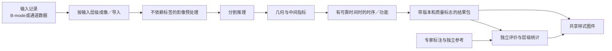

# 已确认研究流程下的代码与公开数据适配审查

审查日期为2026年11月21日，代码基点为ee7cc1d，实际文件版本以[逐文件代码清单](code_inventory.csv)和[审计记录](audit.json)中的SHA256为准。作者已认可“采集→波束合成→深度学习解剖→中间指标→心功能→独立验证”的主线，并要求不符合之处先讨论，再决定是否重塑代码。

**结论是部分符合。CAMUS适合保留为成像后分析基线，现有代码尚不是这条完整研究流程的实现。应补齐数据类型和解耦接口，不能只更换训练目录，也没有依据要求推倒现有训练、分割及坐标恢复代码。** 本轮只审查与提出方案，未修复或重构运行代码。

## 1. 本次实际检查了什么

- 核心src下49个Python文件、scripts下8个入口共3,379行，按数据、配置、训练、模型、几何、时序、指标和输出模块走查。另对12个测试文件、29个绘图／规划脚本及3个样式脚本建立语法、定义和来源清单，共101个第一方Python文件。绘图数值的全量复算沿用冻结审阅中的既有独立核查，本次不重跑绘图。
- 解码全部1,000个缓存，检查图像、二值掩膜、标注帧、原始GT、变换、时间与空间元数据，并验证原始GT最近邻变换后的标签与缓存一致。
- 核对7份训练运行记录、5份评价摘要、当前配置、初始化权重、数据集来源和当前绘图入口。
- 使用明确隔离的软件探针核验无标签入口、标签依赖预处理、时间缺口、未核实FPS和单切面外部参考。探针以人工构造数组和模拟模型调用检验程序行为，不是新研究仿真、医学数据或新模型结果。
- 本地项目检查为39 passed，耗时12.35秒。这包括小型测试网络的优化／结构前向检查，不涉及研究模型重新训练、CAMUS新推理或新的最终测试。

第三方vendor源码未作为本项目自研算法逐行审计。未下载新数据、重新获取原始文件、核验远端Release当前完整性，亦未运行完整原始预处理。这些未完成项不写成已通过或已失败。

## 2. 已获取的公开数据是否符合任务

| 资产 | 本次实际核验 | 适合的任务 | 当前不能承担的任务 |
|---|---|---|---|
| CAMUS处理后缓存 | 500患者、2CH／4CH共1,000半序列、19,232帧；每序列2张标注，共2,000张；全部112×112 | LV腔分割、坐标恢复、标定几何、端点功能比较和观测半序列分析 | 原始通道波束合成、完整逐搏监测、真实贴片泛化 |
| 原始标签和坐标 | 原图尺寸292–973高、323–1,181宽；原始间距约0.308 mm，转换及标签身份检查通过 | 在原坐标计算mm距离及声明几何下的mL | 独立临床标定准确性；代理点的真实解剖定位精度 |
| 时间／相位 | FPS 32.6–85.6，全部时间轴由Info.cfg帧率派生；979条ED→ES、21条ES→ED；全部是半序列 | 观测相位和时长；显式处理原始方向 | 从半序列推造完整心搏、HR或CO |
| EF标签 | 500患者两切面标签一致，无EF标签冲突 | 对照CAMUS临床EF标签 | 独立EDV／ESV／SV／CO参考或完整连续变化真值 |
| CAMUS原始数据 | 历史下载清单记录500患者、7,500个选定文件且无失败；1,000份影像／配置来源SHA与清单对应。本地引用的原始序列存在数为0 | 溯源已有缓存及规划恢复原始数据 | 当前不能在本地从原始文件完整复现预处理；不根据历史标志宣称现在原始文件齐全 |
| EchoNet资产 | 已有vendor源码及官方分割初始化权重，权重SHA核验一致；data下实际只有CAMUS缓存 | 网络初始化及源方法比对 | 已获取EchoNet视频队列、已完成EchoNet训练／外部验证 |
| 通道数据、仿真及真实贴片 | 当前数据目录没有相应研究队列；仿真尚为方案，贴片尚未收到 | 后续独立补充 | 现在不存在可报告的声学、整周期或贴片实测结果 |

原始间距与112×112后的间距不能混用。处理后x间距约0.888–3.248 mm，y间距约0.803–2.676 mm；代码恢复原坐标后测量，保留这一做法。全部ROI审阅状态仍为false，不凭空改为已审阅。

`prepared_provenance.json`中的`source_manifest_sha256`对应原始下载清单，值为2938fc…；当前缓存清单为e8603f…，固定划分清单为85975e…。这三者承担不同角色，不能仅因值不同判为数据损坏。

## 3. 与目标处理链逐环对照

| 研究环节 | 代码／数据现状 | 适配判断 | 本轮建议 |
|---|---|---|---|
| 采集导入 | 有医学图像／视频读取、已有NPZ适配器；没有通道文件解析或实测贴片导入 | 已成像数据部分符合 | 保留现有读取，另设带元数据的输入记录 |
| 波束合成 | 仓库没有已接入的RF／IQ合成模块和对应数据 | 缺失 | 通道公开数据或声明的声学仿真单独验证DAS，再按实际输入接入 |
| 影像预处理 | 有强度、声窗、裁剪缩放和正反变换；当前可选预处理依赖标签 | 标注数据可用，部署接口不符合 | 把纯影像变换与标签审计分开 |
| 深度学习解剖 | DeepLabV3单前景LV腔分割；有训练／验证隔离和权重记录 | 符合LV腔轮廓子任务 | 复用，不把它描述成瓣环、全心解剖或时序模型 |
| 中间几何 | 面积、轴长、代理点、20个位置的盘径及容积 | 已实现，但测量定义待验证 | 解剖对象统一及独立几何验证优先 |
| 无标签分析 | evaluate在预测前读取original_gt字段；准备接口要求实际标注帧 | 不符合未来无标签记录 | 分离推理／量化与参考评价 |
| 周期和连续功能 | 有基础峰检测、平滑、条件式HR／CO；缺采集缺口与时间可信度约束 | 仅基础实现 | 完整周期及可靠时间验证后再用于连续记录 |
| 独立参考验证 | 有JSON入口，但按患者读取，外部比较只在双平面分支生成 | 不符合通用配对验证 | 独立参考按指标、方法、单位、时间和测量对象配对 |
| 图表与复现 | 当前论文脚本刻意锁定旧实验；默认配置是较新的训练版本 | 冻结基线合理，新实验尚未贯通 | 为新实验显式指定结果包，旧版保持冻结 |

## 4. 需要讨论的具体问题

### ALIGN-01 数据能力与整条流程不匹配（数据缺口，P0）

CAMUS本身无需放弃，它提供了当前最完整的分割／几何验证资产。但它已经是B-mode，当前获取部分只有半周期，没有原始通道信号及独立CO等参考。单一更换到另一个图像数据集也不必然补齐全部环节。

建议采用互补证据路线，保留CAMUS；完整周期视频用于周期与变化分析，通道公开数据用于成像，独立几何／动态／声学仿真分别补对应可控真值，未来贴片承担全链验证。EchoNet视频与PICMUS类通道数据是待核验候选，不计入现有资产。非心脏通道仿体只能验证成像模块；EchoNet的时间、空间标定、标签及预训练重叠必须逐项确认，不能预设它可直接提供本项目mL真值。

证据为`case_audit.csv`全部1,000行、`audit.json.acquired_data`及`src/data/base.py:79`的适配器注册。

### ALIGN-02 无标签推理被标注评价绑定（接口缺口，P0）

`src/data/camus/prepare.py:41`要求`labeled.any()`，无法直接准备全无标签记录。`src/engine/evaluator.py:57`在模型预测前强制读取`original_gt_indices`／`original_gt`。软件探针在仅有影像的记录上得到该字段KeyError，预测模拟调用数为0。统计中的患者数也主要从有结构评价的记录生成，不能直接作为无标签部署的对象数。

建议建立可不带标签的影像记录与推理／量化路径，参考标签仅由独立评价模块使用。保留已有带标注训练协议，通过明确转换兼容旧数据，不给无标签患者伪造空白专家标注来凑协议。

验收是同一影像有无附带参考时，预测及几何输出一致；无标签仍生成有效计数与质量记录，结构误差为不可评价而非零。

### ALIGN-03 当前可选预处理的图像输出会受真值影响（已证实行为，P0）

`estimate_image_support`本身只读影像，但`prepare_case`的`src/data/camus/prepare.py:65`根据专家标签是否落在声窗之外，决定是否应用自动声窗。同一组影像只改变参考标签，探针中自动声窗从true变为false，图像输出2个像素发生改变。其初衷是防止擦除专家标签，但不能当作可用于无标签部署的相同影像变换。

**不能据此认定历史CAMUS缓存发生标签泄漏。** 历史缓存来自eefbd61的另一个实现，冻结审阅已核实当时声窗由影像决定。本项针对当前可选重预处理接口，旧结果没有重算或改写。

建议纯影像变换仅由影像、设备标定及开发阶段冻结规则决定；标签覆盖审计独立记录和提示，不暗中改变影像变换。原始标签、坐标和失败记录照常保留，具体异常处理规则先讨论再修改。

### ALIGN-04 几何测量定义未与真实解剖闭合（科学定义，P0）

`src/geometry/mask_features.py:36`在长轴后40%搜索最宽横截面作为代理基底，而`src/geometry/mask_features.py:80`的面积取完整清理掩膜；`src/geometry/volume.py:21`只沿代理轴积分。冻结审阅已量化其范围差异，且同法专家参考不能消除共同的测量假设。

建议先明确心尖／基底及测量对象，再用独立已知三维几何与人工解剖依据验证。当前代理点和几何函数保留为基线，新方法独立版本化；不能按这82名已暴露测试患者的EF调轴或校准。独立几何验证不要求等待贴片到位。

### ALIGN-05 时间来源和采集缺口未贯通到周期计算（已证实行为，P0）

`src/data/medical_io.py:43`已标记容器FPS未经采集核实，但`src/data/metadata.py:27`只要有FPS就派生时间轴，不按来源阻止其进入生理时间计算。`src/temporal/beat_detection.py:13`检查递增，并用valid分段；若未显式插入无效帧，它不会因采集时间缺口自动断开。

软件探针中，中位间隔0.1秒、有一个0.7秒缺口且valid全true的输入，仍接受了跨缺口的一个周期。这个结果不等于所有非均匀采样都无效，而是当前实现缺少“已知采集中断”的独立约束。平滑函数不接收时间戳，也不能单独识别这种缺口。

建议把可信时间、事件组、采集缺口与完整周期状态传入时序处理，按预定规则分段，并分别验证相位、幅度和功能量。当前CAMUS全部为half_sequence，评价不会进入整周期分支，HR／CO仍为空；本项不推翻当前半序列结果。

### ALIGN-06 单切面和独立参考验证仍受CAMUS双平面组织限制（已证实行为，P0）

`src/engine/evaluator.py:173`缺任一2CH／4CH相位就跳过双平面；外部参考行位于该分支的`src/engine/evaluator.py:194`。只有4CH并附外部EF参考的软件探针能完成分割和单平面量化，却没有产生任何外部参考比较。`src/engine/evaluator.py:202`还固定汇总2CH／4CH，会为不存在的切面产生无有效配对的空统计。

JSON入口存在，不代表已实现独立验证协议。目前没有强制记录参考的测量方法、单位、时间、会话／心搏配对及对应测量对象。公共数据的EF是数据集标签，同法轮廓另成一类，不靠文件名升级为独立金标准。

建议参考评价从单／双平面重建中分离；依据实际可用切面和有效配对建立统计，增加参考来源、单位、时间配对及缺失原因。单切面记录有匹配独立参考时，也应能评价它真正输出的指标。

### ALIGN-07 新训练、评价与论文图件尚未形成同一实验入口（版本组织，P1）

`configs/experiment.yaml`默认是camus_regularized_v2，已有14轮训练与验证，当前没有相应测试摘要。`scripts/plot_results.py:18`及`figures/_paper_common.py:17`仍锁定camus_cuda_progress的历史结果。这是已知的冻结安排，尚未发现旧图冒用新模型分数，但改变训练目录并不会自动生成新方法的对应图表。

建议保留旧图复现入口，为新实验生成明确的结果包，绑定数据／划分／预处理／成像／模型／几何／参考／统计版本，再由绘图指定结果包。当前训练记录有元数据摘要，却没有把每个NPZ内容校验和绑定到运行清单，今后还应将数据文件版本纳入结果包。

历史1000次与投稿2000次bootstrap分属不同统计版本，既有数值核查已解释。未来统一统计入口并记录版本，不覆盖历史区间。Mean BCE的等批次权重与全帧权重也须分清，当前不能断言既有最佳轮次选错。

### ALIGN-08 质量和重复测量统计只能支持当前基线（能力限制，P1）

`src/temporal/quality_gate.py:14`把未人工审阅ROI列为质量标志；当前1,000份侧车均未审阅，若直接开启现有gate，会因此拒绝全部当前记录。不能为让结果通过而把标志批量改为已审阅。预测概率均值也尚无独立校准，不能直接当作临床可信度。

`src/metrics/cardiac.py:5`先按患者汇总误差，LOA明确命名为patient_mean_limits_of_agreement，适用于当前口径；未来多会话／多搏不能把它误读成每搏一致性。代码还没有为声明的连续监测实现参考时点配对、重复性、变化跟踪和有效时间覆盖评价。当前计时含分析与I/O，也不是贴片整链延迟。

建议先按临床用途定义质量标志与有效覆盖，再冻结规则；对连续数据采用受试者、会话和搏的层级统计，分别报告患者级误差与逐搏／变化表现。已有患者级聚合函数保留，不冒充完成了新任务。

## 5. 建议保留的代码和资产

固定患者级划分、训练集归一化、验证选模、同步图像／标签增强、原始标注及双向坐标、原坐标mm计算、缺失参考null、输出目录保护、权重匹配和旧结果冻结均应保留。它们是新流程的基础，不是重塑时需要清除的包袱。

DeepLabV3可继续作LV分割基线；`Transform`、距离指标、基础功能公式和日志工具可复用。几何估算须以当前代理定义作为历史版本保留；算法公式实现检查与医学测量有效性分开。

## 6. 推荐的最小重塑方案（尚未实施）

训练仍单独读取开发受试者的标签。推理与参考在结果级配对，不在读取影像时要求专家GT。已成像输入跳过通道合成；几何仿真可以直接进入测量验证，不必伪造B-mode。

| 顺序 | 拟更改范围 | 必须先通过的检查 |
|---|---|---|
| M0 保留冻结基线 | 不动旧划分、权重、缓存、评价结果和图件；新实验另命名 | 所有旧来源SHA保留，现有39项检查作为回归基础 |
| M1 分离无标签推理与评价 | 新影像记录；影像预处理和参考审计分开；拆开evaluate的推理／量化与评价职责 | 同影像附带／不附带标签不改变预测；无标签可输出；单切面外部参考可评价；单位／时间配对不明时明确拒绝对应比较 |
| M2 独立验证几何 | 统一解剖范围，建立已知三维形状和虚拟点验证，保留旧几何版本 | 测量真值由独立生成模型／积分获得；测试包含偏离理想假设的形状；不以旧测试标签调参 |
| M3 连续时间链 | 时间可信度、缺口、周期边界及重复测量统计 | 已知时间中断不跨越；不可靠容器FPS不生成生理HR；半序列保持不可整搏评价 |
| M4 成像分支 | 先核验公开通道或声学仿真，再接DAS及候选成像法 | 点靶／标定／元数据可追溯；成像对照固定下游，解剖对照固定成像；不将非心脏仿体当功能验证 |
| M5 新结果到图表 | 新结果包指定实验、参考、统计及样式，旧图单独可复现 | 新图每行n、单位、参考和版本可追溯，低分和失效保留 |

建议先M1与M2，再推进M3和M4。这个顺序由目前可用的B-mode数据决定，不减少波束合成在最终论文中的位置。若作者希望优先验证成像，也可先开展独立M4，但它暂时不能接上真实贴片整链。

## 7. 等待作者讨论的决定

1. 是否采用“保留CAMUS冻结基线，增补互补的完整周期和通道证据”的数据路线，而非寻找一个数据集替代所有环节。
2. 是否优先实施M1无标签／参考解耦和M2独立几何验证，再接周期与成像分支；或先开展M4独立成像验证。
3. 独立LVEF主要终点仍是候选。本次“流程可以”不替代临床用途、终点和实际参考资源的明确选择。

在以上讨论完成前不修改预处理、分割模型、几何、相位、质量阈值、指标算法、数据组织或旧图，不因发现问题而先行修复。原有未确认图件状态保持。

## 8. 可复核交付及检查边界

[审计入口](audit_project.py)可从项目根目录用项目Python执行；它只写本审查目录及`.work`中的软件探针。输出为[结构化审计](audit.json)、[1,000病例逐项审计](case_audit.csv)、[代码清单](code_inventory.csv)、[训练与评价清单](experiment_inventory.csv)。重新运行会更新这些审计产物，不会覆盖研究模型或图件。

原3份独立报告、1,371个冻结包文件及198个既有图件资产校验和均保持；1,000个NPZ及对应侧车在检查前后校验和一致。数据来源和缓存格式核验不等于重跑原始预处理，软件探针及39项测试也不等于临床有效性验证。
